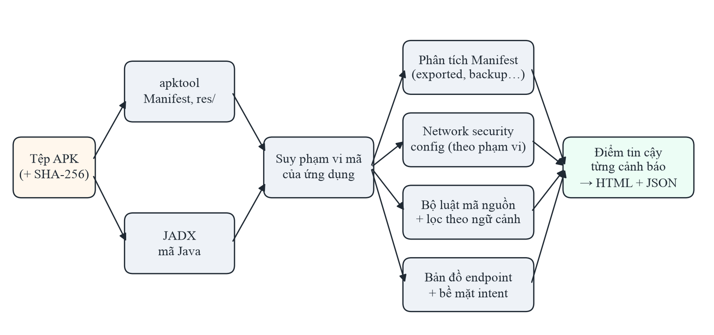
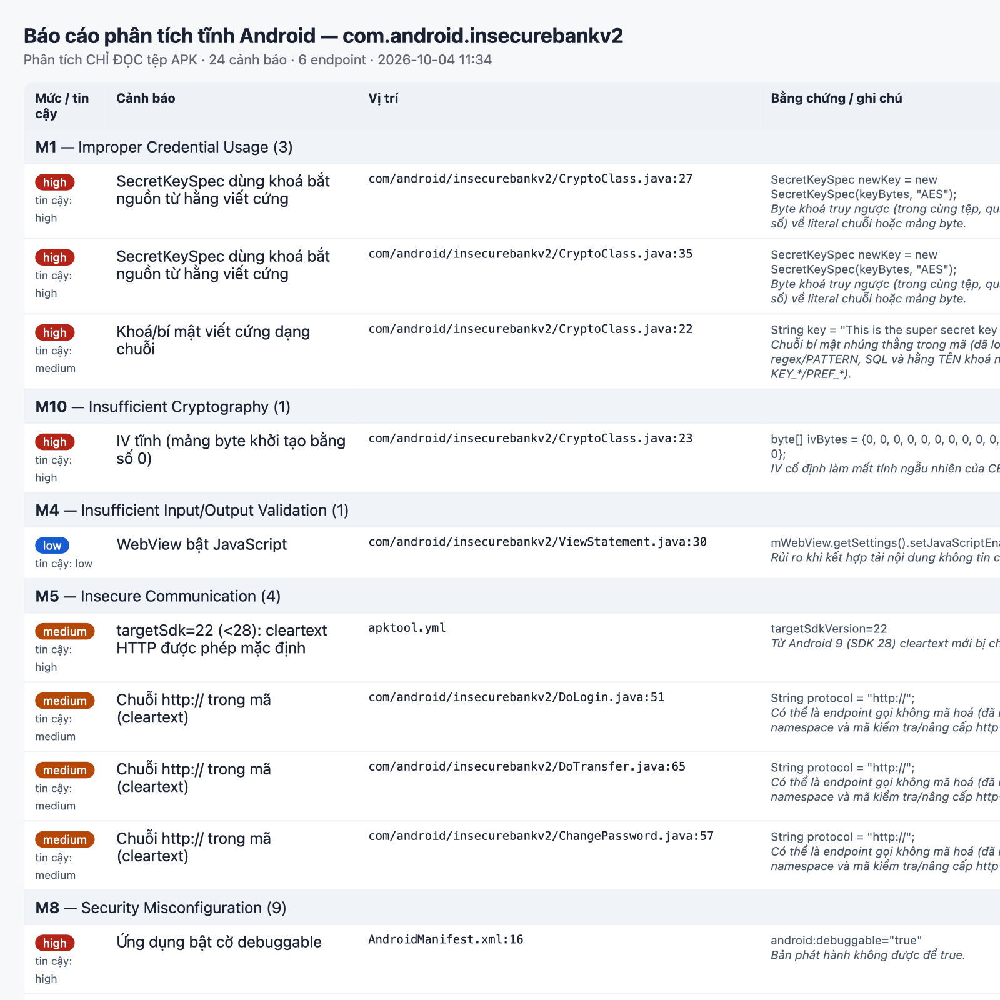
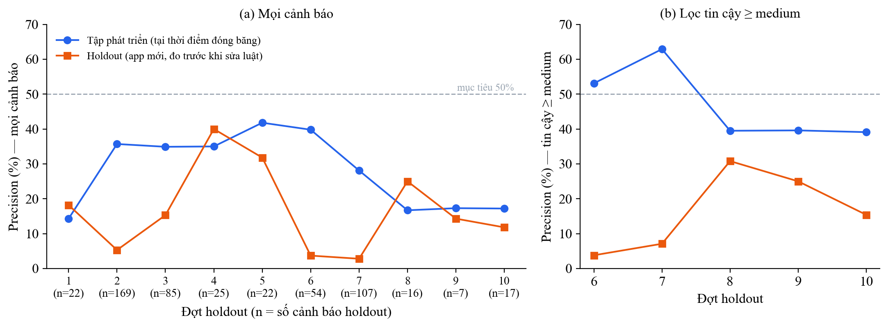
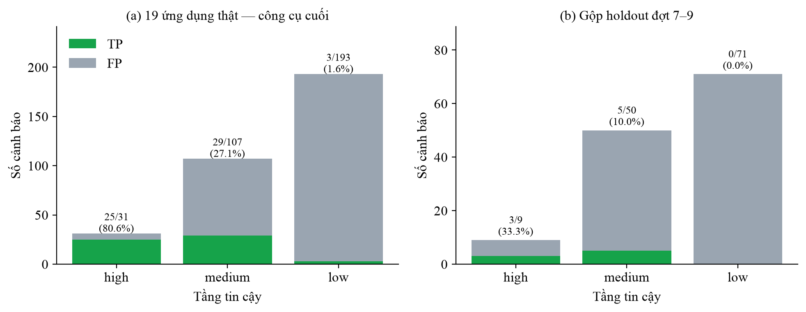

# CHƯƠNG 3. XÂY DỰNG VÀ ĐÁNH GIÁ CÔNG CỤ PHÁT HIỆN LỖ HỔNG TĨNH APISCAN

Chương 2 đã phân tích các công cụ hiện có, xây dựng môi trường thực nghiệm và bộ đáp án lỗ hổng trên ứng dụng
InsecureBankv2. Chương 3 trình bày phần đóng góp chính của đồ án: thiết kế, cài đặt và đánh giá công cụ `apiscan` —
một công cụ phân tích tĩnh tệp APK nhằm phát hiện dấu hiệu lỗ hổng theo OWASP Mobile Top 10 (2024) [1] và OWASP API
Security Top 10 (2023) [2], có khả năng giảm báo nhầm theo ngữ cảnh và chấm điểm tin cậy cho từng cảnh báo. Chương gồm
bảy phần: bối cảnh và câu hỏi nghiên cứu (3.1), thiết kế công cụ (3.2), phương pháp đánh giá (3.3), kết quả (3.4),
đối chứng với công cụ sẵn có (3.5), recall trên lỗ hổng đã công bố (3.6), quét động có dẫn đường (3.7), thảo luận và hạn chế (3.8), kết luận chương (3.9).

## 3.1. Bối cảnh và câu hỏi nghiên cứu

Khi chạy thử một bộ luật phân tích tĩnh đơn giản ở giai đoạn đầu, đồ án ghi nhận một khoảng cách lớn giữa hai môi
trường. Trên ứng dụng có lỗ hổng có chủ đích InsecureBankv2, mọi cảnh báo đều chỉ đúng một điểm yếu có thật (precision
24/24). Nhưng trên ứng dụng mã nguồn mở thực tế NewPipe, chỉ 1 trong 19 cảnh báo là lỗ hổng thật (precision 5,3%) —
phần còn lại là mã nâng cấp http→https, URI namespace XML, thành phần buộc phải exported, hay một dòng log có chữ
"secret" trong lời chào. Một báo cáo mà 18/19 cảnh báo là nhầm sẽ không được người kiểm thử sử dụng.

Từ quan sát đó, đồ án đặt ra ba mục tiêu đo được cho công cụ: (1) giữ recall 100% trên các lỗ hổng tĩnh của
InsecureBankv2; (2) đạt precision từ 50% trở lên trên ứng dụng thật chưa từng dùng để chỉnh luật; (3) cho đầu ra dùng
được — một lệnh từ tệp APK tới báo cáo HTML/JSON gắn nhãn OWASP, bản đồ endpoint và điểm tin cậy. Ba câu hỏi nghiên cứu
tương ứng là:

- **RQ1.** Các kỹ thuật giảm báo nhầm dựa trên ngữ cảnh có giữ được recall trên bộ đáp án không?
- **RQ2.** Precision đo trên tập ứng dụng dùng để phát triển luật phản ánh precision trên ứng dụng mới đến mức nào?
- **RQ3.** Điểm tin cậy theo từng cảnh báo có giúp lọc báo nhầm mà không làm mất lỗ hổng thật không?

## 3.2. Thiết kế công cụ apiscan

### 3.2.1. Kiến trúc tổng thể

Hình 3.1 mô tả luồng xử lý của công cụ. Người dùng chỉ chạy một lệnh:

```
python3 apiscan.py scan app.apk --min-confidence medium
```

Công cụ tính SHA-256 của tệp APK, giải nén bằng apktool [16] (lấy AndroidManifest.xml và thư mục tài nguyên) và dịch ngược
bằng JADX [15] (lấy mã Java) vào một thư mục làm việc đặt theo SHA-256, để lần quét sau dùng lại. Sau đó công cụ suy ra phạm
vi mã của ứng dụng (mục 3.2.4), chạy bốn nhóm phân tích — Manifest, network security config, bộ luật trên mã nguồn,
bản đồ endpoint và bề mặt tiếp nhận intent — rồi chấm điểm tin cậy cho từng cảnh báo và xuất báo cáo HTML cùng tệp JSON.



*Hình 3.1. Kiến trúc của công cụ apiscan*

Nguyên tắc thiết kế xuyên suốt là **chỉ đọc**: công cụ không cài đặt, không chạy ứng dụng và không gửi bất kỳ yêu cầu
nào tới máy chủ của ứng dụng. Điều này cho phép áp dụng hợp pháp lên ứng dụng của bên thứ ba ở dạng phân tích tĩnh,
phù hợp với ràng buộc đạo đức đã nêu ở Chương 1. Mã nguồn gồm `apiscan.py` (giao diện dòng lệnh) và `static_scan.py`
(bộ luật và phân tích), kèm bộ kiểm thử hồi quy 37 ca trong `04_code/tests/`.

### 3.2.2. Bộ luật và ánh xạ OWASP

Công cụ có 20 luật, mỗi luật gắn một mục OWASP Mobile Top 10 – 2024 (Bảng 3.1). Luật cấu hình đọc Manifest và tệp
network security config; luật mã nguồn quét từng dòng mã Java trong phạm vi ứng dụng.

*Bảng 3.1. Bộ luật của apiscan theo nhóm OWASP Mobile Top 10 – 2024*

| Nhóm OWASP | Luật | Phát hiện |
|---|---|---|
| M1 – Improper Credential Usage | CRY-KEYLIT, CRY-KEYHARD, KEY-SERVICE | Bí mật viết cứng; khoá mã hoá truy về hằng; chuỗi có dạng khoá API dịch vụ |
| M4 – Insufficient Input/Output Validation | WEB-JS, WEB-IFACE | WebView bật JavaScript; cầu nối JavaScript ↔ mã native |
| M5 – Insecure Communication | NET-CLEAR, NET-NSC, NET-TRUST, NET-SDK, NET-HTTP | Cho phép cleartext; tin CA do người dùng cài; targetSdk < 28; URL http khi kết nối |
| M8 – Security Misconfiguration | CFG-DEBUG, CFG-BACKUP, CFG-EXPORT, API-HIDDEN | debuggable; allowBackup; thành phần exported không bảo vệ; endpoint dev/test |
| M9 – Insecure Data Storage | STO-EXT, STO-PREF-WORLD, LOG-SENS | Tạo tệp ở bộ nhớ ngoài; SharedPreferences world-readable; ghi log giá trị nhạy cảm |
| M10 – Insufficient Cryptography | CRY-WEAK, CRY-IV0, CRY-HASH | ECB/DES/RC4; IV tĩnh; MD5/SHA-1 |

Ngoài danh sách cảnh báo, công cụ xuất hai thông tin hỗ trợ kiểm thử: **bản đồ endpoint** (các URL và đường dẫn API
xuất hiện trong mã có gọi mạng) và **bề mặt tiếp nhận intent** — các thành phần exported có lý do chính đáng (LAUNCHER,
intent hệ thống, giao thức với ứng dụng khác), được liệt kê để rà soát cách xử lý dữ liệu đầu vào nhưng không tính là
lỗ hổng.

### 3.2.3. Các kỹ thuật giảm báo nhầm theo ngữ cảnh

Phần lớn công sức của đồ án nằm ở việc biến các luật so khớp mẫu thô thành luật xét ngữ cảnh. Mỗi kỹ thuật dưới đây
xuất phát từ một lớp báo nhầm cụ thể quan sát được trên ứng dụng thật, và đều được kiểm tra lại với ràng buộc không làm
mất lỗ hổng nào của InsecureBankv2.

**(1) NET-HTTP theo ngữ cảnh của chuỗi.** Chuỗi `http://` chỉ là lỗ hổng khi được dùng làm địa chỉ kết nối. Công cụ phân
tích hàm bao quanh chuỗi (bằng bộ khớp ngoặc trên dòng mã) và bỏ qua các trường hợp chuỗi là định danh: đối số của hàm
XML/namespace (`findChild`, `setFeature`, `setAttribute`…), đối số của phép so sánh (`equals`, `startsWith`), URI có
dạng đặc tả (có `#`, chứa `/protocol/`, `/ns/`, `.dtd`), hằng namespace, liên kết mở bằng trình duyệt ngoài, và mã chuẩn
hoá scheme (`"http://"` cùng `"https://"` trên một dòng). Phép hạ cấp `replace("https://", "http://")` vẫn bị cảnh báo.
Trên Conversations, kỹ thuật này loại 42/42 báo nhầm do namespace giao thức XMPP mà vẫn giữ các cảnh báo
`protocol = "http://"` của InsecureBankv2.

**(2) CFG-EXPORT tách cảnh báo và bề mặt tiếp nhận.** Manifest được đọc bằng bộ phân tích XML; thành phần exported ngầm
định (có intent-filter khi targetSdk < 31, provider khi targetSdk < 17) cũng được tính. Một thành phần exported không có
permission chỉ bị cảnh báo khi không có intent-filter, hoặc khi nhận một action tuỳ biến *do chính ứng dụng tự gửi*
(kênh nội bộ bị mở ra ngoài). Ví dụ, `MyBroadCastReceiver` của InsecureBankv2 vẫn bị cảnh báo vì ứng dụng tự gửi
action `theBroadcast` ở `ChangePassword.java:173`, trong khi các thành phần LAUNCHER hay nhận intent `VIEW`/`MEDIA_BUTTON`
của NewPipe được chuyển sang mục bề mặt tiếp nhận.

**(3) LOG-SENS chỉ khi ghi giá trị.** Một lời gọi log chỉ bị cảnh báo khi in ra biến hay biểu thức mang tên nhạy cảm,
hoặc khi chuỗi có từ khoá được nối với một giá trị (`"token=" + x`); thông điệp cố định như "Authentication exception
for new token" bị bỏ qua. Trên K-9 Mail, kỹ thuật này loại 9/9 báo nhầm.

**(4) STO-EXT chỉ khi tạo đường dẫn tệp.** Chỉ cảnh báo khi thư mục bộ nhớ ngoài được ghép với một tên tệp (ứng dụng tự
tạo tệp ở vùng dùng chung), bỏ qua việc chỉ lấy thư mục làm gốc cho bộ chọn tệp hay so sánh đường dẫn.

**(5) CRY-KEYLIT phân biệt tên khoá và bí mật.** Các hằng như `KEY_TITLE = "title"` (tên cột cơ sở dữ liệu) hay
`PREF_PROXY_PASSWORD = "prefProxyPassword"` (khoá SharedPreferences) chiếm 141 báo nhầm ở AntennaPod và Nextcloud.
Công cụ coi một hằng là tên khoá khi giá trị có dạng định danh và: là câu SQL, là tên đầy đủ theo package, tên biến
theo quy ước `KEY_*`/`PREF_*`/`EXTRA_*`, hoặc giá trị trùng từ với tên biến. Bí mật dạng câu như khoá
`"This is the super secret key 123"` của InsecureBankv2 vẫn bị bắt. Luật này cũng quét thêm `BuildConfig.java`, nhờ
đó phát hiện khoá API nhúng cứng của AntennaPod vốn bị bỏ sót trước đó.

**(6) CRY-KEYHARD bằng phân tích luồng dữ liệu trong tệp.** Thay vì cảnh báo mọi lời gọi `SecretKeySpec`, công cụ chỉ
cảnh báo khi byte khoá truy ngược được về một hằng: literal chuỗi, mảng byte literal, `.getBytes()` hay giải mã Base64
của hằng. Giá trị "nhiễm" được lan truyền qua phép gán (trong phạm vi từng hàm, để tránh trùng tên biến tự sinh của
JADX) và qua tham số: nếu một lời gọi trong cùng tệp truyền hằng vào vị trí tham số thứ k thì tham số đó bị coi là
nhiễm. Đây chính là đường đi của khoá trong InsecureBankv2 — field `key` → biến `keyBytes` → tham số của
`aes256decrypt()`. Kỹ thuật này loại 14/14 báo nhầm (khoá HMAC của SCRAM, khoá tin nhắn OMEMO, khoá dẫn xuất PBKDF2).

**(7) NET-NSC/NET-TRUST theo phạm vi cấu hình.** Tệp network security config [6] được đọc theo cấu trúc: chỉ xét tệp được
Manifest tham chiếu; cleartext ở `base-config` là cảnh báo mức cao; ở `domain-config` chỉ cảnh báo khi có domain công
khai (bỏ qua `.onion`, `localhost`, IP nội bộ); tin CA người dùng trong `debug-overrides` bị bỏ qua vì chỉ có hiệu lực
ở bản debug.

### 3.2.4. Tự xác định phạm vi mã của ứng dụng

Một tệp APK chứa cả mã của ứng dụng lẫn hàng trăm thư viện. Quét toàn bộ sẽ sinh nhiễu từ thư viện, nhưng chỉ quét theo
package khai báo trong Manifest lại dễ bỏ sót: package đó là applicationId, có thể khác namespace mã (KeePassDX có
applicationId `com.kunzisoft.keepass.libre` nhưng mã ở `com.kunzisoft.keepass`) hoặc chỉ là một trong nhiều namespace
(K-9 Mail có mã ở `com.fsck.k9`, `app.k9mail` và `net.thunderbird`). Công cụ suy phạm vi từ Manifest: package Manifest
(nếu có mã), namespace của lớp Application, và namespace của các thành phần không thuộc danh sách thư viện đã biết khi
namespace đó có activity LAUNCHER hoặc từ hai thành phần trở lên.

Tác động thực tế: với KeePassDX, cách quét theo package Manifest chỉ cho 1 cảnh báo (bỏ sót toàn bộ mã), còn phạm vi
tự suy cho 50 cảnh báo; với Nextcloud, phạm vi mở rộng thêm `com.owncloud` và số cảnh báo tăng từ 9 lên 46.

### 3.2.5. Điểm tin cậy theo từng cảnh báo

Công cụ tách hai khái niệm: **mức nghiêm trọng** (hậu quả nếu cảnh báo đúng) và **độ tin cậy** (khả năng cảnh báo đúng).
Độ tin cậy được chấm theo tín hiệu của chính cảnh báo đó, theo các quy tắc đặt ra trước khi đo (Bảng 3.2). Tầng high
dành cho bằng chứng trực tiếp; tầng medium cho dấu hiệu mạnh nhưng mã có thể có kiểm tra mà phân tích tĩnh không thấy;
tầng low cho bề mặt rủi ro tự nó chưa phải lỗ hổng.

*Bảng 3.2. Một số quy tắc chấm độ tin cậy theo tín hiệu của cảnh báo*

| Luật | high | medium | low |
|---|---|---|---|
| LOG-SENS | In biến/field/getter có danh từ chính nhạy cảm (`this.password`, `distinctCredentials`) | Chuỗi kết thúc bằng từ khoá rồi nối giá trị | Từ khoá chỉ ở tên lớp/TAG hoặc giữa câu |
| CRY-KEYLIT | Giá trị dạng khoá ngẫu nhiên (≥ 16 ký tự, entropy ≥ 3,5 bit, có chữ và số) hoặc tiền tố khoá đã biết | Dạng passphrase | Nhãn chữ, tên định danh, đường dẫn/URL, bảng mã, chuỗi < 8 ký tự |
| CRY-IV0 | Mảng thực sự được truyền vào `IvParameterSpec`/`GCMParameterSpec` | — | Không dùng làm IV |
| CFG-EXPORT | — | Mặc định | Thành phần LAUNCHER hoặc mã có kiểm tra danh tính ứng dụng gọi |
| CFG-BACKUP | Không có quy tắc backup/backupAgent | Có quy tắc backup | — |
| Cấu hình mạng, CRY-KEYHARD | Mặc định | `domain-config` cho domain công khai | — |

Một quy tắc ban đầu — "thành phần không đọc dữ liệu từ intent thì xếp low" — đã bị loại bỏ vì sai về nguyên lý: activity
chuyển tiền `DoTransfer` của InsecureBankv2 không đọc intent, nhưng việc ứng dụng khác mở thẳng được màn hình này mà không
qua đăng nhập chính là lỗ hổng. Lỗi được phát hiện vì recall trên InsecureBankv2 ở ngưỡng ≥ medium giảm còn 5/6; đây là
ví dụ cho vai trò của bộ đáp án như một ràng buộc khi thiết kế quy tắc.

### 3.2.6. Đầu ra của công cụ

Báo cáo HTML nhóm cảnh báo theo mục OWASP, mỗi dòng có mức nghiêm trọng, độ tin cậy, vị trí tệp:dòng, trích đoạn bằng
chứng và ghi chú, kèm bảng bề mặt tiếp nhận intent và bản đồ endpoint (Hình 3.2). Tệp JSON chứa cùng nội dung ở dạng máy
đọc được, kèm SHA-256 của APK và phạm vi mã đã quét. Tham số `--min-confidence` lọc báo cáo theo tầng tin cậy.

Ngoài lệnh `scan`, công cụ có ba lệnh phục vụ sử dụng thực tế:

- **`batch`** quét nhiều tệp APK (hoặc cả thư mục) và xuất báo cáo riêng cho từng ứng dụng, kèm trang tổng hợp
  `index.html` và tệp `summary.csv`/`summary.json`: số cảnh báo theo tầng tin cậy, số endpoint, thời gian, và tỉ lệ ứng
  dụng có cảnh báo theo từng luật. Một APK lỗi không làm dừng cả lượt quét mà được ghi vào bảng tổng hợp.
- **Tệp cấu hình YAML** (`--config`) cho phép tắt luật, đặt ngưỡng tin cậy và khai báo danh sách bỏ qua (suppression).
  Mỗi cảnh báo có một dấu vân tay 12 ký tự tính từ luật, vị trí (bỏ số dòng) và bằng chứng, nên không đổi khi mã xung
  quanh dịch chuyển. Một mục bỏ qua khớp theo dấu vân tay, mã luật hoặc mẫu glob trên vị trí và bằng chứng, và bắt buộc
  có lý do. Cảnh báo bị bỏ qua vẫn được đếm và liệt kê kèm lý do trong báo cáo; mục bỏ qua không khớp cảnh báo nào được
  báo ra để phát hiện mục lỗi thời. Lệnh **`baseline`** sinh tệp cấu hình bỏ qua mọi cảnh báo hiện có, để các lần quét sau
  chỉ hiện cảnh báo mới.
- **`dynamic`** dùng bản đồ endpoint tĩnh làm điểm khởi đầu cho OWASP ZAP (truy cập, spider rồi active scan), gắn nhãn
  OWASP API Security Top 10 – 2023 cho cảnh báo theo CWE, và gộp với báo cáo tĩnh (cùng kết quả MobSF nếu có) thành một
  báo cáo hợp nhất. Lệnh có cổng an toàn: mục tiêu phải là địa chỉ cục bộ hoặc mạng riêng, nếu không phải có tệp văn
  bản cho phép (SHA-256 của tệp được ghi vào báo cáo); endpoint thuộc host khác trong bản đồ bị loại khỏi danh sách gửi
  cho ZAP. Ngoài đường dẫn, bước phân tích tĩnh còn trích phương thức và tên tham số của từng yêu cầu HTTP từ mã dịch
  ngược: lời tạo `HttpPost`/`HttpGet` kèm các `BasicNameValuePair` ngay sau đó (Apache HttpClient), và các annotation
  `@POST`, `@Field`, `@Query`, `@Path`, `@Body` của Retrofit. Lệnh `dynamic` dùng danh sách này để tự sinh yêu cầu mẫu
  với giá trị giả cho ZAP; người dùng vẫn có thể cung cấp yêu cầu viết tay (ví dụ kèm thông tin đăng nhập hợp lệ) để
  thay thế yêu cầu tự sinh cùng phương thức và đường dẫn.



*Hình 3.2. Một phần báo cáo HTML của apiscan trên InsecureBankv2*

## 3.3. Phương pháp đánh giá

### 3.3.1. Bộ đáp án InsecureBankv2 và hiệu chỉnh đáp án

Recall được đo trên sáu lỗ hổng thuộc phạm vi phân tích tĩnh của đáp án V01–V12 (Bảng 2.10): V01 (khoá viết cứng), V02
(HTTP không mã hoá), V05 (mật mã yếu), V06 (thành phần exported), V07 (cửa hậu `/devlogin`) và V11 (allowBackup). Điều
kiện chấm được đặt chặt: V06 chỉ đạt khi phát hiện đủ cả sáu thành phần exported; V02 đạt khi phát hiện cả cấu hình
targetSdk lẫn chuỗi `http://` ở ba tệp gọi mạng. Tệp APK có SHA-256 `b18af2a0…94a4`.

Trước khi dùng đáp án để chấm công cụ, đáp án được đối chiếu lại với hai nguồn sự thật: mã dịch ngược của ứng dụng và mã
nguồn công khai của máy chủ đi kèm (`AndroLabServer/app.py`). Việc đối chiếu cho thấy mô tả của bốn mục và một phần Bảng
2.7 không khớp với mã thật (Bảng 3.3); các mục này đã được hiệu chỉnh trong Chương 2. Nhóm OWASP của cả bốn mục giữ
nguyên. Trong sáu mục tĩnh dùng để đo recall, chỉ V05 thay đổi mô tả và vẫn thuộc M10, vẫn phát hiện được bằng phân tích
tĩnh; V04, V08, V09 thuộc nhánh động, không tham gia phép đo. Vì vậy kết quả recall không bị ảnh hưởng. Sai sót trong
chính tài liệu đáp án cho thấy đáp án cũng cần được kiểm chứng bằng mã nguồn trước khi dùng để chấm công cụ.

*Bảng 3.3. Hiệu chỉnh đáp án InsecureBankv2 sau khi đối chiếu mã nguồn*

| Mục | Mô tả ban đầu | Mô tả sau đối chiếu | Bằng chứng |
|---|---|---|---|
| V04 (M9) | Tên đăng nhập và mật khẩu lưu dạng rõ trong SharedPreferences | Tên đăng nhập mã hoá Base64, mật khẩu mã hoá AES bằng khoá viết cứng — giải mã ngược được | `DoLogin.java:144-148` |
| V05 (M10) | Dùng DES khoá 56 bit | AES/CBC với khoá viết cứng và IV tĩnh toàn số 0 | `CryptoClass.java:22-23` |
| V08 (API1) | Đổi tham số định danh để xem giao dịch của người khác | `/dotransfer` nhận tài khoản nguồn tuỳ ý → chuyển tiền từ tài khoản của người khác | `app.py`, hàm `dotransfer` |
| V09 (M3, API2) | Mã thông báo không được kiểm tra, phiên không hết hạn | Không có cơ chế phiên; `/changepassword` không xác thực; phản hồi `/login` cho phép dò tên người dùng | `app.py`, hàm `login`, `changepassword` |
| Bảng 2.7 | Có điểm cuối `/getusers`; `/getaccounts` lộ dữ liệu thừa | Máy chủ chỉ có 5 điểm cuối; `/getaccounts` chỉ trả số tài khoản — rủi ro thật là gửi lại thông tin đăng nhập ở mọi yêu cầu | `app.py` |

### 3.3.2. Tập ứng dụng thật

Precision được đo trên 19 ứng dụng mã nguồn mở tải từ kho F-Droid [26], chọn trải rộng nhiều miền chức năng để tránh kết
luận chỉ đúng cho một loại ứng dụng (Bảng 3.4). Mọi tệp APK đều được ghi SHA-256 trong `04_code/target-app/APK_SOURCES.md`
để tái lập. Việc chỉ dùng ứng dụng mã nguồn mở và chỉ phân tích tĩnh bảo đảm thực nghiệm hợp pháp và không tác động tới
máy chủ của bên thứ ba.

*Bảng 3.4. Tập ứng dụng thật và vai trò trong đánh giá*

| Vai trò | Ứng dụng (phiên bản) | Miền chức năng |
|---|---|---|
| Phát triển ban đầu | NewPipe 0.29.1 | Xem video |
| Holdout đợt 1 | Tusky 32.2; K-9 Mail 23.1 | Mạng xã hội; email |
| Holdout đợt 2 | AntennaPod 3.12.2; Nextcloud 35.0.0 | Podcast; đồng bộ tệp |
| Holdout đợt 3 | Conversations 2.20.4; Jellyfin 2.7.3 | Nhắn tin XMPP; máy chủ media |
| Holdout đợt 4 | DAVx⁵ 4.5.20; Feeder 2.23.2 | Đồng bộ lịch/danh bạ; RSS |
| Holdout đợt 5 | Aegis 3.4.3; RedReader 1.26 | Xác thực 2 lớp; Reddit |
| Holdout đợt 6 | KeePassDX 4.5.5; Breezy Weather 6.2.2 | Quản lý mật khẩu; thời tiết |
| Holdout đợt 7 | Gadgetbridge 0.94.0; Wikipedia | Thiết bị đeo; tri thức |
| Holdout đợt 8 | Briar 1.5.21; Money Manager Ex 5.5.13 | Nhắn tin qua Tor; tài chính cá nhân |
| Holdout đợt 9 | Termux 0.118.3; Catima 2.45.1 | Terminal; ví thẻ |
| Holdout đợt 10 | Organic Maps 2026.09.29; Etar 1.0.57; FlorisBoard 0.5.2; OpenTracks 4.29.0 | Bản đồ; lịch; bàn phím; theo dõi thể thao |

### 3.3.3. Quy trình gán nhãn

Mỗi cảnh báo được đối chiếu với mã dịch ngược, Manifest hoặc tệp cấu hình liên quan và gán một nhãn kèm lý do. **TP**
là cảnh báo chỉ đúng một điểm yếu bảo mật có thật. **FP** được chia hai loại: *pattern* (luật khớp mẫu sai, ví dụ URI
namespace bị coi là kết nối) và *intended* (hành vi cố ý hoặc bắt buộc của ứng dụng, ví dụ WebView đăng nhập OAuth cần
JavaScript). Nhãn *borderline* đánh dấu các nhận định có thể tranh luận; với các mục này, chương báo cáo thêm số liệu
"chặt" khi coi chúng là FP. Một số quy ước được giữ nhất quán xuyên ứng dụng: mật mã do giao thức quy định (CRAM-MD5,
APOP, giao thức thiết bị đeo) là FP *intended*; cho phép cleartext hoặc tin CA người dùng ở cấp toàn ứng dụng là TP
(điểm yếu có thật dù có chủ đích). Tổng cộng có 608 dòng nhãn trên 23 ứng dụng (589 dòng trên 19 ứng dụng của Bảng 3.7 và 19 dòng của holdout đợt 10), lưu ở `03_benchmark/ground-truth/`. Các lỗ hổng mà công
cụ bỏ sót nhưng phát hiện được khi rà soát được ghi riêng ở trường `known_false_negatives`.

### 3.3.4. Giao thức đánh giá holdout

Khi một luật được chỉnh để loại các báo nhầm quan sát được trên một ứng dụng, precision trên chính ứng dụng đó tăng lên
— nhưng không cho biết công cụ hoạt động thế nào trên ứng dụng mới. Để đo trung thực, đồ án dùng giao thức **holdout
nhiều đợt**: trước mỗi đợt, toàn bộ luật được đóng băng tại một phiên bản mã (ghi lại mã commit); công cụ chạy trên hai
ứng dụng mới; các cảnh báo được gán nhãn và đo precision; chỉ sau đó mới được sửa luật dựa trên ứng dụng này, và ứng dụng
chuyển thành tập phát triển. Đợt kế tiếp lại dùng hai ứng dụng mới. Từ đợt 8, holdout được đo bằng chính lệnh
`apiscan scan` với phạm vi mã tự suy, tức là đúng hành vi mặc định mà người dùng nhận được. Đợt 10 dùng bốn ứng dụng
thay vì hai, vì mục đích chính của đợt này là đo hai thay đổi chỉ tác động tới luật CFG-EXPORT (mục 3.6), nên cần nhiều
thành phần exported hơn; tiêu chí chọn ứng dụng và tiêu chí kết luận được commit trước khi tải APK.

### 3.3.5. Chỉ số đánh giá

- Recall tĩnh trên InsecureBankv2 = số mục tĩnh phát hiện được / 6.
- Precision = TP / (TP + FP) theo nhãn gán tay; báo cáo dạng gộp (micro, trên tổng số cảnh báo) và trung bình theo ứng
  dụng (macro).
- Precision theo tầng tin cậy: riêng từng tầng và cộng dồn (từ tầng đó trở lên).
- Tỉ lệ giảm số cảnh báo và số TP bị mất khi lọc theo ngưỡng tin cậy.
- Thời gian phân tích trên máy MacBook Apple Silicon.

## 3.4. Kết quả

### 3.4.1. Recall trên InsecureBankv2 (RQ1)

Công cụ phát hiện đủ **6/6 mục tĩnh** ở mọi phiên bản luật trong quá trình phát triển, với 24 cảnh báo đều là TP (precision
24/24) và bản đồ 6 endpoint (`/login`, `/devlogin`, `/getaccounts`, `/dotransfer`, `/changepassword`, `/Statements_`).
Công cụ còn phát hiện thêm V04 (SharedPreferences ở chế độ world-readable) và V10 (ghi log tên đăng nhập và mật khẩu) dù
đáp án xếp hai mục này vào nhánh động, vì bản thân mã nguồn đã để lộ dấu hiệu. Khi lọc ở ngưỡng tin cậy ≥ medium, recall
vẫn là 6/6; chỉ giữ tầng high thì còn 2/6, nên ngưỡng khuyến nghị cho báo cáo là ≥ medium. Lỗ hổng V03 (thiếu certificate
pinning) không phát hiện được vì là lỗi "vắng mặt một cơ chế", nằm ngoài khả năng của luật dựa trên dấu hiệu.

Như vậy, với RQ1: các kỹ thuật giảm báo nhầm ở mục 3.2.3 giữ được recall trên bộ đáp án. Mọi thay đổi luật đều được kiểm
tra tự động bằng bộ kiểm thử hồi quy, gồm cả ca tích hợp kiểm tra recall và đối chiếu mọi cảnh báo của InsecureBankv2 với
nhãn TP.

### 3.4.2. Precision trên tập phát triển

Bảng 3.5 cho thấy precision trên NewPipe tăng dần qua từng kỹ thuật, trên cùng một tệp APK.

*Bảng 3.5. Precision trên NewPipe qua các cải tiến luật*

| Phiên bản luật | Số cảnh báo | TP | Precision |
|---|---|---|---|
| Ban đầu | 19 | 1 | 5,3% |
| + NET-HTTP theo ngữ cảnh | 13 | 1 | 7,7% |
| + CFG-EXPORT tách bề mặt tiếp nhận | 7 | 1 | 14,3% |
| + LOG-SENS theo giá trị | 6 | 1 | 16,7% |
| + STO-EXT theo đường dẫn tệp | 3 | 1 | 33,3% |

Trên toàn tập phát triển tại thời điểm đóng băng mỗi đợt, precision gộp dao động 14–42% với mọi cảnh báo và 40–63% ở
ngưỡng ≥ medium (Hình 3.3). Nếu chỉ nhìn các con số này, có thể kết luận rằng công cụ gần đạt mục tiêu 50%.

### 3.4.3. Precision trên holdout (RQ2)

Bảng 3.6 trình bày precision của mười đợt holdout, mỗi đợt đo trên các ứng dụng mới trước khi luật được sửa dựa trên chúng.
Đợt 10 được đo bằng bộ luật của chương này (v1).

*Bảng 3.6. Precision trên holdout theo đợt*

| Đợt | Ứng dụng | Số cảnh báo | TP | Precision | Precision chặt |
|---|---|---|---|---|---|
| 1 | Tusky, K-9 Mail | 22 | 4 | 18,2% | 18,2% |
| 2 | AntennaPod, Nextcloud | 169 | 9 | 5,3% | 5,3% |
| 3 | Conversations, Jellyfin | 85 | 13 | 15,3% | 9,4% |
| 4 | DAVx⁵, Feeder | 25 | 10 | 40,0% | 32,0% |
| 5 | Aegis, RedReader | 22 | 7 | 31,8% | 27,3% |
| 6 | KeePassDX, Breezy Weather | 54 | 2 | 3,7% | 1,9% |
| 7 | Gadgetbridge, Wikipedia | 107 | 3 | 2,8% | 2,8% |
| 8 | Briar, Money Manager Ex | 16 | 4 | 25,0% | 18,8% |
| 9 | Termux, Catima | 7 | 1 | 14,3% | 14,3% |
| 10 | Organic Maps, Etar, FlorisBoard, OpenTracks | 17 | 2 | 11,8% | 5,9% |



*Hình 3.3. Precision trên tập phát triển (tại thời điểm đóng băng) và trên holdout qua các đợt*

Kết quả trả lời RQ2 một cách rõ ràng: **precision trên tập phát triển không phản ánh precision trên ứng dụng mới.** Precision
holdout dao động từ 2,8% đến 40% và không hội tụ theo thời gian, dù luật được cải tiến sau mỗi đợt. Ở ngưỡng ≥ medium,
khoảng cách giữa tập phát triển và holdout ở các đợt 6–10 là từ 9 đến 56 điểm phần trăm (Hình 3.3b). **Mục tiêu precision
≥ 50% trên ứng dụng mới không đạt** ở bất kỳ đợt nào.

Nguyên nhân là mỗi miền ứng dụng sinh ra một lớp báo nhầm mới mà luật chưa gặp (mục 3.4.5). Ví dụ, đợt 2 làm lộ việc luật
CRY-KEYLIT nhận nhầm hàng trăm tên khoá cơ sở dữ liệu là bí mật; đợt 3 làm lộ namespace giao thức XMPP; đợt 6 cho thấy ứng
dụng quản lý mật khẩu có từ vựng trùng đúng các từ khoá mà luật dùng để tìm (password, token, secret).

### 3.4.4. Hiệu quả của điểm tin cậy (RQ3)

Bảng 3.7 và Hình 3.4 trình bày precision theo tầng tin cậy của phiên bản công cụ cuối cùng trên 19 ứng dụng thật.

*Bảng 3.7. Precision theo tầng tin cậy, phiên bản công cụ cuối trên 19 ứng dụng thật (331 cảnh báo)*

| Tầng | Riêng tầng | Cộng dồn (≥ tầng) | Cộng dồn, chặt | Cộng dồn, nếu cấu hình mạng/backup là FP |
|---|---|---|---|---|
| high | 80,6% (25/31) | 80,6% | 80,6% | 9,7% |
| medium | 27,1% (29/107) | 39,1% (54/138) | 31,2% | 21,0% |
| low | 1,6% (3/193) | 17,2% (57/331) | 13,6% | 9,7% |



*Hình 3.4. TP và FP theo tầng tin cậy: (a) 19 ứng dụng thật; (b) gộp holdout đợt 7–9*

Ba nhận xét rút ra:

- **Tầng low là bộ lọc nhiễu đáng tin cậy.** Chỉ 3/193 cảnh báo tầng low là TP. Lọc ở ngưỡng ≥ medium giảm số cảnh báo
  từ 331 xuống 138 (−58,3%) và chỉ mất 3/57 TP. Trên holdout đợt 7–9 (đo khi điểm tin cậy đã đóng băng), tầng low không
  chứa TP nào (0/71); holdout đợt 10 cho kết quả cùng chiều (0/4). Đây là đóng góp thực tế nhất của điểm tin cậy: người kiểm thử chỉ cần đọc khoảng 40% số cảnh báo mà
  gần như không bỏ sót lỗ hổng thật.
- **Tầng high có precision cao (80,6%) nhưng phụ thuộc mạnh vào quy ước gán nhãn.** 22/25 TP của tầng high là cấu hình
  mạng hoặc sao lưu ở cấp toàn ứng dụng. Nếu hội đồng coi nhóm này là hành vi có chủ đích (FP), precision tầng high chỉ
  còn 9,7%. Các FP còn lại của tầng high đều là trường hợp ứng dụng buộc phải dùng giá trị cố định: IV và khoá theo giao
  thức thiết bị (Gadgetbridge), IV theo định dạng sao lưu của ứng dụng khác (Aegis) và khoá công khai của Google Play
  (Briar).
- **Tầng medium không vượt được giới hạn của phân tích tĩnh.** Precision 27,1% trên 19 ứng dụng và 10% trên holdout đợt
  7–9: phần lớn cảnh báo medium là thành phần exported chỉ mở giao diện, cầu nối JavaScript tới trang tin cậy, hay chuỗi
  `http://` mà phân tích tĩnh không phân biệt được với kết nối thật.

Như vậy, với RQ3: điểm tin cậy theo từng cảnh báo giúp lọc khoảng 60% báo nhầm gần như không mất lỗ hổng thật, nhưng
không nâng precision ở ngưỡng ≥ medium lên 50% trên ứng dụng mới.

### 3.4.5. Phân tích báo nhầm theo luật và theo miền ứng dụng

Bảng 3.8 cho thấy precision rất khác nhau giữa các luật. Luật cấu hình mạng và sao lưu có precision cao; luật dựa trên từ
khoá trong mã (LOG-SENS, CRY-KEYLIT, STO-EXT) và luật mật mã có precision thấp.

*Bảng 3.8. Precision theo luật, phiên bản công cụ cuối trên 19 ứng dụng thật*

| Luật | TP / tổng | Precision | Lớp báo nhầm chính |
|---|---|---|---|
| NET-NSC | 7/7 | 100% | — |
| NET-TRUST | 7/7 | 100% | — |
| NET-CLEAR | 5/5 | 100% | — |
| CFG-BACKUP | 6/11 | 54,5% | Có backupAgent/quy tắc chỉ sao lưu dữ liệu không nhạy cảm |
| CFG-EXPORT | 12/43 | 27,9% | Activity chỉ mở giao diện; provider được bảo vệ bằng permission `dangerous`; kiểm tra quyền trong mã |
| NET-HTTP | 9/39 | 23,1% | Hằng `"http://"` dùng để so sánh; URL mẫu; link mở trình duyệt; namespace mới |
| WEB-IFACE | 5/22 | 22,7% | Cầu nối tới trang cục bộ hoặc trang tin cậy; hàm tự viết trùng tên |
| CRY-KEYLIT | 2/36 | 5,6% | Nhãn trường, tên tham số, đường dẫn API, khoá công khai |
| LOG-SENS | 2/40 | 5,0% | Tên lớp/TAG chứa từ khoá; thông điệp nối với giá trị không nhạy cảm |
| STO-EXT | 2/75 | 2,7% | Tệp xuất/cache do người dùng chủ động; đường dẫn chỉ để so sánh |
| WEB-JS, CRY-HASH, CRY-WEAK, CRY-IV0, CRY-KEYHARD | 0/46 | 0% | JS cần cho trang; hash không dùng cho bảo mật; mật mã do giao thức quy định |

Theo miền ứng dụng, báo nhầm tập trung theo kiểu: ứng dụng dùng giao thức dựa trên XML (podcast, XMPP, GPX) sinh báo nhầm
namespace; ứng dụng quản lý mật khẩu sinh báo nhầm từ khoá; ứng dụng thiết bị đeo sinh báo nhầm mật mã giao thức; ứng dụng
lớn có nhiều thành phần cấu hình exported. Precision theo ứng dụng vì vậy dao động từ 0% (Aegis, Wikipedia, Briar, Termux)
tới 70% (Jellyfin), với trung bình theo ứng dụng 26,4% và gộp 17,2%.

### 3.4.6. Các phát hiện bảo mật trên ứng dụng thật

Dù precision chưa đạt mục tiêu, công cụ đã dẫn tới một số phát hiện có giá trị khi người kiểm thử rà soát cảnh báo (Bảng
3.9). Mọi phát hiện đều từ phân tích tĩnh và cần kiểm chứng động — chỉ được thực hiện khi có sự cho phép của chủ ứng dụng.

*Bảng 3.9. Một số phát hiện bảo mật đáng chú ý*

| Lớp phát hiện | Ứng dụng | Ghi chú |
|---|---|---|
| Hai lỗ hổng mức nghiêm trọng cao ở thành phần exported không được bảo vệ (một liên quan kho chứng chỉ tin cậy, một liên quan dữ liệu tài chính) | Hai ứng dụng trong tập đánh giá | Ẩn danh cho tới khi công bố có trách nhiệm cho nhà phát triển |
| Activity cắt/sửa ảnh exported trả dữ liệu ảnh đã giải mã cho ứng dụng gọi | Tusky, Conversations (thư viện CanHub cropper), Gadgetbridge | Rủi ro chuỗi cung ứng (M2) |
| `PreviewActivity` của công cụ debug Compose lọt vào bản phát hành | Feeder, RedReader, Breezy Weather | Cấu hình build sai |
| Provider exported bỏ kiểm tra người gọi cho bảng metadata tệp | Nextcloud | Độ tin cậy trung bình |
| Sao lưu token/cookie/cơ sở dữ liệu không yêu cầu mã hoá | Jellyfin, RedReader | Trích xuất được qua adb backup trên Android ≤ 11 |
| Thông tin xác thực/khoá API nhúng cứng | Feeder (Basic Auth đồng bộ), AntennaPod (PodcastIndex) | |
| Ghi log mật khẩu ICE | Conversations | Mức nhẹ |

### 3.4.7. Tốc độ

Phân tích (không gồm giải nén) mất trung vị 0,82 giây mỗi ứng dụng, chậm nhất 6,92 giây với Gadgetbridge (4.918 tệp Java
trong phạm vi). Toàn bộ quy trình một lệnh trên InsecureBankv2, gồm cả giải nén bằng apktool và dịch ngược bằng JADX, mất
14 giây; với ứng dụng lớn, phần lớn thời gian nằm ở bước dịch ngược JADX.

Lệnh `batch` chạy lại trên toàn bộ 20 tệp APK (19 ứng dụng thật và InsecureBankv2) cho đúng số cảnh báo của từng ứng
dụng như phiên bản công cụ cuối (tổng 331 cảnh báo trên 19 ứng dụng thật), kể cả với bốn ứng dụng được giải nén và dịch
ngược lại từ đầu. Kết quả nằm ở `03_benchmark/ket-qua-test/batch_20apk/`.

## 3.5. Đối chứng với công cụ sẵn có

Trên InsecureBankv2, JADX 1.5.0 làm lộ bằng chứng cho 6/12 lỗ hổng (thêm 2 ở mức gợi ý) trong 22,9 giây mỗi lượt, apktool
2.9.3 cho 2/12 trong 7,8 giây, cả hai không có báo nhầm. Tuy nhiên hai công cụ này chỉ dịch ngược; người kiểm thử phải tự
đọc mã để tìm lỗ hổng. `apiscan` tự động hoá chính bước "tìm" đó trên đầu ra của hai công cụ, và đạt 6/6 mục tĩnh mà
không cần đọc mã thủ công.

Để so sánh với công cụ phân tích tĩnh phổ biến nhất hiện nay, đồ án chạy MobSF v4.5.4 [10] (Docker, cấu hình mặc định, chỉ
phân tích tĩnh) trên đúng 20 tệp APK đã dùng và chấm bằng cùng định nghĩa nhãn. Với MobSF, một cảnh báo là một cặp
(luật, tệp) ở phần mã, hoặc một mục manifest, network security config hay chứng chỉ ở mức high/warning. Mức info và danh
sách "secrets" không được tính. Vì MobSF đưa ra quá nhiều cảnh báo để gán nhãn hết, precision của MobSF được ước lượng
từ 100 cảnh báo lấy ngẫu nhiên (seed cố định), kèm khoảng tin cậy 95% theo phương pháp Wilson [27]. Khi một cảnh báo trùng
thành phần hoặc tệp đã gán nhãn cho `apiscan`, nhãn cũ được dùng lại để giữ nhất quán. Kết quả ở Bảng 3.10.

*Bảng 3.10. Đối chứng apiscan với MobSF trên cùng tập ứng dụng và cùng định nghĩa nhãn*

| Chỉ số | apiscan | MobSF 4.5.4 |
|---|---|---|
| Recall tĩnh InsecureBankv2 (cấu hình mặc định) | 6/6 | 2/6 (V06, V11) |
| Recall tĩnh InsecureBankv2 (MobSF chỉnh `SKIP_CLASS_PATH`) | — | 3/6 + V05 một phần |
| Số cảnh báo trên 19 ứng dụng thật | 331 | 1.182 (+2.177 mức info) |
| Precision, mọi cảnh báo (KTC 95%) | 17,2% (13,5–21,7%) | 5,0% (2,2–11,2%), mẫu 100 |
| Precision phần phân tích mã (KTC 95%) | 7,8% (20/258; 5,1–11,7%) | 1,3% (1/75; 0,2–7,2%) |
| Precision theo quy ước nhạy (cấu hình mạng → FP) | 9,7% | 3,0% |
| TP của apiscan mà MobSF cũng báo ở mức high/warning | — | 41/57 |
| Thời gian mỗi ứng dụng (trung vị) | 0,82 s phân tích | 84 s, gồm giải nén |

Trên InsecureBankv2, MobSF ở cấu hình mặc định không báo được lỗ hổng nào trong mã: danh sách bỏ qua `SKIP_CLASS_PATH` có
tiền tố `com/android/`, trùng với package `com.android.insecurebankv2` của ứng dụng. Ngay cả khi bỏ tiền tố này, MobSF vẫn
không phát hiện V02 (HTTP cleartext) và V07 (cửa hậu `/devlogin`). Với V05, MobSF chỉ báo chế độ CBC có nguy cơ padding
oracle, không báo IV tĩnh và khoá cứng.

Trên ứng dụng thật, MobSF báo được phần lớn các TP cấu hình mà `apiscan` tìm thấy (thành phần exported, sao lưu,
cleartext, tin CA người dùng). MobSF bỏ sót 16/57 TP:

- 9 URL `http://` ghép chuỗi trong mã, vì MobSF không có luật tương ứng.
- 5 cầu nối JavaScript, vì luật của MobSF đòi `setJavaScriptEnabled` và `addJavascriptInterface` nằm cùng một tệp.
- 2 lệnh log dữ liệu nhạy cảm, mà MobSF chỉ xếp chung vào mức info cùng mọi lệnh log.

Ngược lại, mẫu của MobSF chứa một lỗ hổng mà `apiscan` bỏ sót. Một ứng dụng trong tập tạo cơ sở dữ liệu người dùng mặc
định ở bộ nhớ ngoài, nhưng đoạn mã này bị R8 dời sang package `defpackage`, nằm ngoài phạm vi `apiscan` tự suy.

Precision của MobSF thấp hơn ở mọi quy ước gán nhãn. Ở quy ước chính, hai khoảng tin cậy không chồng nhau; ở quy ước
nhạy, chúng chồng nhau một phần (1,0–8,5% so với 6,9–13,3%). Phần phân tích mã của MobSF gần như toàn báo nhầm. Trong mẫu
có 36 cảnh báo `android_hardcoded`: 35 là tên khoá preference, hằng số `*_KEY` hoặc chuỗi `toString()`, cái còn lại là
mật khẩu cố định của định dạng backup của một ứng dụng khác mà ứng dụng đang xét chỉ dùng để nhập dữ liệu. Đây đúng là
lớp báo nhầm mà kỹ thuật nhận diện hằng số tên khoá ở mục 3.2.3 loại bỏ. Các cảnh báo về Random không an toàn, lộ địa chỉ
IP và truy vấn SQL thô (27 cảnh báo, không có luật tương ứng trong `apiscan`) cũng đều sai.

Về số lỗ hổng thật, MobSF ước lượng có khoảng 59 TP (KTC 26–132), tương đương 57 TP của `apiscan`. Khác biệt chính vì vậy
nằm ở chi phí kiểm tra: để có cùng số lỗ hổng thật, người kiểm thử phải đọc số cảnh báo nhiều gấp khoảng 3,6 lần khi dùng
MobSF. Phép đối chứng có ba hạn chế:

- Precision của MobSF là ước lượng từ mẫu.
- Người gán nhãn đã biết nhãn của `apiscan`.
- `apiscan` đã được chỉnh luật qua các đợt holdout trên chính các ứng dụng này; trên ứng dụng mới, precision của `apiscan`
  chỉ 2,8–40% (mục 3.4.3), nên lợi thế có thể nhỏ hơn.

Chi tiết số liệu và nhãn có lý do nằm ở `03_benchmark/ket-qua-test/doi_chung_mobsf.md` và
`03_benchmark/ground-truth/mobsf_sample_labels.json`.

## 3.6. Recall trên lỗ hổng đã công bố

Nhãn ở mục 3.4 chỉ gán cho cảnh báo mà công cụ đưa ra, nên chưa trả lời được câu hỏi bổ sung: *trên ứng dụng thật,
`apiscan` bỏ sót bao nhiêu lỗ hổng?* Để có đáp án độc lập với quá trình chỉnh luật, đồ án lấy các lỗ hổng do GitHub
Security Lab công bố [29] trên ứng dụng Android mã nguồn mở có trên F-Droid. Hai phát hiện của chính `apiscan` không được
dùng, để tránh thiên lệch. Tập gồm 10 lỗ hổng trên 5 ứng dụng: Nextcloud (CVE-2021-43863, CVE-2021-41166), ownCloud
(GHSL-2022-059, GHSL-2022-060), Nextcloud News (CVE-2021-41256), Wikipedia (CVE-2026-65993, CVE-2026-65994) và OsmAnd
(CVE-2026-65995, CVE-2026-65996, CVE-2026-65997).

Với mỗi lỗ hổng, đồ án tải bản APK bị ảnh hưởng từ kho lưu của F-Droid (đối chiếu SHA-256 với chỉ mục F-Droid; với hai lỗ
hổng năm 2026, chọn bản phát hành trước ngày bản sửa được xác nhận). Luật được giữ nguyên như phiên bản cuối của mục 3.4,
và tiêu chí chấm được ghi lại trước khi quét. Mỗi lỗ hổng được xếp vào một trong ba mức:
- **phát hiện đúng cơ chế**: có cảnh báo gọi tên đúng thành phần, và luật của cảnh báo mô tả đúng nguyên nhân;
- **chỉ đúng thành phần**: thành phần xuất hiện trong cảnh báo hoặc trong mục bề mặt tiếp nhận intent, nhưng luật không
  mô tả nguyên nhân;
- **bỏ sót**.

Có một sai lệch so với tiêu chí ghi trước. Manifest của Nextcloud 3.18.0 cho thấy CVE-2021-41166 đã được sửa ở bản này,
nên lỗ hổng được chấm trên bản 3.17.0 mà advisory nêu. Kết quả ở Bảng 3.11.

*Bảng 3.11. Recall của apiscan trên 10 lỗ hổng đã công bố*

| Mức | Số lỗ hổng | Lỗ hổng |
|---|---|---|
| Phát hiện đúng cơ chế | 3/10 (2/10 ở ngưỡng ≥ medium) | CVE-2021-43863 (low), CVE-2021-41166 (medium), GHSL-2022-059 (medium) |
| Chỉ đúng thành phần | 7/10 | GHSL-2022-060, CVE-2021-41256, CVE-2026-65993, CVE-2026-65994, CVE-2026-65995, CVE-2026-65996, CVE-2026-65997 |
| Bỏ sót | 0/10 | — |

Ba lỗ hổng phát hiện đúng cơ chế đều là content provider exported thiếu permission, tức là lỗi cấu hình đọc được trực tiếp
từ Manifest. Bảy lỗ hổng còn lại là lỗi logic khi xử lý dữ liệu đầu vào của các thành phần có lý do chính đáng để exported:
- kiểm tra host của deep link bằng `endsWith`;
- path traversal qua tham số tên tệp;
- trả nguyên intent nhận được qua `setResult`, khiến cờ cấp quyền URI có hiệu lực;
- dịch vụ AIDL không xác thực bên gọi.

Mọi thành phần này đều có trong mục bề mặt tiếp nhận intent, nên báo cáo dẫn người rà soát tới đúng chỗ. Nhưng luật dựa
trên dấu hiệu không kết luận được đó là lỗ hổng. Kết quả này khớp với thiết kế của công cụ: tách cảnh báo khỏi bề mặt tiếp
nhận giúp giảm báo nhầm (mục 3.2.3), và cái giá là các lỗi logic ở bề mặt đó chỉ được chỉ ra, không được cảnh báo.

Phân tích sau khi xem kết quả (không dùng để sửa các số liệu trên) chỉ ra hai điểm cần cải tiến:
- **CVE-2021-43863 bị xếp tầng low** vì mã provider có gọi API kiểm tra ứng dụng gọi. Có lời gọi kiểm tra không có nghĩa
  là kiểm tra đúng, nên quy tắc hạ tin cậy này làm mất một lỗ hổng thật ở ngưỡng khuyến nghị.
- **CVE-2026-65995 là dịch vụ exported không có permission.** Công cụ xếp nó vào bề mặt tiếp nhận chỉ vì dịch vụ nhận một
  action tuỳ biến. Nếu nâng riêng nhóm "service nhận action tuỳ biến, không permission" thành cảnh báo, trên 19 ứng dụng thật
  chỉ phát sinh thêm 6 cảnh báo. Tác động của thay đổi này lên precision cần được đo bằng một đợt holdout mới.

Hai thay đổi trên được cài thành bộ luật thử nghiệm v2 (tuỳ chọn `--export-rules v2`, bộ luật mặc định v1 giữ nguyên) và
đo bằng holdout đợt 10 trên bốn ứng dụng mới (Bảng 3.4). Luật được đóng băng, tiêu chí chọn ứng dụng và tiêu chí kết luận
được commit trước khi tải APK: giữ một thay đổi nếu nhóm cảnh báo bị nó tác động có precision không thấp hơn precision
≥ medium của v1 trong cùng đợt, bỏ nếu thấp hơn, và chưa kết luận nếu nhóm đó có ít hơn 3 cảnh báo.
- Precision của v1 là 11,8% (2/17), ở ngưỡng ≥ medium là 15,4% (2/13). Precision của v2 là 10,5% (2/19), ở ngưỡng ≥ medium
  là 13,3% (2/15).
- Thay đổi thứ nhất không tác động tới cảnh báo nào trên bốn ứng dụng này.
- Thay đổi thứ hai thêm 2 cảnh báo, cả hai là FP. Đó là các dịch vụ do thư viện khai báo (Android Auto, Health Connect)
  và có xác thực bên gọi trong mã.

Theo tiêu chí ghi trước, cả hai thay đổi **chưa kết luận được**, vì mỗi nhóm có ít hơn 3 cảnh báo. Chạy lại trên tập phát
triển và tập lỗ hổng đã công bố (chỉ để tham khảo, vì đây là dữ liệu đã dùng để rút ra hai thay đổi) cho thấy hai thay đổi
đi theo hai chiều khác nhau:
- Thay đổi thứ nhất nâng 2 cảnh báo từ low lên medium trên 19 ứng dụng (1 TP, 1 FP), và đưa CVE-2021-43863 lên ngưỡng
  khuyến nghị.
- Thay đổi thứ hai biến CVE-2026-65995 thành cảnh báo, nên recall đúng cơ chế tăng từ 3/10 lên 4/10. Nhưng cả 6 cảnh báo
  mới trên 19 ứng dụng đều là dịch vụ của thư viện (Media3, UnifiedPush, Health Connect) nhận action giao thức của thư
  viện, cùng dạng với 2 FP của holdout: luật coi action của thư viện là action tuỳ biến của ứng dụng.

Vì vậy bộ luật mặc định vẫn là v1, và mọi số liệu khác của chương dùng v1. Chi tiết ở `03_benchmark/ket-qua-test/m3_holdout10/`.

Trên các bản đã sửa, công cụ phân biệt được bản sửa dạng cấu hình: khi Nextcloud thêm `android:permission`, cảnh báo biến
mất. Các bản sửa logic (Nextcloud News, OsmAnd, Wikipedia) thì công cụ không phân biệt được. Tập lỗ hổng còn nhỏ và thiên
về nhóm thành phần exported, vì nguồn công bố chính tập trung vào nhóm này; recall của các luật mật mã, lưu trữ và ghi log
vì vậy chưa được đo. Dữ liệu và báo cáo nằm ở `03_benchmark/recall_cve/`.

## 3.7. Quét động có dẫn đường trên InsecureBankv2

Phần này kiểm tra lệnh `dynamic` (mục 3.2.6) trên backend của InsecureBankv2. Backend chạy trong container chỉ lắng nghe ở
127.0.0.1, và OWASP ZAP 2.17.0 dùng chung network namespace với nó. Để đo phân tích tĩnh giúp quét động được bao nhiêu,
ZAP được chạy với bốn cấu hình. Mỗi cấu hình dùng một cặp container mới để cơ sở dữ liệu luôn ở trạng thái sạch. Kết quả ở
Bảng 3.12.

*Bảng 3.12. Kết quả ZAP trên backend InsecureBankv2 theo đầu vào dẫn đường*

| Cấu hình | Đầu vào cho ZAP | Cảnh báo | Mức high | Endpoint API được quét |
|---|---|---|---|---|
| A | Chỉ URL gốc | 3 | 0 | 0/6 |
| B | A + 6 đường dẫn từ bản đồ endpoint tĩnh | 9 | 0 | 6/6, chỉ bằng GET |
| C | B + 5 POST viết tay, tài khoản hợp lệ | 27 | 2 | 6/6, POST có tham số |
| D | B + 5 POST tự trích, giá trị giả | 26 | 2 | 6/6, POST có tham số |

Backend không có trang liên kết nào, nên spider của ZAP không tự tìm được endpoint; không có bản đồ thì ZAP không quét được
API. Riêng đường dẫn cũng chưa đủ: các endpoint chỉ nhận POST với tham số form, nên chỉ cấu hình C và D cho kết quả đáng
kể. Hai cảnh báo high của cấu hình C là **XSS phản xạ** ở `/login` và `/devlogin` (tham số `username`); kiểm tra lại bằng tay
cho thấy phản hồi `text/html` chứa nguyên đoạn mã chèn vào. Đây là lỗ hổng không có trong đáp án V01–V12. Các cảnh báo còn
lại là thiếu header bảo mật.

Cấu hình D kiểm tra việc tự động hoá bước dựng yêu cầu. Công cụ tự trích được đủ 5 yêu cầu POST, khớp từng tên tham số
với tệp viết tay của cấu hình C. Vì giá trị tham số không có trong mã tĩnh, yêu cầu được điền giá trị giả, và ZAP thay
bằng payload khi quét chủ động. Kết quả D có đúng hai cảnh báo XSS phản xạ như C; toàn bộ lệnh chạy trong 123 giây.
Khác biệt chỉ ở mức low và medium: D có thêm hai cảnh báo lộ thông tin lỗi do `/dotransfer` trả HTTP 500 với tên người
dùng giả, và ít hơn ba cảnh báo về header. Trên 16 ứng dụng thật đã giải nén, việc trích yêu cầu không làm thay đổi số
cảnh báo tĩnh; công cụ trích được yêu cầu ở Wikipedia (33, Retrofit) và Conversations (2), còn Tusky dù dùng Retrofit
nhưng bị R8 đổi tên cả thư viện lẫn annotation nên không trích được. Cách dựng yêu cầu bằng builder của OkHttp chưa được
hỗ trợ.

ZAP không phát hiện được lỗ hổng nghiệp vụ nào của đáp án. Dựa trên bản đồ endpoint và tham số, đồ án kiểm chứng thủ công
từng mục bằng các yêu cầu có chủ đích, và xác nhận được cả bốn:
- **V07:** `/devlogin` chấp nhận `devadmin` với mật khẩu bất kỳ.
- **V08 (API1):** người dùng dinesh chuyển được tiền *từ* tài khoản của jack.
- **V09 (API2):** `/changepassword` đổi mật khẩu của người khác mà không cần xác thực; thông báo lỗi của `/login` cho phép dò
  tên người dùng.
- **V12:** mật khẩu dài một ký tự vẫn được chấp nhận.

Như vậy, quét tự động theo chữ ký chỉ phát hiện lỗi chèn mã và lỗi cấu hình. Lỗi phân quyền và lỗi luồng xác thực, vốn là
trọng tâm của OWASP API Top 10, cần yêu cầu có chủ đích mà phân tích tĩnh giúp xác định. Thực nghiệm này chỉ dùng một ứng
dụng có chủ đích với ZAP ở cấu hình mặc định. Burp Suite và Frida trong ma trận Chương 2 vẫn chưa được chạy. Dữ liệu nằm ở
`03_benchmark/ket-qua-test/dynamic_ib/`.

## 3.8. Thảo luận và hạn chế

**Bài học về phương pháp đánh giá.** Kết quả quan trọng nhất của chương không phải một con số precision cụ thể, mà là
khoảng cách giữa tập phát triển và holdout. Nếu chỉ đo trên các ứng dụng đã dùng để chỉnh luật, đồ án có thể báo cáo
precision 40–63% và kết luận gần đạt mục tiêu. Giao thức holdout nhiều đợt cho thấy con số thật trên ứng dụng mới thấp hơn
nhiều và phụ thuộc mạnh vào miền ứng dụng. Đồ án đề xuất rằng việc đánh giá công cụ phân tích tĩnh nên kết hợp một bộ đáp
án có chủ đích (để đo recall) với nhiều đợt holdout trên ứng dụng thật (để đo precision).

**Giới hạn của luật dựa trên mẫu.** Các kỹ thuật ngữ cảnh giảm mạnh từng lớp báo nhầm đã biết, nhưng mỗi miền ứng dụng mới
lại sinh lớp báo nhầm mới. Nhiều báo nhầm còn lại là hành vi có chủ đích (WebView cần JavaScript, người dùng chủ động xuất
tệp) mà phân tích tĩnh không phân biệt được với lỗ hổng nếu không hiểu ngữ nghĩa ứng dụng.

**Ảnh hưởng của quy ước gán nhãn.** Precision tầng high thay đổi từ 80,6% xuống 9,7% chỉ vì một quy ước: coi cấu hình
cleartext và tin CA người dùng ở cấp toàn ứng dụng là lỗ hổng hay hành vi có chủ đích. Mọi so sánh precision giữa các công
cụ chỉ có ý nghĩa khi dùng cùng một quy ước gán nhãn được công bố rõ.

**Hạn chế của nghiên cứu:**

- *Phạm vi mã*: namespace không có thành phần nào khai báo trong Manifest (mã lõi của Briar và Conversations) không được
  tự suy và cần chỉ định bằng `--app-pkg`. Trước khi có bộ suy phạm vi, precision của Nextcloud bị thổi phồng (44,4% với
  một phần ba mã so với 13,0% khi quét đủ phạm vi).
- *Mã đã tối ưu*: R8 [28] đổi tên hàm (hàm `replace` thành `p.g0`) và gộp mã thư viện vào package ứng dụng làm một số heuristic
  kết luận sai.
- *Phân tích luồng dữ liệu* chỉ trong một tệp; khoá khai báo ở lớp này và dùng ở lớp khác không được theo dõi.
- *Phân tích tĩnh không thấy lỗi phía máy chủ* (V08, V09, V12) và lỗi "vắng mặt cơ chế" (V03). Phần động (mục 3.7) mới
  thực hiện trên một ứng dụng có chủ đích; ZAP không tự phát hiện lỗi nghiệp vụ, mà các lỗi này phải kiểm chứng thủ công.
- *Recall trên ứng dụng thật mới đo trên 10 lỗ hổng đã công bố* (mục 3.6), thiên về thành phần exported; recall trên 19
  ứng dụng của tập đánh giá vẫn chưa biết vì nhãn chỉ gán cho cảnh báo công cụ đưa ra.
- *Một người gán nhãn*, chưa đo độ đồng thuận giữa người gán; mỗi đợt holdout có ít cảnh báo (7–169). Bộ phiếu gán nhãn
  ẩn nhãn gốc (80 cảnh báo lấy mẫu phân tầng) và script tính Cohen's kappa [30] đã được chuẩn bị ở
  `03_benchmark/ground-truth/dong_thuan/` cho người gán thứ hai.
- *Đối chứng MobSF dựa trên mẫu*: precision của MobSF ước lượng từ 100/1.182 cảnh báo, do cùng một người gán nhãn.

**Đạo đức.** Thực nghiệm chỉ dùng ứng dụng có lỗ hổng có chủ đích và ứng dụng mã nguồn mở, chỉ phân tích tĩnh, không gửi
yêu cầu tới máy chủ của bên thứ ba. Hai phát hiện mức nghiêm trọng cao được ẩn danh trong báo cáo cho tới khi nhà phát
triển được thông báo theo quy trình công bố có trách nhiệm.

## 3.9. Kết luận chương

Chương 3 đã xây dựng và đánh giá công cụ `apiscan`. Về mặt công cụ, `apiscan` cho đầu ra dùng được bằng một lệnh: tự giải
nén, tự suy phạm vi mã, áp dụng 20 luật với bảy kỹ thuật giảm báo nhầm theo ngữ cảnh, chấm độ tin cậy cho từng cảnh báo
và xuất báo cáo HTML/JSON gắn nhãn OWASP trong khoảng một giây phân tích cho mỗi ứng dụng. Về ba câu hỏi nghiên cứu:

- **RQ1:** các kỹ thuật giảm báo nhầm giữ được recall 6/6 trên các lỗ hổng tĩnh của InsecureBankv2, kể cả khi lọc ở ngưỡng
  tin cậy ≥ medium.
- **RQ2:** precision trên tập phát triển (14–42% với mọi cảnh báo, 40–63% ở ngưỡng ≥ medium) không phản ánh precision
  trên ứng dụng mới; qua mười đợt holdout, precision dao động 2,8–40% và không hội tụ. Mục tiêu precision ≥ 50% trên ứng dụng mới không đạt.
- **RQ3:** điểm tin cậy theo từng cảnh báo lọc được khoảng 60% cảnh báo mà gần như không mất lỗ hổng thật (tầng low không
  chứa TP nào trên holdout đợt 7–9), nhưng không nâng precision ở ngưỡng ≥ medium lên mức mục tiêu.
- **Recall trên lỗ hổng đã công bố:** trên 10 lỗ hổng do GitHub Security Lab công bố, công cụ phát hiện đúng cơ chế 3/10
  và trỏ đúng thành phần cho 7/10 còn lại, không bỏ sót hoàn toàn lỗ hổng nào; phần thiếu là các lỗi logic ở thành phần có
  lý do để exported.
- **Quét động có dẫn đường:** không có bản đồ endpoint, ZAP không quét được endpoint API nào của InsecureBankv2; có bản đồ
  và tham số do công cụ tự trích từ mã, ZAP tìm ra XSS phản xạ ở hai endpoint, và các lỗi V07, V08, V09, V12 được kiểm chứng
  thủ công.

So với MobSF trên cùng tập ứng dụng và cùng định nghĩa nhãn:

- Trên InsecureBankv2, `apiscan` đạt 6/6 mục tĩnh, MobSF ở cấu hình mặc định đạt 2/6.
- Trên ứng dụng thật, precision của `apiscan` là 17,2%, của MobSF ước lượng 5,0%. Số lỗ hổng thật tìm được tương đương
  nhau, nhưng `apiscan` đưa ra ít cảnh báo hơn khoảng 3,6 lần.

Bên cạnh công cụ, đồ án đóng góp một bộ dữ liệu đánh giá gồm 23 ứng dụng thật với 608 nhãn có lý do (thêm 100 nhãn cho mẫu cảnh báo MobSF), một giao thức đánh
giá holdout nhiều đợt, và một số phát hiện bảo mật trên ứng dụng thật. Phần Kết luận chung sẽ tổng kết các kết quả này và
nêu hướng phát triển: phân tích luồng dữ liệu xuyên lớp, tự suy phạm vi cho namespace không có thành
phần khai báo và cho mã bị R8 dời vào package mặc định, và kết hợp kiểm thử động trên ứng dụng được phép.
