# LỜI MỞ ĐẦU

Điện thoại thông minh ngày nay lưu giữ những dữ liệu nhạy cảm nhất của người dùng, và phần lớn các ứng dụng Android không
tự xử lý nghiệp vụ mà đóng vai trò máy khách của các API trên máy chủ: đăng nhập, đồng bộ dữ liệu, thanh toán, tải quảng cáo.
Mỗi ứng dụng được phân phối dưới dạng một tệp APK mà bất kỳ ai cũng có thể tải về và dịch ngược. Vì vậy, khoá API viết cứng
trong mã, cấu hình cho phép giao tiếp không mã hoá hay một thành phần vô tình mở cho ứng dụng khác gọi tới đều có thể bị kẻ
tấn công phát hiện chỉ bằng cách đọc tệp APK. Danh sách OWASP Mobile Top 10 phiên bản 2024 và OWASP API Security Top 10 phiên
bản 2023 [1], [2] cho thấy đây là những nhóm rủi ro phổ biến nhất của ứng dụng di động hiện nay.

Với một doanh nghiệp phát hành nhiều ứng dụng Android như Công ty TNHH Công nghệ BetaSoft, việc kiểm tra bảo mật thủ công
từng tệp APK trước mỗi lần phát hành tốn nhiều công sức. Các công cụ quét tự động có sẵn như MobSF thì đưa ra rất nhiều
cảnh báo, phần lớn là báo nhầm, khiến người kiểm tra mất thời gian sàng lọc. Từ thực tế đó, trong kỳ thực tập em được giao
tìm hiểu kỹ thuật phân tích tĩnh ứng dụng Android và xây dựng một công cụ phân tích tĩnh có khả năng giảm báo nhầm, có thể
dùng làm bước sàng lọc bảo mật tự động trong quy trình phát triển ứng dụng.

Thực tập tốt nghiệp là một học phần quan trọng trong chương trình đào tạo đại học ngành An toàn thông tin. Thông qua quá
trình thực tập, sinh viên có cơ hội vận dụng kiến thức đã học vào môi trường làm việc thực tế. Chính vì những lý do trên, em
đã lựa chọn chủ đề thực tập **"Xây dựng công cụ phân tích tĩnh phát hiện lỗ hổng bảo mật API cho ứng dụng Android"**. Trong
quá trình thực tập em đã tìm hiểu và thực hiện những nội dung sau:

**Chương 1: Giới thiệu chung về cơ sở thực tập**

Chương này giới thiệu về Công ty BetaSoft: lĩnh vực hoạt động, cơ cấu tổ chức, mô hình kinh doanh, nhu cầu bảo mật đối với
các ứng dụng của công ty, cùng vị trí thực tập và nhiệm vụ được giao.

**Chương 2: Cơ sở lý thuyết về bảo mật API và phân tích tĩnh ứng dụng Android**

Chương này trình bày kiến thức nền tảng: cấu trúc tệp APK và các thành phần ứng dụng, các nhóm rủi ro theo OWASP Mobile Top
10 – 2024 và OWASP API Security Top 10 – 2023, kỹ thuật dịch ngược và các kỹ thuật phát hiện lỗ hổng bằng phân tích tĩnh,
cùng các công cụ sẵn có và hạn chế của chúng.

**Chương 3: Quá trình xây dựng và đánh giá công cụ phân tích tĩnh**

Chương này trình bày công việc thực tế trong kỳ thực tập: dựng môi trường làm việc, phân tích thủ công ứng dụng mẫu để xây
dựng bộ đáp án, thiết kế và cài đặt công cụ `apiscan`, các kỹ thuật giảm báo nhầm, đánh giá công cụ trên 19 ứng dụng mã
nguồn mở, đối chứng với MobSF và đề xuất quy trình áp dụng.

Em xin chân thành cảm ơn các thầy cô trong Khoa An toàn thông tin – Học viện Kỹ thuật mật mã đã dạy cho em các kiến thức đại
cương cũng như chuyên ngành, giúp em có cơ sở lý thuyết vững vàng để thực hiện báo cáo thực tập này. Em xin gửi lời cảm ơn
tới anh Nguyễn Văn Thịnh, người quản lý thực tập tại Công ty BetaSoft, đã giao nhiệm vụ, định hướng và góp ý cho em trong
suốt quá trình thực tập, cùng các anh chị trong công ty đã tạo điều kiện để em được làm việc trong môi trường thực tế.

Trong quá trình thực hiện và làm báo cáo, do thời gian có hạn nên khó tránh khỏi sai sót. Em mong nhận được góp ý, nhận xét
từ phía quý thầy cô để em có thể hoàn thiện kiến thức và rút ra được kinh nghiệm bổ ích để áp dụng vào thực tiễn trong tương
lai.

# CHƯƠNG 1. GIỚI THIỆU CHUNG VỀ CƠ SỞ THỰC TẬP

## 1.1. Giới thiệu về Công ty BetaSoft

Công ty TNHH Công nghệ BetaSoft là một doanh nghiệp hoạt động trong lĩnh vực phát triển và phát hành ứng dụng di động tại
Việt Nam. Sản phẩm chủ lực của công ty là các ứng dụng tiện ích và giải trí trên nền tảng Android, được phát hành miễn phí
trên kho ứng dụng Google Play và hướng tới người dùng ở nhiều quốc gia. Doanh thu của công ty đến chủ yếu từ quảng cáo trong
ứng dụng (In-App Advertising), bên cạnh một phần từ tính năng mua hàng để gỡ quảng cáo.

Để chuẩn hoá việc phát triển trên một danh mục nhiều ứng dụng, công ty xây dựng bộ công cụ phát triển dùng chung là BetaSoft
SDK, đóng gói các chức năng lặp lại như tích hợp quảng cáo và cấu hình từ xa thành một thư viện thống nhất. Nhờ đó, mỗi ứng
dụng mới có thể được phát triển nhanh và theo cùng một chuẩn chất lượng.

## 1.2. Quá trình hình thành và phát triển

BetaSoft khởi đầu là một nhóm nhỏ các kỹ sư phần mềm phát triển ứng dụng di động. Trong giai đoạn đầu, nhóm tập trung xây
dựng các ứng dụng tiện ích đơn giản và tìm hiểu cách vận hành mô hình doanh thu từ quảng cáo. Khi đã tích luỹ được kinh
nghiệm về thị trường ứng dụng quốc tế, nhóm chính thức thành lập công ty và mở rộng sang nhiều dòng sản phẩm.

Khi số lượng ứng dụng tăng lên, công ty chuyển từ cách mỗi ứng dụng tự xử lý các chức năng chung sang mô hình dùng chung bộ
công cụ BetaSoft SDK. Hướng phát triển hiện nay của công ty tập trung vào tăng số lượng và chất lượng ứng dụng phát hành,
cải tiến bộ công cụ dùng chung, và xây dựng năng lực phân tích dữ liệu người dùng để ra quyết định sản phẩm dựa trên số liệu.

## 1.3. Cơ cấu tổ chức và chức năng các bộ phận

Cơ cấu tổ chức của BetaSoft được thiết kế xoay quanh vòng đời của một ứng dụng: từ ý tưởng, phát triển, phát hành, vận hành
cho tới phân tích và tối ưu (Hình 1.1).

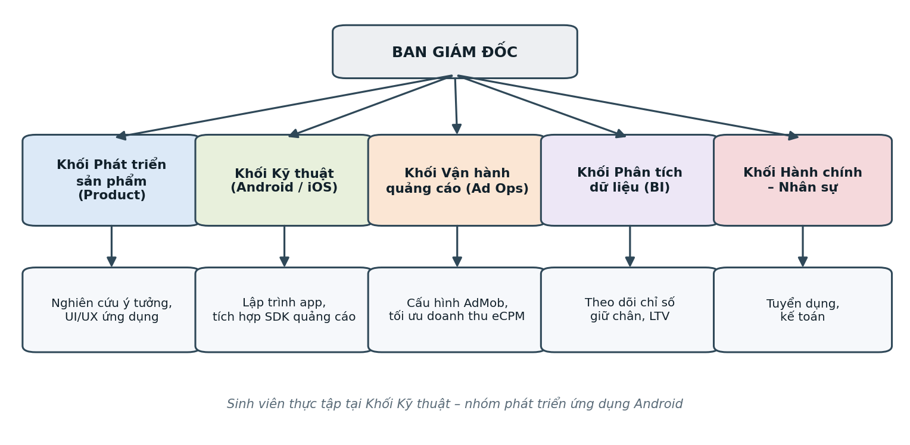

*Hình 1.1. Cơ cấu tổ chức của Công ty BetaSoft*

Chức năng chính của từng bộ phận như sau:

- **Ban Giám đốc:** điều hành chung, quyết định chiến lược sản phẩm và định hướng kinh doanh, phân bổ nguồn lực giữa các khối.
- **Khối Phát triển sản phẩm (Product):** nghiên cứu ý tưởng ứng dụng, khảo sát thị trường, thiết kế trải nghiệm và giao diện
  người dùng.
- **Khối Kỹ thuật:** lập trình ứng dụng trên Android và iOS, tích hợp các bộ công cụ dùng chung, xử lý các vấn đề kỹ thuật
  phát sinh. Đây là bộ phận em tham gia thực tập, cụ thể là nhóm phát triển ứng dụng Android.
- **Khối Vận hành quảng cáo (Ad Operations):** cấu hình đơn vị quảng cáo, thiết lập điều phối giữa nhiều mạng quảng cáo, theo
  dõi và tối ưu doanh thu.
- **Khối Phân tích dữ liệu (BI):** thu thập và phân tích các chỉ số về hành vi người dùng như tỉ lệ giữ chân, thời gian sử
  dụng và giá trị vòng đời người dùng.
- **Khối Hành chính – Nhân sự:** phụ trách tuyển dụng, hành chính, kế toán và các hoạt động hỗ trợ vận hành.

## 1.4. Lĩnh vực hoạt động và mô hình kinh doanh

Lĩnh vực hoạt động chính của BetaSoft là phát triển và phát hành ứng dụng di động miễn phí. Vòng tuần hoàn của mô hình kinh
doanh như sau: công ty phát hành ứng dụng miễn phí lên Google Play; người dùng tải về và sử dụng; trong quá trình sử dụng, ứng
dụng hiển thị quảng cáo do mạng quảng cáo cung cấp; nhà quảng cáo trả tiền theo lượt hiển thị hoặc lượt nhấp; phần doanh thu
được chia sẻ lại cho công ty để tái đầu tư phát triển ứng dụng mới.

Trong mô hình này, người dùng không trả tiền trực tiếp nhưng lại là tài sản quan trọng nhất của công ty, vì doanh thu tỉ lệ
thuận với số người dùng và thời gian họ ở lại trong ứng dụng. Niềm tin của người dùng vì vậy gắn trực tiếp với hoạt động kinh
doanh: một sự cố lộ dữ liệu hay một ứng dụng bị gỡ khỏi Google Play vì vi phạm chính sách bảo mật đều ảnh hưởng tới toàn bộ
danh mục sản phẩm.

## 1.5. Nhu cầu bảo mật đối với các ứng dụng của công ty

Một ứng dụng Android hiện đại của công ty phát hành ứng dụng thường tích hợp nhiều thành phần bên thứ ba: SDK quảng cáo, dịch
vụ cấu hình từ xa, công cụ phân tích hành vi, thư viện giao diện. Mỗi thành phần mang theo khoá, định danh và cấu hình riêng
được đóng gói trong tệp APK, đồng thời gọi tới các API trên máy chủ của bên thứ ba. Điều này đặt ra một số yêu cầu bảo mật cụ
thể trước mỗi lần phát hành:

- Không để lộ bí mật (khoá API, mật khẩu, token) trong mã nguồn hay tài nguyên của tệp APK.
- Giao tiếp với máy chủ qua kênh được mã hoá và cấu hình mạng đúng.
- Không vô tình mở thành phần của ứng dụng cho ứng dụng khác gọi tới.
- Không lưu dữ liệu nhạy cảm của người dùng ở nơi ứng dụng khác đọc được, và không ghi dữ liệu nhạy cảm vào nhật ký.
- Không để lại cờ gỡ lỗi và cấu hình phát triển trong bản phát hành.

Các yêu cầu này đều kiểm tra được bằng cách phân tích tệp APK mà không cần chạy ứng dụng. Tuy nhiên, kiểm tra thủ công từng
bản phát hành tốn nhiều thời gian, còn công cụ tự động phổ biến lại sinh nhiều báo nhầm. Đây là lý do nhiệm vụ thực tập của
em được đặt ra.

## 1.6. Vị trí thực tập và nhiệm vụ được giao

Trong kỳ thực tập, em được phân công vào nhóm phát triển ứng dụng Android thuộc Khối Kỹ thuật, dưới sự quản lý của anh Nguyễn
Văn Thịnh. Nhiệm vụ được giao là tìm hiểu kỹ thuật kiểm tra bảo mật ứng dụng Android và xây dựng một công cụ phân tích tĩnh
có thể dùng làm bước sàng lọc tự động. Các đầu việc cụ thể gồm:

- Tìm hiểu các nhóm lỗ hổng theo OWASP Mobile Top 10 – 2024 và OWASP API Security Top 10 – 2023.
- Dựng môi trường làm việc gồm các công cụ dịch ngược và công cụ quét có sẵn.
- Phân tích thủ công một ứng dụng có lỗ hổng có chủ đích để hiểu dấu hiệu của từng lỗ hổng và làm bộ đáp án kiểm tra.
- Thiết kế và cài đặt công cụ phân tích tĩnh, xuất báo cáo dễ đọc cho người kiểm tra.
- Đánh giá công cụ trên các ứng dụng mã nguồn mở thực tế và so sánh với công cụ có sẵn.

Một nguyên tắc được thống nhất từ đầu là công cụ chỉ đọc tệp APK, không chạy ứng dụng và không gửi yêu cầu tới máy chủ của
bên nào. Mọi thử nghiệm chỉ dùng ứng dụng có lỗ hổng có chủ đích và ứng dụng mã nguồn mở; việc áp dụng lên ứng dụng của công ty
chỉ thực hiện khi có sự đồng ý bằng văn bản.

# CHƯƠNG 2. CƠ SỞ LÝ THUYẾT VỀ BẢO MẬT API VÀ PHÂN TÍCH TĨNH ỨNG DỤNG ANDROID

Chương này trình bày các kiến thức nền tảng cần có trước khi xây dựng công cụ: ứng dụng Android được đóng gói và tổ chức
như thế nào, các nhóm rủi ro theo OWASP, kỹ thuật dịch ngược, các kỹ thuật phát hiện lỗ hổng bằng phân tích tĩnh, cách tổ
chức việc kiểm tra theo bộ tiêu chuẩn MASVS và hạn chế của các công cụ sẵn có.

## 2.1. Ứng dụng Android và tệp APK

### 2.1.1. Nền tảng Android và mức API

Android là hệ điều hành mã nguồn mở xây dựng trên nhân Linux. Ứng dụng Android được viết bằng Java hoặc Kotlin, biên dịch
thành bytecode Dalvik và chạy trên môi trường Android Runtime (ART). Mỗi phiên bản Android tương ứng với một mức API. Ứng
dụng khai báo hai giá trị trong tệp Manifest: `minSdkVersion` là phiên bản thấp nhất có thể cài đặt, còn `targetSdkVersion`
là phiên bản mà ứng dụng được thiết kế để chạy. Giá trị `targetSdkVersion` đặc biệt quan trọng với bảo mật vì nhiều thay
đổi an toàn hơn của nền tảng chỉ áp dụng cho ứng dụng nhắm tới mức API đủ mới (Bảng 2.1) [3], [4].

*Bảng 2.1. Một số thay đổi bảo mật của Android theo mức API*

| Phiên bản (API) | Thay đổi liên quan tới bảo mật | Điều kiện áp dụng |
|---|---|---|
| Android 4.2 (17) | ContentProvider mặc định không exported; chế độ `MODE_WORLD_READABLE/WRITEABLE` bị đánh dấu lỗi thời | `targetSdkVersion` ≥ 17 |
| Android 6.0 (23) | Quyền nguy hiểm phải được người dùng cấp khi chạy | `targetSdkVersion` ≥ 23 |
| Android 7.0 (24) | Có network security configuration; mặc định không tin CA do người dùng cài; lược đồ ký APK v2 | `targetSdkVersion` ≥ 24 |
| Android 9 (28) | Chặn giao tiếp cleartext theo mặc định; lược đồ ký APK v3 | `targetSdkVersion` ≥ 28 |
| Android 10–11 (29–30) | Lưu trữ theo phạm vi (scoped storage) hạn chế truy cập bộ nhớ ngoài dùng chung | `targetSdkVersion` ≥ 29/30 |
| Android 12 (31) | Bắt buộc khai báo `android:exported` cho thành phần có `<intent-filter>`; `adb backup` không còn lấy dữ liệu ứng dụng | `targetSdkVersion` ≥ 31 |

### 2.1.2. Cấu trúc tệp APK

Tệp APK thực chất là tệp nén ZIP chứa toàn bộ những gì cần để cài đặt ứng dụng (Hình 2.1): tệp khai báo
`AndroidManifest.xml`, các tệp mã `classes.dex`, tài nguyên đã biên dịch (`resources.arsc`, thư mục `res/`), tệp thô trong
`assets/`, thư viện native trong `lib/` và chữ ký trong `META-INF/` [3].

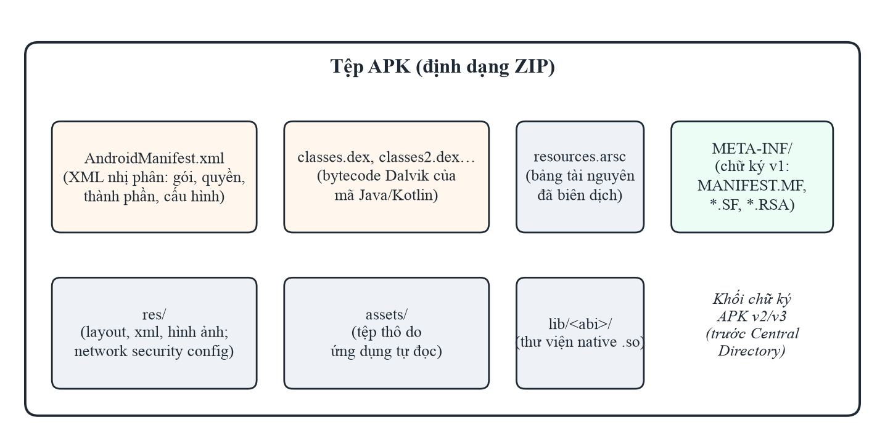

*Hình 2.1. Cấu trúc của một tệp APK*

Với người kiểm tra bảo mật, `AndroidManifest.xml` là nguồn chính để tìm lỗi cấu hình và bề mặt tấn công, còn `classes.dex`
chứa mã cần dịch ngược để tìm khoá viết cứng, URL máy chủ, cách dùng mật mã và cách lưu dữ liệu. Tệp network security
config nằm trong `res/xml/` cho biết chính sách mạng của ứng dụng.

### 2.1.3. Thành phần ứng dụng và cơ chế bảo vệ

Một ứng dụng Android được xây dựng từ bốn loại thành phần: Activity (màn hình), Service (tác vụ nền), BroadcastReceiver
(nhận sự kiện) và ContentProvider (chia sẻ dữ liệu). Các thành phần giao tiếp với nhau qua đối tượng Intent. Thuộc tính
`android:exported` quyết định thành phần có nhận lời gọi từ ứng dụng khác hay không; một thành phần exported mà không có
permission bảo vệ có thể bị bất kỳ ứng dụng nào trên thiết bị gọi tới. Tuy nhiên, không phải thành phần exported nào cũng là
lỗ hổng: Activity khởi chạy (LAUNCHER), dịch vụ đồng bộ hay receiver của widget buộc phải exported theo thiết kế của nền tảng.

Mỗi ứng dụng chạy trong hộp cát (sandbox) với mã định danh người dùng Linux riêng, nên dữ liệu riêng của ứng dụng được nền tảng
bảo vệ. Phần lớn lỗ hổng vì vậy không đến từ việc phá vỡ sandbox mà từ việc chính ứng dụng tự mở dữ liệu hoặc chức năng ra
ngoài: lưu dữ liệu ở bộ nhớ dùng chung, mở thành phần không bảo vệ, gửi dữ liệu qua kênh không mã hoá, bật cờ gỡ lỗi
(`android:debuggable`) hay cho phép sao lưu dữ liệu (`android:allowBackup`) trong bản phát hành.

## 2.2. Các nhóm rủi ro theo OWASP

### 2.2.1. OWASP Mobile Top 10 – 2024

OWASP Mobile Top 10 phiên bản 2024 [1] là bản cập nhật lớn đầu tiên kể từ năm 2016, xếp hạng mười nhóm rủi ro phổ biến nhất
của ứng dụng di động. Bảng 2.2 tóm tắt các nhóm cùng dấu hiệu điển hình có thể tìm thấy trong tệp APK.

*Bảng 2.2. OWASP Mobile Top 10 – 2024 và dấu hiệu trong tệp APK*

| Mã | Tên rủi ro | Dấu hiệu điển hình trong tệp APK |
|---|---|---|
| M1 | Improper Credential Usage | Mật khẩu, khoá API viết cứng trong mã hoặc tài nguyên |
| M2 | Inadequate Supply Chain Security | Thư viện, SDK bên thứ ba lỗi thời hoặc thu thập dữ liệu ngoài ý muốn |
| M3 | Insecure Authentication/Authorization | Điểm cuối đăng nhập phụ, kiểm tra quyền chỉ ở phía ứng dụng |
| M4 | Insufficient Input/Output Validation | Truy vấn SQL ghép chuỗi, WebView nạp dữ liệu không kiểm tra |
| M5 | Insecure Communication | URL `http://`, cấu hình cho phép cleartext, bỏ kiểm tra chứng chỉ |
| M6 | Inadequate Privacy Controls | Xin quyền vượt nhu cầu, ghi dữ liệu cá nhân vào log |
| M7 | Insufficient Binary Protections | Không làm rối mã, không phát hiện root hay giả mạo |
| M8 | Security Misconfiguration | Cờ `debuggable`, `allowBackup`, thành phần exported không bảo vệ |
| M9 | Insecure Data Storage | Dữ liệu nhạy cảm trong SharedPreferences, bộ nhớ ngoài, log |
| M10 | Insufficient Cryptography | Khoá viết cứng, IV cố định, thuật toán hoặc chế độ yếu |

Với một công ty phát hành nhiều ứng dụng tích hợp SDK bên thứ ba, ba nhóm đáng chú ý nhất là M1 (khoá và định danh của các
dịch vụ bị đóng gói trong tệp APK), M2 (rủi ro từ chuỗi cung ứng thư viện) và M8 (cấu hình phát triển còn sót trong bản phát
hành). Đây cũng là các nhóm có dấu hiệu rõ ràng trong tệp APK, phù hợp để tự động hoá kiểm tra.

### 2.2.2. OWASP API Security Top 10 – 2023

OWASP API Security Top 10 – 2023 [2] tập trung vào rủi ro của API phía máy chủ. Bảng 2.3 liệt kê mười nhóm cùng dấu hiệu
có thể quan sát từ phía ứng dụng.

*Bảng 2.3. OWASP API Security Top 10 – 2023 và dấu hiệu quan sát được từ tệp APK*

| Mã | Tên rủi ro | Dấu hiệu quan sát được từ tệp APK |
|---|---|---|
| API1 | Broken Object Level Authorization (BOLA) | Tham số định danh đối tượng do ứng dụng gửi lên; cần kiểm thử động để khẳng định |
| API2 | Broken Authentication | Cách ứng dụng gửi và lưu thông tin đăng nhập, token |
| API3 | Broken Object Property Level Authorization | Các trường dữ liệu ứng dụng gửi lên hoặc nhận về |
| API4 | Unrestricted Resource Consumption | Hầu như không quan sát được từ phía ứng dụng |
| API5 | Broken Function Level Authorization | Điểm cuối dành cho quản trị hoặc nhà phát triển xuất hiện trong mã |
| API6 | Unrestricted Access to Sensitive Business Flows | Luồng nghiệp vụ nhạy cảm gọi trực tiếp tới API |
| API7 | Server Side Request Forgery | Tham số URL do ứng dụng gửi lên máy chủ |
| API8 | Security Misconfiguration | Giao tiếp không mã hoá, cấu hình TLS phía ứng dụng |
| API9 | Improper Inventory Management | Điểm cuối cũ, điểm cuối thử nghiệm còn được gọi trong bản phát hành |
| API10 | Unsafe Consumption of APIs | Ứng dụng tin tưởng dữ liệu nhận từ API bên thứ ba |

Phần lớn lỗ hổng API nằm ở logic phía máy chủ nên không khẳng định được chỉ bằng tệp APK. Tuy nhiên, phân tích tệp APK đóng góp
ba thông tin quan trọng cho kiểm thử API: danh sách điểm cuối mà ứng dụng gọi tới (kể cả điểm cuối không có trong tài liệu),
cách ứng dụng xác thực với API, và kênh truyền được sử dụng. Đây là lý do công cụ được xây dựng trong kỳ thực tập vừa tìm dấu
hiệu lỗ hổng, vừa lập bản đồ điểm cuối API.

## 2.3. Phân tích tĩnh và phân tích động

Phân tích tĩnh là việc kiểm tra chương trình mà không chạy nó, bằng cách đọc mã và cấu hình. Phân tích động quan sát hành vi
khi chạy, cần thiết bị hoặc máy ảo, máy chủ uỷ nhiệm như Burp Suite hay OWASP ZAP để chặn lưu lượng, và công cụ can thiệp
thời gian chạy như Frida. Bảng 2.4 so sánh hai phương pháp.

*Bảng 2.4. So sánh phân tích tĩnh và phân tích động ứng dụng Android*

| Tiêu chí | Phân tích tĩnh | Phân tích động |
|---|---|---|
| Đầu vào | Tệp APK | Ứng dụng đang chạy trên thiết bị hoặc máy ảo |
| Độ phủ mã | Toàn bộ mã, kể cả nhánh hiếm khi chạy | Chỉ những nhánh được kích hoạt khi thử |
| Hạ tầng | Máy tính và công cụ dịch ngược | Thiết bị/máy ảo, proxy, công cụ can thiệp, máy chủ đích |
| Tự động hoá | Nhanh, dễ chạy hàng loạt | Chậm hơn, cần kịch bản tương tác |
| Điểm mạnh | Khoá viết cứng, cấu hình sai, mật mã yếu, thành phần exported | Lỗi phía máy chủ, xác thực, phân quyền |
| Điểm yếu | Báo nhầm cao; khó với mã làm rối, mã nạp động, mã native | Bỏ sót nhánh không được kích hoạt |
| Yêu cầu pháp lý | Chỉ đọc tệp APK | Gửi yêu cầu tới máy chủ, cần sự cho phép của chủ hệ thống |

Vì nhanh, không cần hạ tầng và không tác động tới hệ thống của ai, phân tích tĩnh thích hợp làm bước sàng lọc đầu tiên trong
quy trình phát hành ứng dụng, chỉ ra những vị trí cần kiểm thử động sau.

## 2.4. Dịch ngược ứng dụng Android

Bước đầu tiên của phân tích tĩnh là đưa tệp APK về dạng đọc được. Có hai hướng dịch ngược bổ sung cho nhau (Hình 2.2).

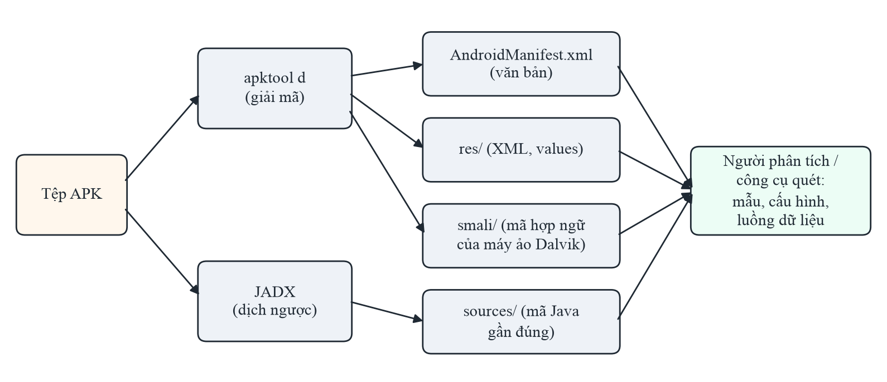

*Hình 2.2. Hai hướng dịch ngược tệp APK*

**apktool** [5] giải mã `AndroidManifest.xml` và các tệp XML nhị phân trong `res/` về dạng văn bản, đồng thời chuyển bytecode
thành mã hợp ngữ smali. Mã smali phản ánh chính xác từng lệnh bytecode nên có thể sửa rồi đóng gói lại, nhưng khó đọc với khối
lượng mã lớn. Hình 2.3 là kết quả chạy apktool trên ứng dụng mẫu InsecureBankv2: các dòng nhật ký thể hiện đúng các bước nạp
bảng tài nguyên, chuyển `classes.dex` thành smali, giải mã tài nguyên và Manifest.

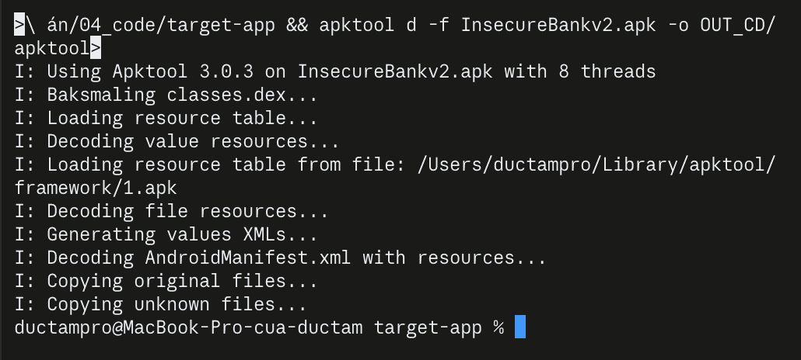

*Hình 2.3. Kết quả chạy apktool 3.0.3 trên InsecureBankv2*

**JADX** [6] dịch bytecode trực tiếp về mã Java gần đúng, dễ đọc hơn smali nhiều lần. JADX có dạng dòng lệnh để dịch ngược
hàng loạt và giao diện đồ hoạ hỗ trợ tìm kiếm, tra cứu nơi sử dụng của lớp hay phương thức, và xem song song mã Java với smali.
Mã thu được không giống hệt mã gốc (tên biến cục bộ có thể bị mất, cấu trúc điều khiển có thể bị viết lại), nhưng đủ để đọc
hiểu logic và tìm dấu hiệu lỗ hổng. Một chi tiết cần lưu ý khi trích dẫn bằng chứng là số dòng: giao diện JADX hiển thị số dòng
của mã nguồn gốc lấy từ thông tin gỡ lỗi trong bytecode, còn tệp Java do JADX dòng lệnh sinh ra có cách đánh số riêng.

## 2.5. Các kỹ thuật phát hiện lỗ hổng bằng phân tích tĩnh

Có thể xếp các kỹ thuật theo độ phức tạp tăng dần:

- **Phân tích cấu hình:** đọc Manifest và tệp network security config theo cấu trúc XML để tìm cờ gỡ lỗi, sao lưu, thành phần
  exported, cấu hình cleartext. Kết quả ít nhầm nhưng cần diễn giải đúng thiết kế của nền tảng.
- **So khớp mẫu trên mã:** dùng biểu thức chính quy hoặc từ khoá để tìm `http://`, `Cipher.getInstance`, lời gọi log, biến tên
  `password`. Đơn giản, nhanh, dễ mở rộng, nhưng không hiểu ngữ cảnh. Chuỗi `"http://"` có thể là URL máy chủ thật, cũng có thể
  chỉ dùng để so sánh trong hàm chuyển `http` thành `https`; biến tên `PASSWORD_KEY` có thể chỉ là tên khoá lưu cài đặt.
- **Phân tích cú pháp:** phân tích mã thành cây cú pháp để viết luật chính xác hơn, ví dụ chỉ xét đối số thật sự của một lời
  gọi hàm thay vì cả dòng mã.
- **Phân tích luồng dữ liệu và phân tích vết:** theo dõi giá trị từ nguồn nhạy cảm (mật khẩu người dùng nhập) tới đích nguy hiểm
  (lệnh ghi log, gửi qua mạng), như công trình FlowDroid [7]. Chính xác hơn nhưng tốn tài nguyên và khó mở rộng.

Hai đại lượng dùng để đánh giá một công cụ là **precision**, tỉ lệ cảnh báo đúng trên tổng số cảnh báo, TP/(TP + FP), và
**recall**, tỉ lệ lỗ hổng thật được phát hiện, TP/(TP + FN); trong đó TP là cảnh báo đúng, FP là báo nhầm, FN là lỗ hổng bị bỏ
sót. Công cụ dựa trên mẫu thường có recall khá nhưng precision thấp. Một báo cáo có quá nhiều báo nhầm khiến người kiểm tra mất
thời gian và dễ bỏ qua cả cảnh báo đúng, nên với một công cụ dùng trong quy trình phát hành, precision quan trọng không kém
recall.

## 2.6. Tổ chức kiểm tra theo MASVS và MASTG

Để việc kiểm tra không bỏ sót nhóm yêu cầu nào, có thể tổ chức theo các nhóm của bộ tiêu chuẩn MASVS (Mobile Application
Security Verification Standard) [11] và dùng các ca kiểm thử của hướng dẫn MASTG (Mobile Application Security Testing Guide)
[12] làm chỉ dẫn chi tiết. Bảng 2.5 tóm tắt nội dung kiểm tra tĩnh tiêu biểu cho từng nhóm.

*Bảng 2.5. Nội dung kiểm tra tĩnh tiêu biểu theo các nhóm yêu cầu MASVS*

| Nhóm MASVS | Mục tiêu | Kiểm tra tĩnh tiêu biểu |
|---|---|---|
| MASVS-STORAGE | Lưu trữ dữ liệu nhạy cảm an toàn | SharedPreferences, SQLite, bộ nhớ ngoài, log |
| MASVS-CRYPTO | Dùng mật mã đúng chuẩn | Thuật toán, chế độ mã hoá, IV, nguồn khoá |
| MASVS-AUTH | Xác thực và phân quyền an toàn | Logic đăng nhập phía ứng dụng, cách lưu token, điểm cuối phụ |
| MASVS-NETWORK | Bảo vệ kênh truyền | Chuỗi `http://`, network security config, kiểm tra chứng chỉ |
| MASVS-PLATFORM | Tương tác an toàn với nền tảng | Thành phần exported, dữ liệu từ Intent, cấu hình WebView |
| MASVS-CODE | Chất lượng mã và cấu hình build | Cờ `debuggable`, thư viện lỗi thời, truy vấn SQL ghép chuỗi |
| MASVS-RESILIENCE | Chống dịch ngược, giả mạo | Làm rối mã, phát hiện root, kiểm tra chữ ký |
| MASVS-PRIVACY | Bảo vệ quyền riêng tư | Quyền vượt nhu cầu, thu thập dữ liệu cá nhân |

Trong kỳ thực tập, bộ luật của công cụ được thiết kế bao phủ các nhóm STORAGE, CRYPTO, NETWORK, PLATFORM và CODE, là những nhóm
có dấu hiệu rõ ràng trong tệp APK; kết quả được phân loại theo OWASP Mobile Top 10 – 2024 để dễ trao đổi với nhóm phát triển.

## 2.7. Các công cụ sẵn có và hạn chế

**MobSF** (Mobile Security Framework) [8] là khung kiểm thử mã nguồn mở phổ biến nhất cho ứng dụng di động. MobSF là ứng dụng
web viết bằng Python, thường chạy trong Docker. Người dùng tải tệp APK lên qua giao diện web hoặc REST API (các lời gọi
`/api/v1/upload`, `/api/v1/scan`, `/api/v1/report_json`). Với phân tích tĩnh, MobSF tự dịch ngược, phân tích Manifest, chứng
chỉ ký, cấu hình mạng, chạy bộ luật so khớp mẫu trên mã Java, rồi xuất báo cáo web, PDF hoặc JSON kèm điểm bảo mật trên thang
100. MobSF có một danh sách đường dẫn lớp bị bỏ qua khi quét mã để giảm báo nhầm từ thư viện, và ở phiên bản 4.5.4 nhãn OWASP
trong báo cáo vẫn theo danh sách năm 2016.

Hạn chế chung của các công cụ dựa trên mẫu là báo nhầm cao trên ứng dụng thực tế, vì chúng không phân biệt được mã của ứng
dụng với mã của hàng trăm thư viện đi kèm, cũng không phân biệt được một dấu hiệu nguy hiểm thật với một trường hợp vô hại có
cùng hình thức. Nghiên cứu của Ranganath và Mitra [9] đánh giá 14 công cụ phát hiện lỗ hổng Android miễn phí trên 42 lỗ hổng
đã biết và cho thấy gộp tất cả công cụ cũng chỉ phát hiện được 30/42 lỗ hổng. Hai nhận xét này là điểm xuất phát cho công việc
ở Chương 3: cần một công cụ vừa giữ được khả năng phát hiện, vừa giảm báo nhầm theo ngữ cảnh, và phải được đánh giá trung thực
trên ứng dụng thực tế chứ không chỉ trên ứng dụng mẫu.

# CHƯƠNG 3. QUÁ TRÌNH XÂY DỰNG VÀ ĐÁNH GIÁ CÔNG CỤ PHÂN TÍCH TĨNH

Chương này trình bày công việc thực tế trong kỳ thực tập theo trình tự thực hiện: lập kế hoạch, dựng môi trường, phân tích
thủ công ứng dụng mẫu, thiết kế công cụ, các kỹ thuật giảm báo nhầm, đánh giá trên ứng dụng thực tế, đối chứng với MobSF và
đề xuất quy trình áp dụng.

## 3.1. Kế hoạch thực hiện

Công việc được chia thành bảy giai đoạn (Hình 3.1, Bảng 3.1). Giai đoạn 4 và 5 được lặp lại nhiều vòng: mỗi lần chạy công cụ
trên ứng dụng mới và phát hiện một lớp báo nhầm mới, bộ luật được sửa rồi kiểm tra lại. Kết quả của mỗi vòng được ghi vào sổ
tiến độ, và mã nguồn được quản lý bằng Git để mọi con số trong báo cáo đều có thể truy lại lần chạy tạo ra nó.

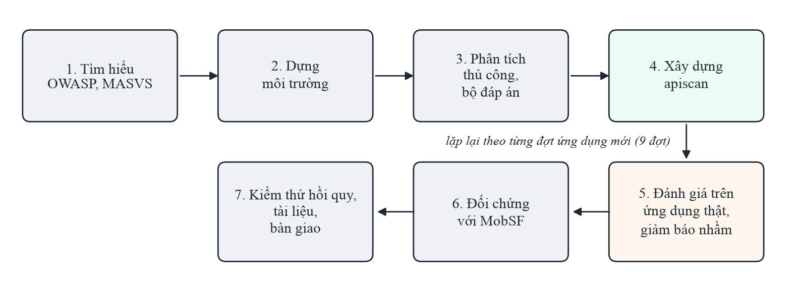

*Hình 3.1. Các giai đoạn công việc trong kỳ thực tập*

*Bảng 3.1. Các giai đoạn công việc trong kỳ thực tập*

| Giai đoạn | Nội dung | Kết quả |
|---|---|---|
| 1. Tìm hiểu | OWASP Mobile/API Top 10, MASVS/MASTG, các công cụ hiện có | Danh sách nhóm lỗ hổng cần phát hiện |
| 2. Môi trường | Cài JADX, apktool, MobSF trong Docker | Môi trường chạy được, có hướng dẫn cài đặt |
| 3. Bộ đáp án | Phân tích thủ công InsecureBankv2 | Danh sách lỗ hổng có bằng chứng mã nguồn |
| 4. Công cụ | Thiết kế, cài đặt `apiscan` và bộ luật | Một lệnh từ tệp APK tới báo cáo HTML/JSON |
| 5. Giảm báo nhầm | Chạy trên ứng dụng thật, gán nhãn, sửa luật theo đợt | Bảy kỹ thuật lọc theo ngữ cảnh, điểm tin cậy |
| 6. Đối chứng | Chạy MobSF trên cùng tập ứng dụng | So sánh trên cùng định nghĩa nhãn |
| 7. Tài liệu | Bộ kiểm thử hồi quy, hướng dẫn sử dụng, báo cáo | Công cụ có thể bàn giao |

## 3.2. Dựng môi trường làm việc

### 3.2.1. Cấu hình phần cứng và phần mềm

Môi trường làm việc được dựng trên một máy MacBook dùng chip Apple M1 với 16 GB RAM (Bảng 3.2). Các công cụ dòng lệnh được cài
qua trình quản lý gói Homebrew; MobSF chạy trong Docker Desktop, dùng ảnh hỗ trợ kiến trúc ARM64 của chip Apple Silicon.

*Bảng 3.2. Cấu hình môi trường làm việc*

| Thành phần | Phiên bản / thông số | Vai trò |
|---|---|---|
| Máy tính | MacBook Apple M1, 16 GB RAM, macOS 14.4 | Máy làm việc chính |
| Python | 3.14 | Ngôn ngữ cài đặt công cụ `apiscan` |
| OpenJDK | 21.0.9 | Môi trường chạy JADX và apktool |
| JADX | 1.5.6 | Dịch ngược mã về Java |
| apktool | 3.0.3 | Giải mã Manifest, tài nguyên, smali |
| Docker Desktop | Được cấp khoảng 8 GB RAM | Chạy MobSF cô lập |
| MobSF | 4.5.4 (ảnh ARM64) | Công cụ đối chứng |
| Git | — | Quản lý mã nguồn, lưu vết các lần chạy |

Các lệnh cài đặt chính:

```
brew install jadx apktool
docker run -d --name mobsf -p 127.0.0.1:8000:8000 opensecurity/mobile-security-framework-mobsf:latest
```

Cổng của MobSF chỉ mở trên địa chỉ 127.0.0.1 để dịch vụ không truy cập được từ mạng ngoài, vì MobSF lưu toàn bộ tệp APK và mã
dịch ngược của các ứng dụng đã quét.

### 3.2.2. Các vấn đề gặp phải và cách xử lý

Trong quá trình dựng và sử dụng môi trường, em gặp một số vấn đề đáng ghi nhận:

- **Tài nguyên máy:** ảnh Docker của MobSF dung lượng khoảng 4,4 GB. Khi phân tích các ứng dụng lớn, Docker dùng gần hết phần bộ
  nhớ được cấp, khiến bộ nhớ hoán đổi của máy tăng lên 12–14 GB và ổ đĩa có lúc chỉ còn khoảng 3 GB trống. Cách xử lý là chạy
  MobSF theo lô có theo dõi dung lượng ổ đĩa, lưu kết quả dạng JSON và tắt container ngay khi không dùng.
- **Báo cáo không được tạo:** khi gọi REST API của MobSF cho một ứng dụng chưa từng quét kèm cờ quét lại (`re_scan=1`), MobSF chỉ
  cập nhật một bản ghi chưa tồn tại nên không sinh báo cáo, và lời gọi lấy báo cáo trả về lỗi "Report not Found". Nguyên nhân
  được tìm ra bằng cách đọc nhật ký và mã nguồn của MobSF; tập lệnh chạy hàng loạt được sửa để chỉ bật cờ này khi thật sự cần
  quét lại.
- **MobSF không quét mã của ứng dụng mẫu:** ở cấu hình mặc định, phần phân tích mã của MobSF trả về 0 kết quả cho InsecureBankv2.
  Ban đầu em nghi do thiếu thành phần phân tích trong ảnh Docker ARM64, nhưng kiểm tra lại thì nguyên nhân thật là danh sách
  đường dẫn bỏ qua của MobSF chứa tiền tố `com/android/`, trùng với tên gói `com.android.insecurebankv2`. Bài học là cần kiểm
  chứng giả thuyết bằng bằng chứng trước khi kết luận.
- **Tương thích tệp báo cáo:** tệp Word xuất tự động ban đầu không mở được trên Google Docs. Bằng cách tạo các phiên bản rút gọn
  và thử lần lượt, em xác định nguyên nhân là phần chân trang sinh từ mẫu của thư viện, rồi thay bằng chân trang tối giản.

## 3.3. Phân tích thủ công ứng dụng mẫu InsecureBankv2

### 3.3.1. Mục đích và cách làm

Trước khi viết công cụ, em phân tích thủ công ứng dụng InsecureBankv2 [10], một ứng dụng ngân hàng mô phỏng được xây dựng có
chủ đích để chứa lỗ hổng. Mục đích là hiểu dấu hiệu của từng lỗ hổng trong mã thật, và có một bộ đáp án để kiểm tra công cụ sau
này. Tệp APK (SHA-256 `b18af2a0…94a4`, `minSdkVersion` 15, `targetSdkVersion` 22) được dịch ngược bằng apktool và JADX. Sau dịch
ngược có 2.992 tệp Java, nhưng chỉ 14 tệp thuộc gói `com.android.insecurebankv2` của ứng dụng; phần còn lại là thư viện. Mã được
đọc theo các nhóm yêu cầu của MASVS (mục 2.6).

### 3.3.2. Các điểm yếu tìm được

Hình 3.2 là lớp `CryptoClass` khi mở trong JADX: trường `key` chứa khoá AES dạng chuỗi, trường `ivBytes` là 16 byte 0, và hai
phương thức mã hoá, giải mã dùng chế độ `AES/CBC/PKCS5Padding`.

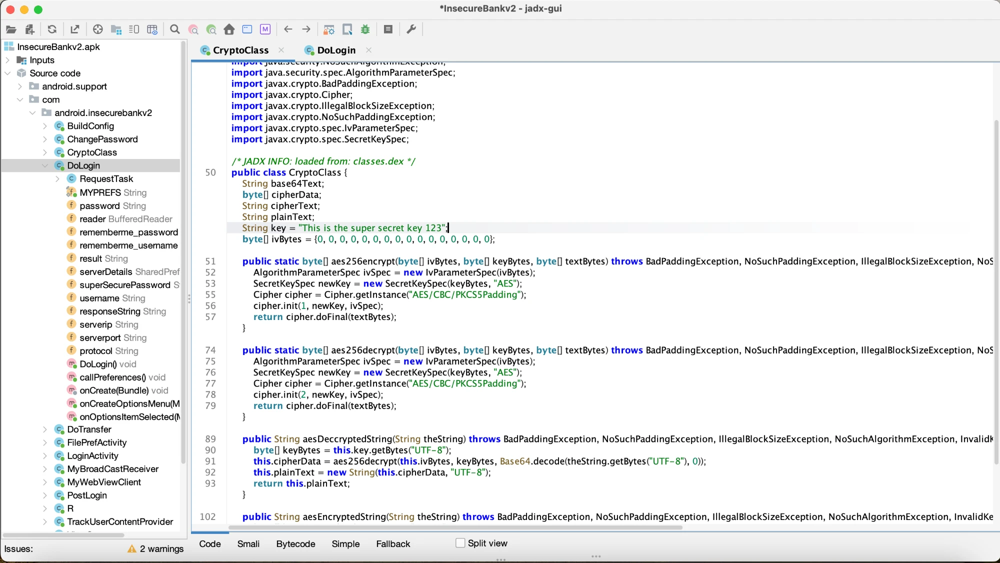

*Hình 3.2. Lớp CryptoClass của InsecureBankv2 trong giao diện JADX*

Hình 3.3 là lớp `DoLogin`, nơi ứng dụng dựng hai yêu cầu tới `/login` và `/devlogin`, và chọn `/devlogin` khi tên đăng nhập là
`devadmin`. Cây bên trái liệt kê các trường `password`, `rememberme_password`, `superSecurePassword`, gợi ý những nơi cần kiểm tra
cách lưu mật khẩu.

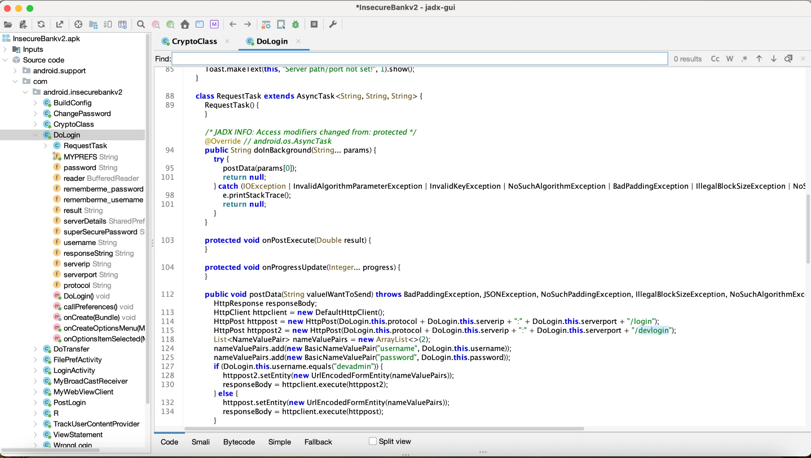

*Hình 3.3. Lớp DoLogin trong giao diện JADX: nhánh `devadmin` gửi yêu cầu tới `/devlogin`*

Bảng 3.3 tổng hợp 11 nhóm điểm yếu tìm được, thuộc 8 hạng mục OWASP Mobile Top 10 – 2024. Vị trí ghi theo tệp Java do JADX dòng
lệnh sinh ra.

*Bảng 3.3. Các điểm yếu tìm được khi phân tích thủ công InsecureBankv2*

| STT | Điểm yếu | Bằng chứng | OWASP 2024 |
|---|---|---|---|
| 1 | Khoá AES viết cứng, IV toàn số 0 | `CryptoClass.java:22–23` | M1, M10 |
| 2 | Giao tiếp HTTP không mã hoá, `targetSdkVersion` 22 | `DoLogin.java:51`, `DoTransfer.java:65`, `ChangePassword.java:57` | M5 |
| 3 | Điểm cuối `/devlogin` cho tài khoản `devadmin` | `DoLogin.java:98–105` | M3 |
| 4 | Thông tin đăng nhập lưu trong SharedPreferences, giải mã được | `DoLogin.java:140–149` | M9 |
| 5 | Ghi log tên đăng nhập và mật khẩu | `DoLogin.java:115`; `MyBroadCastReceiver.java:31` | M9 |
| 6 | Bốn Activity sau đăng nhập exported, không permission | `AndroidManifest.xml` | M8, M3 |
| 7 | ContentProvider exported lộ danh sách tên người dùng | `AndroidManifest.xml`; `DoLogin.java:132–134` | M8 |
| 8 | Receiver exported gửi mật khẩu qua SMS tới số tuỳ ý, đọc dữ liệu ở chế độ world-readable | `MyBroadCastReceiver.java:21–32` | M8, M9 |
| 9 | Sao kê ghi ra bộ nhớ ngoài, nạp lại vào WebView có JavaScript | `DoTransfer.java:162, 180`; `ViewStatement.java:25–30` | M9, M4 |
| 10 | `debuggable="true"`, `allowBackup="true"` | `AndroidManifest.xml` | M8 |
| 11 | Không làm rối mã | Tên lớp, hàm gốc còn nguyên | M7 |

Điểm yếu nghiêm trọng nhất là số 8: một ứng dụng bất kỳ trên thiết bị có thể gửi broadcast tới receiver này, khiến ứng dụng đọc
mật khẩu đã lưu, giải mã bằng khoá viết cứng rồi gửi qua SMS tới một số điện thoại do kẻ tấn công chọn. Đây là ví dụ điển hình
cho việc nhiều điểm yếu nhỏ (thành phần exported, khoá viết cứng, dữ liệu đọc chung) cộng lại thành một lỗ hổng nghiêm trọng.

### 3.3.3. Bản đồ điểm cuối API

Đọc các lời gọi `HttpPost` trong mã cho phép lập bản đồ điểm cuối API mà ứng dụng gọi tới (Bảng 3.4). Địa chỉ máy chủ không viết
cứng trong mã mà do người dùng nhập ở màn hình cấu hình, rồi được nối với đường dẫn của từng điểm cuối khi chạy.

*Bảng 3.4. Các điểm cuối API của InsecureBankv2*

| Điểm cuối | Vị trí trong mã | Tham số gửi lên | Dấu hiệu cần kiểm thử động |
|---|---|---|---|
| `POST /login` | `DoLogin.java:98` | `username`, `password` | Gửi qua HTTP không mã hoá |
| `POST /devlogin` | `DoLogin.java:99` | `username`, `password` | Điểm cuối gỡ lỗi còn sót (API5, API9) |
| `POST /getaccounts` | `DoTransfer.java:216` | `username`, `password` | Gửi lại mật khẩu ở mỗi yêu cầu, không có token phiên (API2) |
| `POST /dotransfer` | `DoTransfer.java:103` | `username`, `password`, `from_acc`, `to_acc`, `amount` | Tài khoản nguồn do ứng dụng gửi lên (API1) |
| `POST /changepassword` | `ChangePassword.java:105` | `username`, `newpassword` | Không kèm mật khẩu cũ hay token (API2, API5) |

Các dấu hiệu ở cột cuối chỉ là nghi vấn: muốn khẳng định cần kiểm thử động trên máy chủ, việc chỉ được làm khi có sự cho phép
của chủ hệ thống. Tuy vậy, bảng này cho thấy rõ giá trị của phân tích tĩnh với kiểm thử API: chỉ từ tệp APK, người kiểm thử đã
biết cần thử những điểm cuối nào và với tham số nào.

### 3.3.4. Kiểm chứng tài liệu đáp án

Khi đối chiếu tài liệu mô tả lỗ hổng đi kèm ứng dụng mẫu với mã dịch ngược và mã nguồn công khai của máy chủ, em phát hiện bốn
mục mô tả không khớp với mã thật (Bảng 3.5).

*Bảng 3.5. Các mục của tài liệu đáp án InsecureBankv2 được hiệu chỉnh*

| Mục | Mô tả ban đầu | Mô tả sau khi đối chiếu mã |
|---|---|---|
| Lưu trữ thông tin đăng nhập | Lưu dạng rõ trong SharedPreferences | Tên đăng nhập mã hoá Base64, mật khẩu mã hoá AES bằng khoá viết cứng, giải mã ngược được |
| Mật mã yếu | Dùng DES khoá 56 bit | AES chế độ CBC với khoá viết cứng và IV toàn số 0 |
| Phân quyền mức đối tượng | Đổi tham số định danh để xem giao dịch của người khác | `/dotransfer` nhận tài khoản nguồn tuỳ ý, chuyển tiền từ tài khoản người khác |
| Xác thực | Mã thông báo không được kiểm tra | Không có cơ chế phiên; `/changepassword` không xác thực |

Bài học rút ra là bộ đáp án cũng phải được kiểm chứng bằng mã nguồn trước khi dùng để chấm công cụ. Sáu lỗ hổng có dấu hiệu tĩnh
rõ ràng (khoá viết cứng, giao tiếp không mã hoá, mật mã yếu, thành phần exported, điểm cuối `/devlogin`, `allowBackup`) được chọn
làm bộ đáp án để đo recall của công cụ.

## 3.4. Thiết kế và cài đặt công cụ apiscan

### 3.4.1. Kiến trúc tổng thể

Công cụ được đặt tên `apiscan`, viết bằng Python, và được dùng bằng một lệnh:

```
python3 apiscan.py scan app.apk --min-confidence medium
```

Hình 3.4 mô tả luồng xử lý. Công cụ tính SHA-256 của tệp APK, gọi apktool và JADX để dịch ngược vào thư mục làm việc đặt theo mã
băm để lần quét sau dùng lại, tự suy ra phạm vi mã của ứng dụng, chạy bốn nhóm phân tích (Manifest, network security config, bộ
luật trên mã nguồn, bản đồ điểm cuối và bề mặt tiếp nhận Intent), chấm độ tin cậy cho từng cảnh báo rồi xuất báo cáo HTML và
JSON.

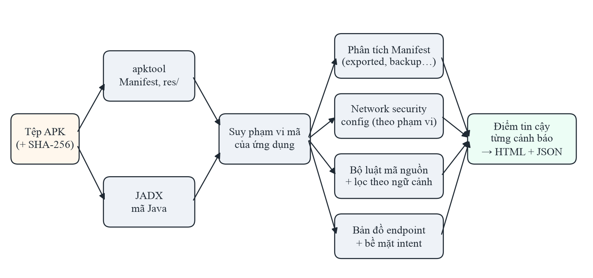

*Hình 3.4. Kiến trúc của công cụ apiscan*

Nguyên tắc thiết kế xuyên suốt là **chỉ đọc**: công cụ không cài đặt, không chạy ứng dụng và không gửi yêu cầu tới máy chủ nào.
Nhờ vậy, công cụ chạy được trên bất kỳ tệp APK nào mà không cần hạ tầng kiểm thử, và có thể đưa vào quy trình phát hành mà không
lo ảnh hưởng tới hệ thống đang vận hành.

### 3.4.2. Bộ luật

Công cụ có 20 luật, mỗi luật gắn một hạng mục OWASP Mobile Top 10 – 2024 (Bảng 3.6). Luật cấu hình đọc Manifest và tệp network
security config; luật mã nguồn quét từng dòng mã Java trong phạm vi ứng dụng.

*Bảng 3.6. Bộ luật của apiscan theo nhóm OWASP Mobile Top 10 – 2024*

| Nhóm OWASP | Luật | Phát hiện |
|---|---|---|
| M1 – Improper Credential Usage | CRY-KEYLIT, CRY-KEYHARD, KEY-SERVICE | Bí mật viết cứng; khoá mã hoá truy về hằng; chuỗi có dạng khoá API dịch vụ |
| M4 – Insufficient Input/Output Validation | WEB-JS, WEB-IFACE | WebView bật JavaScript; cầu nối JavaScript với mã ứng dụng |
| M5 – Insecure Communication | NET-CLEAR, NET-NSC, NET-TRUST, NET-SDK, NET-HTTP | Cho phép cleartext; tin CA do người dùng cài; `targetSdkVersion` < 28; URL `http://` khi kết nối |
| M8 – Security Misconfiguration | CFG-DEBUG, CFG-BACKUP, CFG-EXPORT, API-HIDDEN | `debuggable`; `allowBackup`; thành phần exported không bảo vệ; điểm cuối gỡ lỗi, thử nghiệm |
| M9 – Insecure Data Storage | STO-EXT, STO-PREF-WORLD, LOG-SENS | Tạo tệp ở bộ nhớ ngoài; SharedPreferences world-readable; ghi log giá trị nhạy cảm |
| M10 – Insufficient Cryptography | CRY-WEAK, CRY-IV0, CRY-HASH | ECB, DES, RC4; IV tĩnh; MD5, SHA-1 |

Ngoài danh sách cảnh báo, công cụ xuất hai thông tin hỗ trợ kiểm thử: **bản đồ điểm cuối** (các URL và đường dẫn API xuất hiện
trong mã có gọi mạng) và **bề mặt tiếp nhận Intent** (các thành phần exported có lý do chính đáng, được liệt kê để rà soát cách
xử lý dữ liệu đầu vào nhưng không tính là lỗ hổng).

### 3.4.3. Tự xác định phạm vi mã của ứng dụng

Một tệp APK chứa cả mã của ứng dụng lẫn hàng trăm thư viện. Thử nghiệm trên InsecureBankv2 cho thấy nếu tìm mẫu `Log.*(` trên toàn
bộ tệp APK sẽ được 644 dòng trong 146 tệp, nhưng chỉ 1 dòng thuộc ứng dụng, và đó chính là dòng ghi mật khẩu; với mẫu `http://`,
35 trên 38 dòng nằm ở thư viện. Vì vậy công cụ tự suy phạm vi mã của ứng dụng từ Manifest: tên gói, lớp Application, và các
namespace chứa thành phần khai báo trong Manifest, loại trừ các tiền tố thư viện phổ biến. Tác động thực tế rất lớn: với ứng dụng
KeePassDX, cách quét chỉ theo tên gói trong Manifest cho đúng 1 cảnh báo vì bỏ sót toàn bộ mã thật, còn phạm vi tự suy cho 50
cảnh báo; với Nextcloud, số cảnh báo tăng từ 9 lên 46 khi phạm vi được mở rộng đúng.

### 3.4.4. Các kỹ thuật giảm báo nhầm theo ngữ cảnh

Phần lớn thời gian thực tập dành cho việc biến các luật so khớp mẫu thô thành điều kiện mà một lỗ hổng thật phải thoả mãn. Mỗi kỹ
thuật dưới đây xuất phát từ một lớp báo nhầm cụ thể quan sát được trên ứng dụng thật:

1. **URL `http://` theo ngữ cảnh:** bỏ qua chuỗi chỉ dùng để so sánh hay chuyển `http` thành `https`, URL mẫu, namespace XML.
2. **Thành phần exported:** tách cảnh báo thật khỏi bề mặt tiếp nhận hợp lệ, như Activity khởi chạy hay receiver nhận nút media.
3. **Ghi log dữ liệu nhạy cảm:** chỉ cảnh báo khi giá trị nhạy cảm thật sự được ghi, không cảnh báo khi chỉ tên biến hay thông
   điệp chứa từ khoá.
4. **Bộ nhớ ngoài:** chỉ cảnh báo khi thư mục bộ nhớ ngoài được dùng để tạo đường dẫn tệp.
5. **Khoá viết cứng:** phân biệt tên khoá như `KEY_TITLE = "title"` với bí mật thật dựa trên độ dài và độ ngẫu nhiên của giá trị.
6. **Khoá mã hoá:** theo dõi luồng dữ liệu trong tệp để biết hằng nào thật sự chảy vào hàm tạo khoá `SecretKeySpec`.
7. **Cấu hình mạng theo phạm vi:** đọc network security config theo cấu trúc, chỉ xét cấu hình áp dụng cho toàn ứng dụng.

Hiệu quả của bốn kỹ thuật đầu được đo trên cùng một tệp APK của ứng dụng NewPipe (Bảng 3.7).

*Bảng 3.7. Precision trên NewPipe qua các cải tiến luật*

| Phiên bản luật | Số cảnh báo | Cảnh báo đúng | Precision |
|---|---|---|---|
| Ban đầu | 19 | 1 | 5,3% |
| + URL `http://` theo ngữ cảnh | 13 | 1 | 7,7% |
| + Tách bề mặt tiếp nhận của thành phần exported | 7 | 1 | 14,3% |
| + Ghi log theo giá trị | 6 | 1 | 16,7% |
| + Bộ nhớ ngoài theo đường dẫn tệp | 3 | 1 | 33,3% |

### 3.4.5. Điểm tin cậy theo từng cảnh báo

Công cụ tách hai khái niệm: **mức nghiêm trọng** (hậu quả nếu cảnh báo đúng) và **độ tin cậy** (khả năng cảnh báo đúng). Độ tin
cậy được chấm theo tín hiệu của chính cảnh báo đó, ở ba tầng: high cho bằng chứng trực tiếp, medium cho dấu hiệu mạnh nhưng mã có
thể có kiểm tra mà phân tích tĩnh không thấy, low cho bề mặt rủi ro tự nó chưa phải lỗ hổng. Bảng 3.8 là một số quy tắc chấm.

*Bảng 3.8. Một số quy tắc chấm độ tin cậy*

| Luật | high | medium | low |
|---|---|---|---|
| Ghi log dữ liệu nhạy cảm | In biến hoặc trường có tên nhạy cảm (`this.password`) | Chuỗi kết thúc bằng từ khoá rồi nối giá trị | Từ khoá chỉ ở tên lớp hoặc giữa câu |
| Khoá viết cứng | Giá trị dạng khoá ngẫu nhiên (≥ 16 ký tự, có chữ và số) hoặc tiền tố khoá đã biết | Dạng cụm mật khẩu | Nhãn chữ, đường dẫn, chuỗi ngắn |
| IV cố định | Mảng thực sự được truyền vào `IvParameterSpec` | — | Không dùng làm IV |
| Thành phần exported | — | Mặc định | Thành phần khởi chạy hoặc có kiểm tra ứng dụng gọi |
| Sao lưu dữ liệu | Không có quy tắc sao lưu | Có quy tắc sao lưu | — |

Một quy tắc ban đầu là "thành phần không đọc dữ liệu từ Intent thì xếp low" đã bị loại bỏ vì sai về nguyên lý: Activity chuyển
tiền `DoTransfer` của InsecureBankv2 không đọc Intent, nhưng việc ứng dụng khác mở thẳng được màn hình này mà không qua đăng nhập
chính là lỗ hổng. Lỗi được phát hiện vì bộ kiểm thử hồi quy báo recall trên InsecureBankv2 ở ngưỡng ≥ medium giảm còn 5/6; đây là
ví dụ cho vai trò của bộ đáp án như một ràng buộc khi thiết kế.

### 3.4.6. Kết quả chạy trên InsecureBankv2

Dưới đây là kết quả thật khi chạy công cụ trên InsecureBankv2 ở ngưỡng tin cậy ≥ medium:

```
$ python3 apiscan.py scan InsecureBankv2.apk --min-confidence medium
SHA-256: b18af2a0e44d7634bbcdf93664d9c78a2695e050393fcfbb5e8b91f902d194a4
Đang giải nén bằng apktool…
Đang dịch ngược bằng JADX (có thể mất vài phút)…

Gói ứng dụng: com.android.insecurebankv2  |  phạm vi mã: com.android.insecurebankv2
Tổng cảnh báo: 22  |  theo mức: {'high': 12, 'medium': 10}
Theo độ tin cậy: {'high': 8, 'medium': 14}  (đã lọc --min-confidence medium: 2 cảnh báo ẩn)
Theo OWASP: {'M1': 3, 'M10': 1, 'M5': 4, 'M8': 9, 'M9': 5}
Bề mặt tiếp nhận intent (không tính cảnh báo): 1
Endpoint phát hiện: 6
```

Công cụ tự suy đúng phạm vi mã là gói `com.android.insecurebankv2`, đưa ra 22 cảnh báo và tìm được 6 đường dẫn: 5 điểm cuối API ở
Bảng 3.4 và đường dẫn tệp sao kê `/Statements_`. Lần chạy đầu, gồm cả bước dịch ngược, mất khoảng 112 giây trong lúc máy đang tải
cao; các lần chạy sau dùng lại kết quả dịch ngược đã lưu nên chỉ mất 0,7–1,7 giây. Hình 3.5 là phần đầu báo cáo HTML: cảnh báo
được nhóm theo hạng mục OWASP, mỗi dòng có mức nghiêm trọng, độ tin cậy, vị trí tệp:dòng, trích đoạn bằng chứng và ghi chú giải
thích vì sao luật kết luận như vậy.

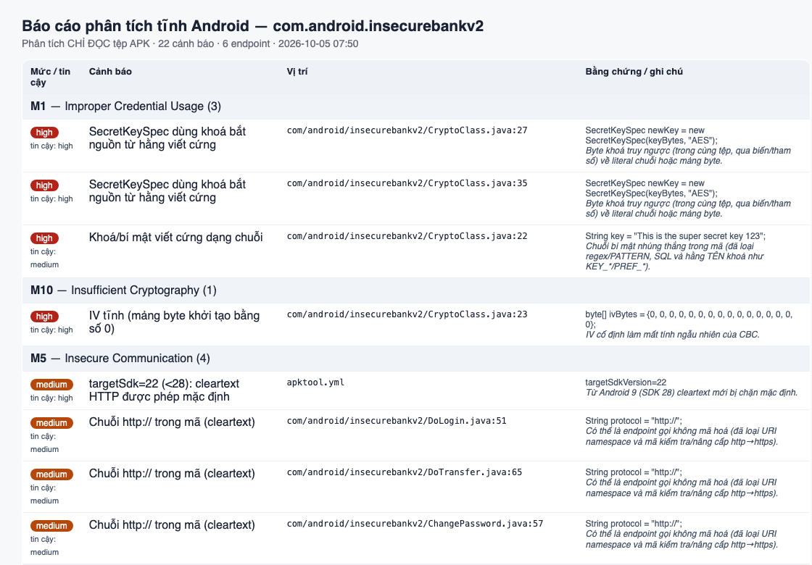

*Hình 3.5. Phần đầu báo cáo HTML của apiscan trên InsecureBankv2*

Cuối báo cáo là danh sách bề mặt tiếp nhận Intent và bản đồ điểm cuối (Hình 3.6). `LoginActivity` được xếp vào bề mặt tiếp nhận
chứ không phải cảnh báo, vì nó là Activity khởi chạy buộc phải exported.

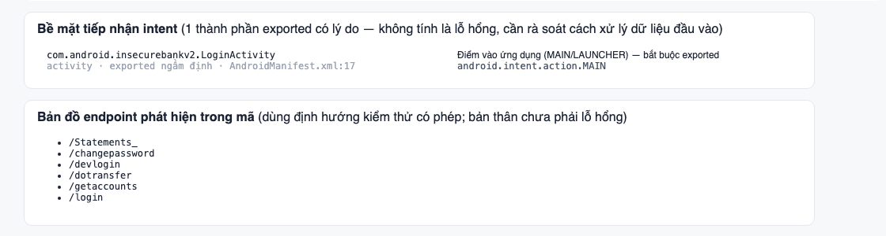

*Hình 3.6. Bề mặt tiếp nhận Intent và bản đồ điểm cuối trong báo cáo apiscan*

### 3.4.7. Kiểm thử hồi quy

Mọi thay đổi luật đều được kiểm tra bằng bộ kiểm thử hồi quy gồm 19 nhóm ca kiểm thử, chạy bằng lệnh
`python3 -m unittest discover -s 04_code/tests`. Bộ kiểm thử gồm các ca đơn vị cho từng luật (một đoạn mã phải được cảnh báo, một
đoạn mã tương tự nhưng vô hại thì không) và một ca tích hợp chạy công cụ trên InsecureBankv2, kiểm tra vẫn phát hiện đủ sáu lỗ hổng
của bộ đáp án. Nhờ đó, mỗi lần sửa luật để giảm báo nhầm trên một ứng dụng mới, em biết ngay nếu thay đổi đó vô tình làm mất khả
năng phát hiện đã có.

## 3.5. Đánh giá công cụ trên ứng dụng thực tế

### 3.5.1. Tập ứng dụng

Precision được đo trên 19 ứng dụng mã nguồn mở tải từ kho F-Droid [13], chọn trải rộng nhiều lĩnh vực để kết luận không chỉ đúng
cho một loại ứng dụng (Bảng 3.9). Mọi tệp APK đều được ghi lại mã băm SHA-256 để có thể tái lập.

*Bảng 3.9. Tập ứng dụng mã nguồn mở dùng để đánh giá*

| Vai trò | Ứng dụng | Lĩnh vực |
|---|---|---|
| Phát triển ban đầu | NewPipe 0.29.1 | Xem video |
| Đợt 1 | Tusky 32.2; K-9 Mail 23.1 | Mạng xã hội; email |
| Đợt 2 | AntennaPod 3.12.2; Nextcloud 35.0.0 | Podcast; đồng bộ tệp |
| Đợt 3 | Conversations 2.20.4; Jellyfin 2.7.3 | Nhắn tin XMPP; máy chủ media |
| Đợt 4 | DAVx⁵ 4.5.20; Feeder 2.23.2 | Đồng bộ lịch, danh bạ; RSS |
| Đợt 5 | Aegis 3.4.3; RedReader 1.26 | Xác thực hai lớp; Reddit |
| Đợt 6 | KeePassDX 4.5.5; Breezy Weather 6.2.2 | Quản lý mật khẩu; thời tiết |
| Đợt 7 | Gadgetbridge 0.94.0; Wikipedia | Thiết bị đeo; tri thức |
| Đợt 8 | Briar 1.5.21; Money Manager Ex 5.5.13 | Nhắn tin qua Tor; tài chính cá nhân |
| Đợt 9 | Termux 0.118.3; Catima 2.45.1 | Terminal; ví thẻ |

### 3.5.2. Gán nhãn cảnh báo

Mỗi cảnh báo được em đối chiếu với mã dịch ngược, Manifest hoặc tệp cấu hình liên quan và gán nhãn kèm lý do. Cảnh báo đúng (TP)
là cảnh báo chỉ đúng một điểm yếu bảo mật có thật. Báo nhầm (FP) được chia hai loại: do luật khớp mẫu sai, và do hành vi có chủ
đích hoặc bắt buộc của ứng dụng. Ví dụ, với NewPipe, cảnh báo `allowBackup="true"` được gán TP vì ứng dụng không khai báo quy tắc
giới hạn sao lưu, còn cảnh báo về `MainActivity` exported được gán FP vì đây là Activity khởi chạy buộc phải exported. Một số quy
ước được giữ nhất quán xuyên ứng dụng, chẳng hạn mật mã do giao thức của thiết bị quy định được coi là FP có chủ đích. Tổng cộng có
589 nhãn, lưu dạng JSON cùng mã nguồn của công cụ.

### 3.5.3. Giao thức holdout nhiều đợt

Khi một luật được chỉnh để loại báo nhầm quan sát được trên một ứng dụng, precision trên chính ứng dụng đó tăng lên, nhưng điều
đó không cho biết công cụ hoạt động thế nào trên ứng dụng mới. Để tránh tự đánh giá quá cao, em dùng giao thức **holdout nhiều
đợt**: trước mỗi đợt, toàn bộ luật được đóng băng tại một phiên bản mã; công cụ chạy trên hai ứng dụng mới; các cảnh báo được gán
nhãn và đo precision; chỉ sau đó mới được sửa luật dựa trên các ứng dụng này. Kết quả chín đợt ở Bảng 3.10.

*Bảng 3.10. Precision trên các đợt holdout*

| Đợt | Ứng dụng | Số cảnh báo | Cảnh báo đúng | Precision |
|---|---|---|---|---|
| 1 | Tusky, K-9 Mail | 22 | 4 | 18,2% |
| 2 | AntennaPod, Nextcloud | 169 | 9 | 5,3% |
| 3 | Conversations, Jellyfin | 85 | 13 | 15,3% |
| 4 | DAVx⁵, Feeder | 25 | 10 | 40,0% |
| 5 | Aegis, RedReader | 22 | 7 | 31,8% |
| 6 | KeePassDX, Breezy Weather | 54 | 2 | 3,7% |
| 7 | Gadgetbridge, Wikipedia | 107 | 3 | 2,8% |
| 8 | Briar, Money Manager Ex | 16 | 4 | 25,0% |
| 9 | Termux, Catima | 7 | 1 | 14,3% |

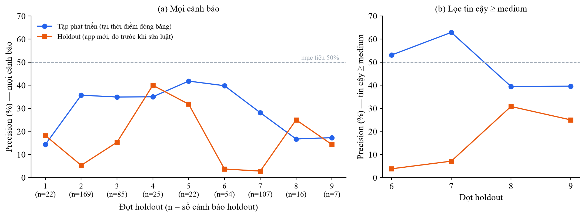

*Hình 3.7. Precision trên tập phát triển (tại thời điểm đóng băng) và trên holdout qua các đợt*

Precision trên ứng dụng mới dao động từ 2,8% đến 40% và không hội tụ theo thời gian, trong khi precision đo trên chính các ứng
dụng đã dùng để chỉnh luật là 40–63% ở ngưỡng ≥ medium (Hình 3.7). Mục tiêu precision ≥ 50% trên ứng dụng mới chưa đạt. Nguyên
nhân là mỗi lĩnh vực ứng dụng sinh ra một lớp báo nhầm mới mà luật chưa gặp: đợt 2 làm lộ việc nhận nhầm hàng trăm tên khoá cơ sở
dữ liệu là bí mật; đợt 3 làm lộ namespace của giao thức XMPP; đợt 6 cho thấy ứng dụng quản lý mật khẩu có từ vựng trùng đúng các
từ khoá mà luật dùng để tìm (password, token, secret).

### 3.5.4. Hiệu quả của điểm tin cậy và phân tích theo luật

Trên 19 ứng dụng, phiên bản cuối của công cụ đưa ra 331 cảnh báo, trong đó 57 cảnh báo đúng (Bảng 3.11, Hình 3.8).

*Bảng 3.11. Precision theo tầng tin cậy trên 19 ứng dụng*

| Tầng | Riêng tầng | Cộng dồn từ tầng đó trở lên |
|---|---|---|
| high | 80,6% (25/31) | 80,6% |
| medium | 27,1% (29/107) | 39,1% (54/138) |
| low | 1,6% (3/193) | 17,2% (57/331) |

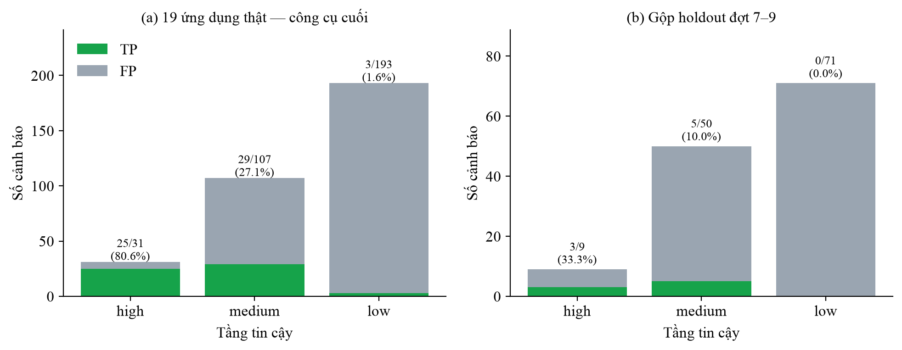

*Hình 3.8. Số cảnh báo đúng (TP) và nhầm (FP) theo tầng tin cậy*

Tầng low hoạt động như một bộ lọc nhiễu đáng tin cậy: chỉ 3/193 cảnh báo tầng low là lỗ hổng thật. Lọc ở ngưỡng ≥ medium giảm số
cảnh báo từ 331 xuống 138 (giảm 58,3%) mà chỉ mất 3/57 lỗ hổng thật, nghĩa là người kiểm tra chỉ cần đọc khoảng 40% số cảnh báo.
Tuy nhiên, precision tầng high phụ thuộc mạnh vào quy ước gán nhãn: 22/25 cảnh báo đúng ở tầng này là cấu hình mạng hoặc sao lưu
ở cấp toàn ứng dụng; nếu coi nhóm này là hành vi có chủ đích thì precision tầng high chỉ còn 9,7%.

Bảng 3.12 cho thấy precision khác nhau rất nhiều giữa các luật.

*Bảng 3.12. Precision theo luật trên 19 ứng dụng*

| Luật | Đúng / tổng | Precision | Lớp báo nhầm chính |
|---|---|---|---|
| NET-NSC, NET-TRUST, NET-CLEAR | 19/19 | 100% | — |
| CFG-BACKUP | 6/11 | 54,5% | Có quy tắc chỉ sao lưu dữ liệu không nhạy cảm |
| CFG-EXPORT | 12/43 | 27,9% | Activity chỉ mở giao diện; thành phần có kiểm tra quyền trong mã |
| NET-HTTP | 9/39 | 23,1% | Hằng `"http://"` dùng để so sánh; URL mẫu; liên kết mở trình duyệt |
| WEB-IFACE | 5/22 | 22,7% | Cầu nối tới trang cục bộ hoặc trang tin cậy |
| CRY-KEYLIT | 2/36 | 5,6% | Nhãn trường, tên tham số, đường dẫn API, khoá công khai |
| LOG-SENS | 2/40 | 5,0% | Tên lớp chứa từ khoá; thông điệp nối với giá trị không nhạy cảm |
| STO-EXT | 2/75 | 2,7% | Tệp xuất hoặc cache do người dùng chủ động |
| WEB-JS, CRY-HASH, CRY-WEAK, CRY-IV0, CRY-KEYHARD | 0/46 | 0% | JavaScript cần cho trang; hash không dùng cho bảo mật; mật mã do giao thức quy định |

Luật cấu hình có precision cao; luật dựa trên từ khoá trong mã và luật mật mã có precision thấp. Đây là gợi ý trực tiếp cho việc áp
dụng: với ứng dụng của công ty, các luật cấu hình có thể dùng làm điều kiện chặn phát hành, còn các luật mã nguồn nên dùng làm danh
sách gợi ý để người kiểm tra rà soát.

### 3.5.5. Các phát hiện bảo mật trên ứng dụng thật

Khi rà soát cảnh báo, em ghi nhận một số phát hiện có giá trị, như Activity cắt ảnh của một thư viện phổ biến bị exported và trả
dữ liệu ảnh cho ứng dụng gọi, công cụ gỡ lỗi giao diện lọt vào bản phát hành ở ba ứng dụng, hay khoá API dịch vụ được nhúng cứng.
Đặc biệt có hai lỗ hổng mức nghiêm trọng cao ở thành phần exported không được bảo vệ của hai ứng dụng mã nguồn mở. Hai phát hiện
này được ẩn danh trong báo cáo cho tới khi nhà phát triển được thông báo theo quy trình công bố có trách nhiệm.

## 3.6. Đối chứng với MobSF

Để biết công cụ tốt hơn hay kém hơn giải pháp có sẵn, MobSF được chạy trên đúng 20 tệp APK và chấm bằng cùng định nghĩa nhãn. Vì
MobSF đưa ra quá nhiều cảnh báo, precision của MobSF được ước lượng từ 100 cảnh báo lấy ngẫu nhiên, kèm khoảng tin cậy 95% theo
phương pháp Wilson [14].

Hình 3.9 là trang tổng quan báo cáo của MobSF cho InsecureBankv2: điểm bảo mật 30/100, thống kê thành phần exported, và thông tin
chữ ký cho thấy tệp APK chỉ được ký theo lược đồ v1.

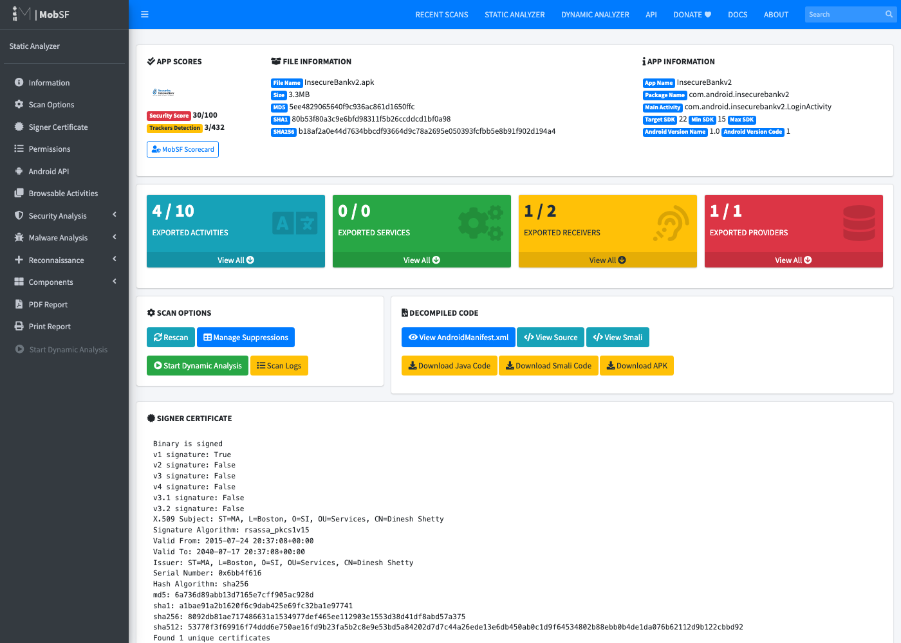

*Hình 3.9. Trang tổng quan báo cáo MobSF cho InsecureBankv2*

Hình 3.10 là mục phân tích mã trong báo cáo MobSF, sau khi bỏ tiền tố `com/android/` khỏi danh sách đường dẫn bỏ qua để MobSF quét
được mã của ứng dụng mẫu.

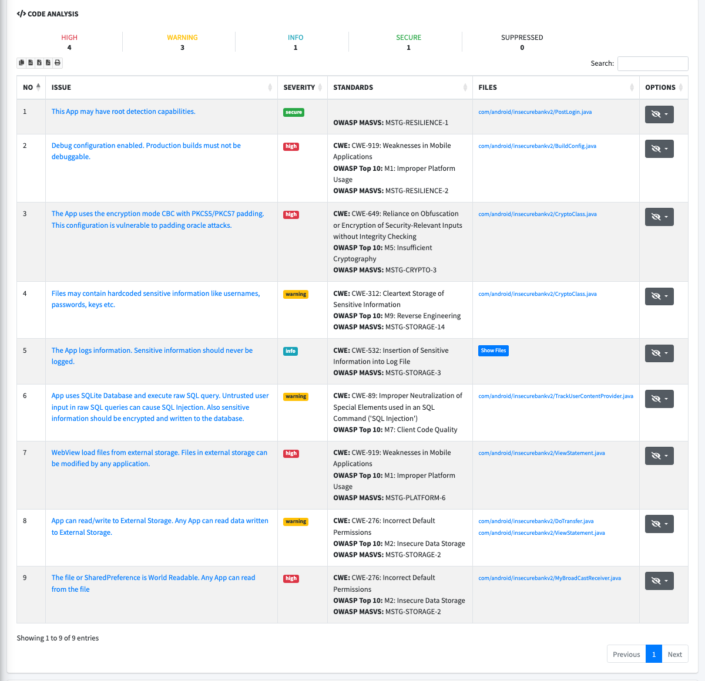

*Hình 3.10. Mục Code Analysis trong báo cáo MobSF*

*Bảng 3.13. Đối chứng apiscan với MobSF trên cùng tập ứng dụng và cùng định nghĩa nhãn*

| Chỉ số | apiscan | MobSF 4.5.4 |
|---|---|---|
| Lỗ hổng tĩnh của InsecureBankv2 phát hiện được (cấu hình mặc định) | 6/6 | 2/6 |
| Số cảnh báo trên 19 ứng dụng thật | 331 | 1.182 |
| Precision với mọi cảnh báo (khoảng tin cậy 95%) | 17,2% (13,5–21,7%) | 5,0% (2,2–11,2%) |
| Precision phần phân tích mã | 7,8% | 1,3% |
| Lỗ hổng thật của apiscan mà MobSF cũng báo | — | 41/57 |

Trên ứng dụng thật, số lỗ hổng thật hai công cụ tìm được là tương đương, nhưng người kiểm tra phải đọc số cảnh báo nhiều gấp khoảng
3,6 lần nếu dùng MobSF. Phần phân tích mã của MobSF gần như toàn báo nhầm: trong mẫu, 36/36 cảnh báo về bí mật viết cứng đều sai,
chủ yếu là tên khoá cài đặt hoặc chuỗi mô tả đối tượng. MobSF bỏ sót các URL `http://` được ghép chuỗi và các cầu nối JavaScript
nằm khác tệp với lệnh bật JavaScript. Ngược lại, MobSF tìm được một lỗ hổng mà `apiscan` bỏ sót, do mã của ứng dụng đó bị công cụ
tối ưu R8 dời sang package mặc định, nằm ngoài phạm vi `apiscan` tự suy; MobSF cũng kiểm tra chữ ký APK và thư viện theo dõi, hai
nội dung `apiscan` chưa có. Hai công cụ vì vậy bổ sung cho nhau hơn là thay thế nhau.

## 3.7. Đề xuất quy trình áp dụng tại công ty

Dựa trên kết quả đánh giá, em đề xuất quy trình kiểm tra bảo mật ba bước cho các ứng dụng Android trước khi phát hành (Hình 3.11),
áp dụng khi được công ty đồng ý:

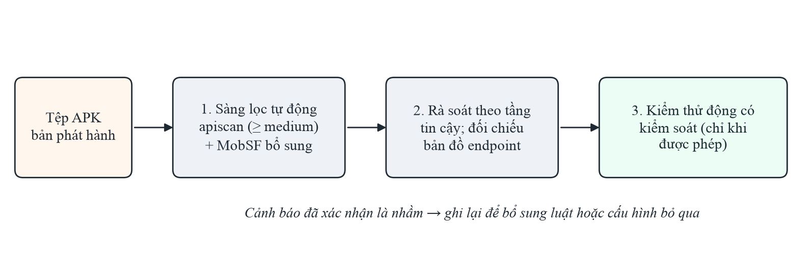

*Hình 3.11. Quy trình kiểm tra bảo mật đề xuất cho ứng dụng trước khi phát hành*

1. **Sàng lọc tự động:** chạy `apiscan` trên tệp APK bản phát hành ở ngưỡng tin cậy ≥ medium. Các cảnh báo cấu hình (cờ gỡ lỗi,
   sao lưu, cleartext, thành phần exported) có precision cao nên có thể dùng làm điều kiện chặn phát hành; có thể chạy thêm MobSF
   để kiểm tra chữ ký APK và thư viện theo dõi.
2. **Rà soát theo tầng tin cậy:** người kiểm tra xem các cảnh báo high trước, medium sau; dùng bản đồ điểm cuối để đối chiếu với
   danh sách API chính thức của ứng dụng, phát hiện điểm cuối thừa hoặc điểm cuối gỡ lỗi còn sót.
3. **Kiểm thử động có kiểm soát:** chỉ với những dấu hiệu cần xác nhận như xác thực, phân quyền API, và chỉ trên hệ thống được
   phép.

Các cảnh báo đã được xác nhận là nhầm nên được ghi lại, làm dữ liệu để bổ sung luật hoặc cấu hình bỏ qua cho từng ứng dụng. Với
danh mục nhiều ứng dụng dùng chung một bộ SDK như của công ty, những cảnh báo lặp lại ở mọi ứng dụng (do cùng một thư viện) chỉ cần
xác nhận một lần.

## 3.8. Kết quả và kinh nghiệm thu được

Qua kỳ thực tập, em rút ra một số kinh nghiệm:

- **Về kỹ thuật:** nắm được quy trình dịch ngược và phân tích bảo mật ứng dụng Android; biết cách đọc Manifest, nhận diện các nhóm
  lỗ hổng phổ biến trong mã thật; sử dụng thành thạo apktool, JADX, MobSF và REST API của MobSF; viết công cụ phân tích bằng
  Python có kiểm thử tự động.
- **Về đánh giá:** một con số đẹp trên dữ liệu quen thuộc không có nhiều ý nghĩa; cần đánh giá trên dữ liệu mới, gán nhãn có lý do
  và công bố rõ quy ước gán nhãn. Ngay cả tài liệu đáp án đi kèm ứng dụng mẫu cũng cần được kiểm chứng.
- **Về giải quyết sự cố:** khi gặp lỗi (MobSF không tạo báo cáo, không quét mã, tệp Word không mở được), cách hiệu quả nhất là thu
  hẹp vấn đề bằng các thử nghiệm nhỏ và kiểm chứng giả thuyết bằng nhật ký, mã nguồn, thay vì đoán.
- **Về quy trình làm việc:** quản lý mã nguồn bằng Git, lưu lại mọi lần chạy kèm minh chứng, ghi sổ tiến độ sau mỗi buổi làm việc,
  và viết bộ kiểm thử hồi quy trước khi sửa luật.
- **Về đạo đức nghề nghiệp:** chỉ phân tích ứng dụng được phép; không gửi yêu cầu tới máy chủ của bên thứ ba; thông báo có trách
  nhiệm cho nhà phát triển khi tìm thấy lỗ hổng.

# KẾT LUẬN

**1. Kết quả đạt được**

Trong thời gian thực tập tại Công ty BetaSoft, em đã hoàn thành các nhiệm vụ được giao:

- Tìm hiểu các nhóm lỗ hổng theo OWASP Mobile Top 10 – 2024 và OWASP API Security Top 10 – 2023, bộ tiêu chuẩn MASVS, kỹ thuật dịch
  ngược và phân tích tĩnh ứng dụng Android.
- Dựng môi trường làm việc với JADX, apktool và MobSF; xử lý các sự cố về tài nguyên máy và cấu hình công cụ.
- Phân tích thủ công InsecureBankv2, tìm được 11 nhóm điểm yếu thuộc 8 hạng mục OWASP, lập bản đồ 5 điểm cuối API, và phát hiện bốn
  mục mô tả sai trong tài liệu đáp án của ứng dụng mẫu.
- Xây dựng công cụ `apiscan` chạy bằng một lệnh, có 20 luật, bảy kỹ thuật giảm báo nhầm theo ngữ cảnh, tự suy phạm vi mã, điểm tin
  cậy cho từng cảnh báo, báo cáo HTML/JSON, bản đồ điểm cuối API và bộ kiểm thử hồi quy 19 nhóm.
- Đánh giá công cụ trung thực trên 19 ứng dụng mã nguồn mở với 589 nhãn có lý do và chín đợt holdout; đối chứng với MobSF trên cùng
  định nghĩa nhãn, cho thấy công cụ đạt precision 17,2% so với 5,0% của MobSF và giảm khoảng 3,6 lần số cảnh báo cần đọc.
- Đề xuất quy trình kiểm tra bảo mật ba bước có thể áp dụng cho các ứng dụng của công ty.

**2. Hạn chế của bài báo cáo**

- Precision trên ứng dụng mới (2,8–40% qua các đợt) chưa đạt mục tiêu 50%; luật dựa trên mẫu vẫn gặp lớp báo nhầm mới ở mỗi lĩnh
  vực ứng dụng.
- Việc gán nhãn do một người thực hiện; recall trên ứng dụng thực tế chưa đo được vì nhãn chỉ gán cho cảnh báo công cụ đưa ra.
- Công cụ chưa được áp dụng trên ứng dụng của công ty vì cần sự đồng ý bằng văn bản; phần kiểm thử động chưa được thực hiện.

**3. Hướng phát triển**

- Mở rộng phân tích luồng dữ liệu ra ngoài phạm vi một tệp, và cải tiến bộ suy phạm vi cho mã bị R8 dời vào package mặc định.
- Bổ sung kiểm tra chữ ký APK và nhận diện thư viện bên thứ ba (M2), chế độ quét hàng loạt nhiều tệp APK kèm bảng tổng hợp, cơ chế
  bỏ qua cảnh báo đã xác nhận và cấu hình luật bằng tệp.
- Khi được phép, áp dụng công cụ vào quy trình phát hành ứng dụng của công ty và kết hợp kiểm thử động trên hệ thống được phép.

# TÀI LIỆU THAM KHẢO

[1] OWASP Foundation, "OWASP Mobile Top 10 – 2024", https://owasp.org/www-project-mobile-top-10/.

[2] OWASP Foundation, "OWASP API Security Top 10 – 2023", https://owasp.org/API-Security/editions/2023/en/0x11-t10/.

[3] Google, "Application fundamentals — Android Developers", https://developer.android.com/guide/components/fundamentals.

[4] Google, "Network security configuration — Android Developers", https://developer.android.com/privacy-and-security/security-config.

[5] iBotPeaches, "Apktool — A Tool for Reverse Engineering Android APK Files", https://apktool.org/.

[6] Skylot, "JADX — Dex to Java Decompiler", https://github.com/skylot/jadx.

[7] S. Arzt và cộng sự, "FlowDroid: Precise Context, Flow, Field, Object-sensitive and Lifecycle-aware Taint Analysis for Android Apps", PLDI 2014, pp. 259–269.

[8] MobSF Development Team, "Mobile Security Framework (MobSF)", https://github.com/MobSF/Mobile-Security-Framework-MobSF.

[9] V.-P. Ranganath, J. Mitra, "Are Free Android App Security Analysis Tools Effective in Detecting Known Vulnerabilities?", Empirical Software Engineering, Vol. 25, 2020, pp. 178–219.

[10] D. Shetty, "Android-InsecureBankv2", https://github.com/dineshshetty/Android-InsecureBankv2.

[11] OWASP Foundation, "OWASP Mobile Application Security Verification Standard (MASVS)", https://mas.owasp.org/MASVS/.

[12] OWASP Foundation, "OWASP Mobile Application Security Testing Guide (MASTG)", https://mas.owasp.org/MASTG/.

[13] F-Droid, "F-Droid — Free and Open Source Android App Repository", https://f-droid.org/.

[14] E. B. Wilson, "Probable Inference, the Law of Succession, and Statistical Inference", Journal of the American Statistical Association, Vol. 22, No. 158, 1927, pp. 209–212.
