# LỜI MỞ ĐẦU

**Tính cấp thiết của đề tài.** Ứng dụng di động ngày nay giữ những dữ liệu nhạy cảm nhất của người dùng: thông tin đăng
nhập, dữ liệu tài chính, tin nhắn, dữ liệu sức khoẻ. Trên nền tảng Android, mỗi ứng dụng được phân phối dưới dạng một tệp
APK mà bất kỳ ai cũng có thể tải về và mở ra. Điều này có hai mặt. Kẻ tấn công có thể dịch ngược tệp APK để tìm khoá bí
mật, điểm cuối API ẩn hay thành phần bị mở cho ứng dụng khác gọi tới. Ngược lại, người kiểm thử bảo mật có thể dùng chính
kỹ thuật đó để phát hiện và khắc phục các điểm yếu trước khi ứng dụng đến tay người dùng. Kỹ thuật này gọi là phân tích
tĩnh: kiểm tra ứng dụng bằng cách đọc mã và cấu hình mà không cần chạy ứng dụng.

Danh sách OWASP Mobile Top 10 phiên bản 2024 [1] cho thấy phần lớn các nhóm rủi ro hàng đầu của ứng dụng di động có dấu
hiệu nằm ngay trong tệp APK: thông tin xác thực viết cứng trong mã, cấu hình cho phép giao tiếp không mã hoá, thành phần
exported không được bảo vệ, lưu trữ dữ liệu nhạy cảm không an toàn, hay sử dụng mật mã sai cách. Nắm vững kỹ thuật phân
tích tĩnh vì vậy là kiến thức cơ sở cần thiết cho sinh viên chuyên ngành An toàn thông tin muốn làm việc trong lĩnh vực
kiểm thử bảo mật ứng dụng di động.

**Mục tiêu của chuyên đề.** Chuyên đề hướng tới ba mục tiêu:

1. Hệ thống hoá kiến thức nền tảng về kiến trúc ứng dụng Android, cấu trúc tệp APK, các cơ chế bảo mật của nền tảng và
   các nhóm lỗ hổng theo OWASP Mobile Top 10 – 2024.
2. Tìm hiểu kỹ thuật phân tích tĩnh mà các công cụ tự động sử dụng để phát hiện lỗ hổng ứng dụng Android: dịch ngược, các
   kỹ thuật phát hiện lỗ hổng, các công cụ phổ biến và giới hạn của phương pháp.
3. Thực hành phân tích tĩnh một ứng dụng có lỗ hổng có chủ đích (InsecureBankv2), tập trung vào các điểm yếu liên quan
   tới giao tiếp API (thông tin xác thực, kênh truyền, điểm cuối ẩn, thành phần exported); ánh xạ các điểm yếu tìm được vào
   OWASP Mobile Top 10 – 2024, so sánh khả năng của ba công cụ và đề xuất biện pháp khắc phục.

**Đối tượng và phạm vi.** Đối tượng nghiên cứu là các kỹ thuật và công cụ phân tích tĩnh tệp APK. Phạm vi thực hành giới
hạn ở ứng dụng InsecureBankv2 [14], một ứng dụng ngân hàng được xây dựng có chủ đích để chứa lỗ hổng phục vụ học tập. Chuyên
đề chỉ phân tích tĩnh tệp APK, không chạy ứng dụng và không gửi yêu cầu tới bất kỳ máy chủ nào. Các lỗ hổng chỉ phát hiện
được khi ứng dụng chạy (phân tích động) hoặc nằm ở phía máy chủ không thuộc phạm vi chuyên đề.

**Phương pháp thực hiện.** Chuyên đề kết hợp nghiên cứu tài liệu (tài liệu chính thức của Android, các tiêu chuẩn OWASP,
tài liệu của công cụ, bài báo khoa học) với thực nghiệm trên máy tính cá nhân. Mọi con số trong chương thực nghiệm đều thu
từ lần chạy thật, kèm tập lệnh để tái lập.

**Bố cục.** Ngoài lời mở đầu và kết luận, báo cáo gồm ba chương:

- Chương 1 trình bày tổng quan về ứng dụng Android và bảo mật ứng dụng di động: kiến trúc nền tảng và các mốc phiên bản,
  cấu trúc tệp APK, các thành phần ứng dụng, các cơ chế bảo mật, OWASP Mobile Top 10 – 2024 và OWASP API Security Top 10 –
  2023.
- Chương 2 trình bày kỹ thuật phân tích tĩnh ứng dụng Android: so sánh với phân tích động, quy trình dịch ngược, các kỹ
  thuật phát hiện lỗ hổng, các công cụ phổ biến và những thách thức của phương pháp.
- Chương 3 thực hành phân tích tĩnh InsecureBankv2: quy trình, các điểm yếu tìm được bằng phân tích thủ công, kết quả
  phân tích tự động bằng MobSF (kèm ảnh chụp báo cáo), so sánh ba công cụ, thử nghiệm về báo nhầm khi tìm kiếm theo mẫu
  và đề xuất khắc phục.

# CHƯƠNG 1. TỔNG QUAN VỀ ỨNG DỤNG ANDROID VÀ BẢO MẬT ỨNG DỤNG DI ĐỘNG

Chương này trình bày các kiến thức nền tảng cần có trước khi phân tích một ứng dụng Android: ứng dụng được đóng gói như
thế nào, gồm những thành phần nào, giao tiếp với ứng dụng khác ra sao, nền tảng cung cấp những cơ chế bảo vệ nào, và các
nhóm rủi ro phổ biến nhất theo OWASP.

## 1.1. Kiến trúc nền tảng Android

Android là hệ điều hành mã nguồn mở xây dựng trên nhân Linux. Kiến trúc của nền tảng gồm nhiều tầng: nhân Linux quản lý
tiến trình, bộ nhớ và trình điều khiển phần cứng; tầng trừu tượng phần cứng; môi trường thực thi Android Runtime (ART) cùng
các thư viện gốc; khung ứng dụng (Android Framework) cung cấp các dịch vụ hệ thống như quản lý Activity, quản lý gói,
quản lý thông báo; và trên cùng là các ứng dụng [4], [9].

Ứng dụng Android thường được viết bằng Java hoặc Kotlin. Mã nguồn được biên dịch thành bytecode Java, sau đó được chuyển
thành bytecode Dalvik và đóng gói trong các tệp `classes.dex` [16]. Từ Android 5.0, ART thay thế máy ảo Dalvik. ART biên dịch
bytecode Dalvik thành mã máy khi cài đặt hoặc khi chạy, nhưng định dạng DEX trong tệp APK vẫn giữ nguyên. Đặc điểm này
quan trọng với phân tích tĩnh: bytecode Dalvik giữ lại khá nhiều thông tin của mã nguồn gốc (tên lớp, tên phương thức,
hằng chuỗi, kiểu dữ liệu), nên có thể dịch ngược về mã Java gần đúng.

Nền tảng cô lập các ứng dụng với nhau bằng cơ chế hộp cát (sandbox). Mỗi ứng dụng khi cài đặt được cấp một mã định danh
người dùng Linux (UID) riêng và chạy trong tiến trình riêng. Dữ liệu trong thư mục riêng của ứng dụng
(`/data/data/<tên gói>`) chỉ tiến trình mang UID đó truy cập được [9]. Vì vậy, phần lớn lỗ hổng của ứng dụng Android không
đến từ việc phá vỡ sandbox, mà đến từ việc chính ứng dụng tự mở dữ liệu hoặc chức năng ra ngoài sandbox: lưu dữ liệu ở
bộ nhớ dùng chung, mở thành phần cho ứng dụng khác gọi tới, hay gửi dữ liệu qua kênh không mã hoá.

Mỗi phiên bản Android tương ứng với một mức API (API level). Ứng dụng khai báo hai giá trị trong Manifest:
`minSdkVersion` là phiên bản thấp nhất có thể cài đặt, còn `targetSdkVersion` là phiên bản mà ứng dụng được thiết kế để chạy.
Giá trị `targetSdkVersion` đặc biệt quan trọng với bảo mật: để không làm hỏng ứng dụng cũ, nhiều thay đổi an toàn hơn của
nền tảng chỉ áp dụng cho ứng dụng nhắm tới mức API đủ mới. Vì vậy, một ứng dụng cài trên điện thoại chạy Android mới nhưng
có `targetSdkVersion` thấp vẫn mang các hành vi mặc định kém an toàn của phiên bản cũ. Bảng 1.1 liệt kê các mốc liên quan
tới nội dung chuyên đề [5], [6], [7], [15].

*Bảng 1.1. Một số thay đổi bảo mật của Android theo mức API*

| Phiên bản (API) | Thay đổi liên quan tới bảo mật | Điều kiện áp dụng |
|---|---|---|
| Android 4.2 (17) | ContentProvider mặc định không exported; chế độ `MODE_WORLD_READABLE/WRITEABLE` bị đánh dấu lỗi thời | `targetSdkVersion` ≥ 17 (với provider) |
| Android 6.0 (23) | Quyền nguy hiểm phải được người dùng cấp khi chạy (runtime permission) | `targetSdkVersion` ≥ 23 |
| Android 7.0 (24) | Có network security configuration; mặc định không tin CA do người dùng cài; lược đồ ký APK v2; dùng `MODE_WORLD_*` gây `SecurityException` | `targetSdkVersion` ≥ 24 (trừ lược đồ ký) |
| Android 9 (28) | Chặn giao tiếp cleartext theo mặc định; lược đồ ký APK v3 | `targetSdkVersion` ≥ 28 (với cleartext) |
| Android 10–11 (29–30) | Lưu trữ theo phạm vi (scoped storage) hạn chế truy cập bộ nhớ ngoài dùng chung, bắt buộc từ API 30 | `targetSdkVersion` ≥ 29/30 |
| Android 12 (31) | Bắt buộc khai báo `android:exported` cho thành phần có `<intent-filter>`; `adb backup` không còn lấy dữ liệu ứng dụng | `targetSdkVersion` ≥ 31 |

Ứng dụng thực nghiệm ở Chương 3 có `minSdkVersion` 15 và `targetSdkVersion` 22, tức là nằm trước hầu hết các mốc trong
bảng; nhiều điểm yếu tìm được ở Chương 3 bắt nguồn trực tiếp từ điều này.

## 1.2. Cấu trúc tệp APK

Tệp APK (Android Package) thực chất là một tệp nén định dạng ZIP chứa toàn bộ những gì cần để cài đặt ứng dụng (Hình
1.1, Bảng 1.2).

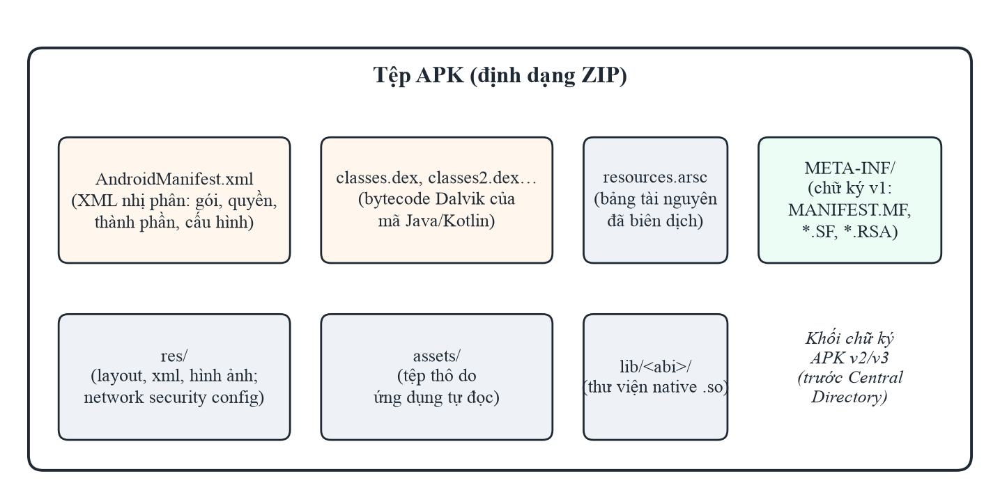

*Hình 1.1. Cấu trúc của một tệp APK*

*Bảng 1.2. Các thành phần chính của tệp APK và giá trị đối với phân tích tĩnh*

| Thành phần | Nội dung | Giá trị đối với phân tích tĩnh |
|---|---|---|
| `AndroidManifest.xml` | Tên gói, phiên bản SDK, quyền, khai báo các thành phần, cờ cấu hình (`allowBackup`, `debuggable`, `usesCleartextTraffic`…) | Nguồn chính để tìm lỗi cấu hình và bề mặt tấn công qua thành phần exported |
| `classes*.dex` | Bytecode Dalvik của toàn bộ mã ứng dụng và thư viện | Dịch ngược để tìm khoá viết cứng, URL, cách dùng mật mã, cách lưu dữ liệu |
| `resources.arsc`, `res/` | Chuỗi, bố cục giao diện, tệp XML cấu hình (gồm network security config) | Tìm khoá/URL trong tài nguyên, cấu hình mạng |
| `assets/` | Tệp thô ứng dụng tự đọc (cấu hình, cơ sở dữ liệu mẫu, mã JavaScript) | Có thể chứa bí mật hoặc mã web nhúng |
| `lib/<abi>/` | Thư viện native (`.so`) cho từng kiến trúc CPU | Cần công cụ phân tích mã máy; ngoài phạm vi dịch ngược Java |
| `META-INF/` và khối chữ ký | Chữ ký theo lược đồ v1 (JAR) và khối chữ ký v2/v3 | Kiểm tra lược đồ ký, chứng chỉ ký |

Tệp `AndroidManifest.xml` và các tệp XML trong `res/` được lưu ở dạng XML nhị phân, không đọc trực tiếp được bằng trình
soạn thảo văn bản; cần công cụ giải mã như apktool để chuyển về dạng văn bản (mục 2.2).

Về chữ ký, Android hỗ trợ nhiều lược đồ ký APK [7]. Lược đồ v1 dựa trên chữ ký JAR, chỉ bảo vệ từng tệp trong ZIP, và là
gốc của lỗ hổng Janus trên các phiên bản Android cũ. Lược đồ v2 (từ Android 7.0) và v3 (từ Android 9, hỗ trợ xoay vòng
khoá) ký toàn bộ tệp APK. Chữ ký bảo đảm bản cập nhật đến từ cùng một nhà phát triển, nhưng không ngăn được việc dịch
ngược: bất kỳ ai cũng đọc được nội dung tệp APK.

## 1.3. Các thành phần ứng dụng và giao tiếp liên tiến trình

Một ứng dụng Android được xây dựng từ bốn loại thành phần, mỗi loại là một điểm vào mà hệ thống hoặc ứng dụng khác có
thể kích hoạt [4] (Hình 1.2):

- **Activity:** một màn hình giao diện. Ứng dụng khác có thể mở Activity bằng `startActivity()` nếu Activity đó cho phép.
- **Service:** thành phần chạy tác vụ nền không có giao diện, ví dụ phát nhạc hay đồng bộ dữ liệu.
- **BroadcastReceiver:** thành phần nhận thông báo sự kiện (broadcast) từ hệ thống hoặc từ ứng dụng khác.
- **ContentProvider:** thành phần chia sẻ dữ liệu có cấu trúc, được truy cập qua URI dạng `content://` bằng các thao tác
  truy vấn, thêm, sửa, xoá.

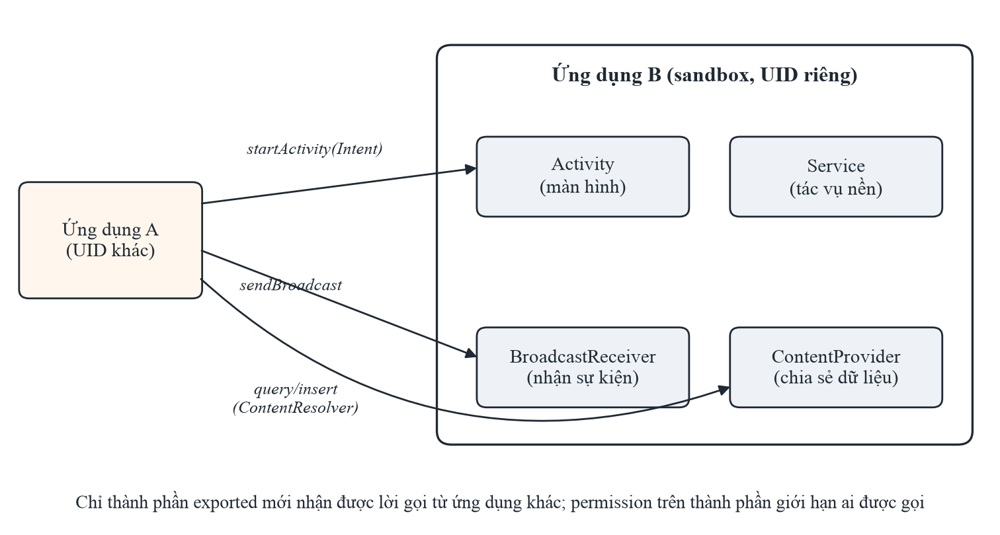

*Hình 1.2. Các thành phần ứng dụng và giao tiếp giữa hai ứng dụng*

Các thành phần giao tiếp với nhau qua đối tượng **Intent**, một thông điệp mô tả hành động cần thực hiện cùng dữ liệu
kèm theo (extra). Intent tường minh chỉ rõ thành phần đích; Intent ngầm định chỉ mô tả hành động và để hệ thống chọn thành
phần phù hợp dựa trên bộ lọc `<intent-filter>` khai báo trong Manifest.

Thuộc tính **`android:exported`** quyết định một thành phần có nhận lời gọi từ ứng dụng khác hay không. Trước Android 12,
thành phần có `<intent-filter>` mặc định là exported nếu không khai báo; từ Android 12, ứng dụng nhắm tới API 31 trở lên
bắt buộc phải khai báo rõ thuộc tính này [15]. Một thành phần exported mà không có thuộc tính `android:permission` có thể
bị bất kỳ ứng dụng nào trên thiết bị gọi tới. Nếu thành phần đó tin tưởng dữ liệu trong Intent, hoặc thực hiện thao tác
nhạy cảm mà không kiểm tra người gọi, kẻ tấn công có thể lợi dụng nó: mở màn hình đáng lẽ chỉ hiện sau khi đăng nhập,
đọc dữ liệu qua ContentProvider, hay kích hoạt chức năng qua BroadcastReceiver. Tuy nhiên, không phải thành phần exported
nào cũng là lỗ hổng: Activity khởi chạy (LAUNCHER), dịch vụ đồng bộ hay receiver của widget buộc phải exported theo thiết
kế của nền tảng. Phân biệt hai trường hợp này là một trong những khó khăn chính của phân tích tĩnh (mục 2.6).

## 1.4. Các cơ chế bảo mật của nền tảng liên quan tới phân tích tĩnh

Bên cạnh sandbox, nền tảng Android cung cấp nhiều cơ chế bảo mật mà nhà phát triển phải cấu hình đúng. Các cơ chế dưới
đây đều được khai báo trong tệp APK, nên phân tích tĩnh có thể kiểm tra trực tiếp.

**Mô hình quyền (permission).** Ứng dụng khai báo quyền cần dùng bằng `<uses-permission>`. Quyền được chia theo mức bảo
vệ (protection level): `normal` được cấp tự động, `dangerous` cần người dùng đồng ý, `signature` chỉ cấp cho ứng dụng ký
cùng chứng chỉ. Ứng dụng cũng có thể tự định nghĩa quyền để bảo vệ thành phần exported của mình; khi đó mức bảo vệ của
quyền quyết định ai được gọi thành phần.

**Cấu hình an toàn mạng (network security configuration).** Từ Android 7.0, ứng dụng có thể khai báo một tệp XML để cấu
hình chính sách mạng: có cho phép giao tiếp HTTP không mã hoá (cleartext) hay không, tin tưởng những chứng chỉ gốc nào,
có ghim chứng chỉ (certificate pinning) hay không, áp dụng cho toàn ứng dụng hay từng tên miền [5]. Với ứng dụng nhắm tới
Android 9 (API 28) trở lên, giao tiếp cleartext bị chặn theo mặc định; ứng dụng nhắm tới API thấp hơn thì vẫn được phép.
Cũng từ Android 7.0, ứng dụng nhắm tới API 24 trở lên mặc định không tin chứng chỉ gốc do người dùng tự cài, trừ khi cấu
hình cho phép.

**Sao lưu dữ liệu.** Thuộc tính `android:allowBackup` (mặc định `true`) cho phép sao lưu dữ liệu ứng dụng [6]. Trên các
phiên bản Android cũ, người có quyền truy cập vật lý và bật gỡ lỗi USB có thể dùng lệnh `adb backup` để trích toàn bộ dữ
liệu riêng của ứng dụng (cơ sở dữ liệu, SharedPreferences) mà không cần root. Từ Android 12, với ứng dụng nhắm tới API 31
trở lên, `adb backup` không còn lấy được dữ liệu ứng dụng, trừ ứng dụng đặt cờ `debuggable`.

**Cờ gỡ lỗi.** Thuộc tính `android:debuggable="true"` cho phép gắn trình gỡ lỗi vào tiến trình và chạy lệnh trong ngữ cảnh
của ứng dụng (`run-as`), tức là đọc được toàn bộ dữ liệu riêng. Cờ này không được phép xuất hiện trong bản phát hành.

**Lưu trữ dữ liệu.** Ứng dụng có thể lưu dữ liệu ở bộ nhớ riêng (thư mục riêng, SharedPreferences, SQLite) hoặc bộ nhớ
ngoài dùng chung. Trên các phiên bản Android trước khi có cơ chế lưu trữ theo phạm vi (scoped storage), tệp ở bộ nhớ ngoài
có thể bị bất kỳ ứng dụng nào có quyền đọc bộ nhớ truy cập. Các chế độ `MODE_WORLD_READABLE` và `MODE_WORLD_WRITEABLE` cho
phép mọi ứng dụng đọc/ghi tệp riêng; hai chế độ này đã bị loại bỏ từ API 17 và gây lỗi `SecurityException` với ứng dụng
nhắm tới API 24 trở lên. Dữ liệu bí mật nên được bảo vệ bằng khoá lưu trong Android Keystore, nơi khoá không thể trích
xuất ra khỏi thiết bị.

**Làm rối mã.** Công cụ R8 (trước đây là ProGuard) trong quá trình build có thể thu gọn mã, đổi tên lớp và phương thức
thành tên ngắn vô nghĩa [8]. Làm rối mã không phải biện pháp bảo vệ bí mật (hằng chuỗi vẫn còn nguyên), nhưng làm tăng
đáng kể công sức đọc hiểu mã dịch ngược.

## 1.5. OWASP Mobile Top 10 – 2024 và bộ tiêu chuẩn MASVS/MASTG

OWASP (Open Worldwide Application Security Project) là tổ chức phi lợi nhuận về an toàn ứng dụng. Danh sách OWASP Mobile
Top 10 phiên bản 2024 [1] là bản cập nhật lớn đầu tiên kể từ năm 2016, xếp hạng mười nhóm rủi ro phổ biến nhất của ứng
dụng di động (Bảng 1.3). Cột cuối của bảng là đánh giá của chuyên đề về khả năng phát hiện dấu hiệu của từng nhóm bằng
phân tích tĩnh, dựa trên nội dung của từng nhóm và các cơ chế đã trình bày ở mục 1.4.

*Bảng 1.3. OWASP Mobile Top 10 – 2024 và khả năng phát hiện bằng phân tích tĩnh*

| Mã | Tên rủi ro | Ví dụ dấu hiệu trong tệp APK | Phân tích tĩnh |
|---|---|---|---|
| M1 | Improper Credential Usage | Mật khẩu, khoá API viết cứng trong mã hoặc tài nguyên | Tốt |
| M2 | Inadequate Supply Chain Security | Thư viện bên thứ ba lỗi thời hoặc có lỗ hổng đã biết | Một phần (nhận diện thư viện) |
| M3 | Insecure Authentication/Authorization | Điểm cuối đăng nhập ẩn, kiểm tra quyền chỉ ở phía ứng dụng | Một phần |
| M4 | Insufficient Input/Output Validation | Truy vấn SQL ghép chuỗi, WebView nạp dữ liệu không kiểm tra | Một phần |
| M5 | Insecure Communication | URL `http://`, cấu hình cho phép cleartext, bỏ qua kiểm tra chứng chỉ | Tốt |
| M6 | Inadequate Privacy Controls | Thu thập dữ liệu cá nhân, ghi dữ liệu cá nhân vào log | Một phần |
| M7 | Insufficient Binary Protections | Không làm rối mã, không phát hiện root/giả mạo | Tốt |
| M8 | Security Misconfiguration | `debuggable`, `allowBackup`, thành phần exported không bảo vệ | Tốt |
| M9 | Insecure Data Storage | Dữ liệu nhạy cảm trong SharedPreferences, bộ nhớ ngoài, log | Tốt (dấu hiệu) |
| M10 | Insufficient Cryptography | Khoá viết cứng, IV cố định, thuật toán/chế độ yếu (DES, ECB, MD5) | Tốt |

Dưới đây là mô tả ngắn từng nhóm rủi ro cùng dấu hiệu điển hình trên ứng dụng Android:

- **M1 – Improper Credential Usage:** mật khẩu, khoá API hay token viết cứng trong mã hoặc tài nguyên (`strings.xml`,
  `BuildConfig`), hoặc thông tin xác thực bị truyền, lưu trữ không an toàn. Vì tệp APK có thể dịch ngược, mọi bí mật đóng
  gói trong ứng dụng đều phải coi như đã lộ.
- **M2 – Inadequate Supply Chain Security:** rủi ro từ thư viện và SDK bên thứ ba (phiên bản có lỗ hổng đã biết, SDK thu
  thập dữ liệu ngoài ý muốn), từ quy trình build và từ việc quản lý khoá ký ứng dụng.
- **M3 – Insecure Authentication/Authorization:** xác thực yếu, kiểm tra phân quyền chỉ ở phía ứng dụng, điểm cuối gỡ lỗi
  bỏ qua đăng nhập, hay màn hình sau đăng nhập có thể mở trực tiếp từ ứng dụng khác.
- **M4 – Insufficient Input/Output Validation:** không kiểm tra dữ liệu vào và ra, dẫn tới SQL injection trong
  ContentProvider, chèn mã JavaScript vào WebView, duyệt đường dẫn (path traversal) khi xử lý tệp nhận từ Intent.
- **M5 – Insecure Communication:** dùng HTTP thay vì HTTPS, chấp nhận mọi chứng chỉ, tắt kiểm tra tên máy chủ, tin chứng chỉ
  do người dùng cài, hay không ghim chứng chỉ với ứng dụng có yêu cầu bảo mật cao.
- **M6 – Inadequate Privacy Controls:** thu thập, ghi log hoặc chia sẻ dữ liệu cá nhân vượt quá nhu cầu chức năng; xin quyền
  truy cập danh bạ, vị trí, hồ sơ mà chức năng không cần.
- **M7 – Insufficient Binary Protections:** không làm rối mã, không phát hiện root, gỡ lỗi hay giả mạo, khiến việc dịch
  ngược, sửa đổi và đóng gói lại ứng dụng trở nên dễ dàng.
- **M8 – Security Misconfiguration:** cờ `debuggable`, `allowBackup`, thành phần exported không được bảo vệ, cấu hình mạng
  cho phép cleartext, quyền truy cập tệp quá rộng.
- **M9 – Insecure Data Storage:** dữ liệu nhạy cảm lưu dạng rõ trong SharedPreferences, SQLite, bộ nhớ ngoài, bộ nhớ đệm hay
  nhật ký hệ thống.
- **M10 – Insufficient Cryptography:** thuật toán lỗi thời (DES, RC4, MD5/SHA-1 để băm mật khẩu), chế độ ECB, IV cố định,
  khoá viết cứng, hay dùng bộ sinh số ngẫu nhiên không an toàn cho mục đích mật mã.

Bên cạnh danh sách Top 10 mang tính nhận thức, OWASP còn duy trì hai tài liệu chi tiết hơn. MASVS (Mobile Application
Security Verification Standard) [2] là tiêu chuẩn yêu cầu bảo mật, chia theo các nhóm như lưu trữ (STORAGE), mật mã
(CRYPTO), xác thực (AUTH), mạng (NETWORK), nền tảng (PLATFORM), mã nguồn (CODE) và chống dịch ngược (RESILIENCE). MASTG
(Mobile Application Security Testing Guide) [3] là hướng dẫn kiểm thử, mô tả cách kiểm tra từng yêu cầu bằng phân tích
tĩnh và phân tích động. Trong chuyên đề này, OWASP Mobile Top 10 – 2024 được dùng để phân loại lỗ hổng, còn MASTG được dùng
làm tài liệu tham khảo cho quy trình kiểm thử.

## 1.6. Bảo mật API của ứng dụng di động theo OWASP API Security Top 10 – 2023

Ứng dụng di động hiện đại hầu như không tự xử lý nghiệp vụ mà đóng vai trò máy khách của các API trên máy chủ: đăng nhập,
lấy dữ liệu tài khoản, chuyển tiền đều là các lời gọi HTTP tới điểm cuối (endpoint) của máy chủ. Vì vậy, bảo mật của ứng
dụng di động gắn chặt với bảo mật API. OWASP duy trì riêng danh sách API Security Top 10, phiên bản mới nhất năm 2023 [18]
(Bảng 1.4).

*Bảng 1.4. OWASP API Security Top 10 – 2023 và dấu hiệu có thể quan sát từ tệp APK*

| Mã | Tên rủi ro | Dấu hiệu quan sát được từ tệp APK |
|---|---|---|
| API1 | Broken Object Level Authorization (BOLA) | Tham số định danh đối tượng (mã tài khoản, mã người dùng) do ứng dụng gửi lên; xác nhận lỗ hổng cần kiểm thử động |
| API2 | Broken Authentication | Cách ứng dụng gửi và lưu thông tin đăng nhập, token; điểm cuối đăng nhập phụ |
| API3 | Broken Object Property Level Authorization | Các trường dữ liệu ứng dụng gửi lên hoặc nhận về; cần kiểm thử động |
| API4 | Unrestricted Resource Consumption | Hầu như không quan sát được từ phía ứng dụng |
| API5 | Broken Function Level Authorization | Điểm cuối dành cho quản trị hoặc nhà phát triển xuất hiện trong mã ứng dụng |
| API6 | Unrestricted Access to Sensitive Business Flows | Luồng nghiệp vụ nhạy cảm (chuyển tiền, đổi mật khẩu) gọi trực tiếp tới API |
| API7 | Server Side Request Forgery | Tham số URL do ứng dụng gửi lên máy chủ |
| API8 | Security Misconfiguration | Giao tiếp không mã hoá, cấu hình TLS phía ứng dụng |
| API9 | Improper Inventory Management | Điểm cuối cũ, điểm cuối thử nghiệm hoặc gỡ lỗi còn được gọi trong bản phát hành |
| API10 | Unsafe Consumption of APIs | Ứng dụng tin tưởng dữ liệu nhận từ API bên thứ ba |

Phần lớn lỗ hổng API nằm ở logic phía máy chủ, nên phân tích tĩnh tệp APK không khẳng định được chúng. Tuy nhiên, phân tích
tĩnh đóng góp ba thông tin quan trọng cho kiểm thử API. Thứ nhất là **bản đồ điểm cuối**: danh sách các đường dẫn API mà ứng
dụng gọi tới, kể cả những điểm cuối không có trong tài liệu. Thứ hai là **cách ứng dụng xác thực với API**: thông tin đăng
nhập, khoá API hay token được gửi, lưu và bảo vệ ra sao. Thứ ba là **kênh truyền**: ứng dụng dùng HTTP hay HTTPS, có kiểm tra
chứng chỉ hay không. Ba thông tin này giúp người kiểm thử khoanh vùng các điểm cần kiểm thử động, việc chỉ được thực hiện
khi có sự cho phép của chủ hệ thống.

## 1.7. Kết luận chương 1

Chương 1 đã trình bày kiến trúc nền tảng Android, cấu trúc tệp APK, bốn loại thành phần ứng dụng cùng cơ chế giao tiếp qua
Intent, các cơ chế bảo mật của nền tảng danh sách OWASP Mobile Top 10 – 2024 và mối liên hệ với bảo mật API qua OWASP API Security Top 10 – 2023. Điểm then chốt rút ra là phần lớn dấu hiệu
lỗ hổng của ứng dụng Android nằm ngay trong tệp APK: trong Manifest (thành phần exported, cờ cấu hình), trong tài nguyên
(cấu hình mạng) và trong bytecode (khoá viết cứng, cách dùng mật mã, cách lưu dữ liệu). Đây là cơ sở để phân tích tĩnh trở
thành bước đầu tiên của quy trình kiểm thử bảo mật ứng dụng di động, được trình bày ở Chương 2.

# CHƯƠNG 2. KỸ THUẬT PHÂN TÍCH TĨNH ỨNG DỤNG ANDROID

Chương này trình bày khái niệm phân tích tĩnh, quy trình dịch ngược tệp APK, các kỹ thuật phát hiện lỗ hổng từ đơn giản
tới phức tạp, các công cụ phổ biến và những thách thức khiến phân tích tĩnh vừa bỏ sót vừa báo nhầm.

## 2.1. Phân tích tĩnh và phân tích động

Phân tích tĩnh (static analysis) là việc kiểm tra một chương trình mà không thực thi nó, bằng cách đọc mã nguồn, mã trung
gian hoặc tệp cấu hình. Phân tích động (dynamic analysis) ngược lại, quan sát hành vi của chương trình khi chạy: lưu lượng
mạng, tệp được ghi, lời gọi hàm. Với ứng dụng Android, phân tích động thường cần máy ảo hoặc thiết bị thật, máy chủ uỷ
nhiệm (proxy) như Burp Suite để chặn lưu lượng, và công cụ can thiệp thời gian chạy như Frida. Hai phương pháp bổ sung cho
nhau (Bảng 2.1).

*Bảng 2.1. So sánh phân tích tĩnh và phân tích động ứng dụng Android*

| Tiêu chí | Phân tích tĩnh | Phân tích động |
|---|---|---|
| Đầu vào | Tệp APK | Ứng dụng đang chạy trên thiết bị/máy ảo |
| Độ phủ mã | Toàn bộ mã, kể cả nhánh hiếm khi chạy | Chỉ những nhánh được kích hoạt khi thử |
| Hạ tầng cần có | Máy tính và công cụ dịch ngược | Thiết bị/máy ảo, proxy, công cụ can thiệp, máy chủ đích |
| Tốc độ, tự động hoá | Nhanh, dễ tự động hoá hàng loạt | Chậm hơn, cần kịch bản tương tác |
| Điểm mạnh | Khoá viết cứng, cấu hình sai, mật mã yếu, thành phần exported | Lỗi phía máy chủ, xác thực/phân quyền, dữ liệu thực sự được gửi/ghi |
| Điểm yếu | Báo nhầm cao; khó với mã làm rối, mã nạp động, mã native | Bỏ sót nhánh không được kích hoạt; bị cản bởi ghim chứng chỉ, phát hiện root |
| Yêu cầu pháp lý | Chỉ đọc tệp APK | Gửi yêu cầu tới máy chủ — cần sự cho phép của chủ ứng dụng |

Phân tích tĩnh vì vậy thường là bước đầu tiên: nó nhanh, không cần hạ tầng, không tác động tới hệ thống của người khác,
và chỉ ra những vị trí đáng nghi để phân tích động kiểm chứng sau.

## 2.2. Dịch ngược ứng dụng Android

Bước đầu tiên của phân tích tĩnh là đưa tệp APK về dạng con người đọc được. Có hai hướng dịch ngược bổ sung cho nhau
(Hình 2.1).

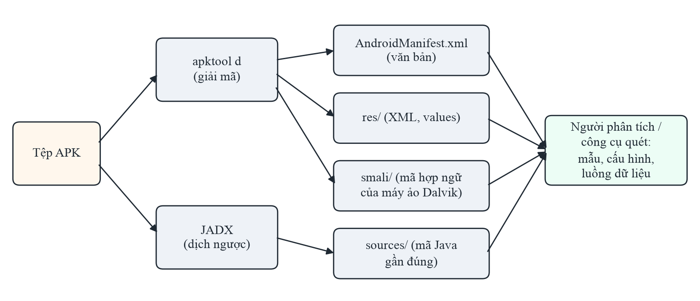

*Hình 2.1. Hai hướng dịch ngược tệp APK*

**Giải mã tài nguyên và hợp ngữ smali bằng apktool.** Apktool [11] giải mã `AndroidManifest.xml` và các tệp XML nhị phân
trong `res/` về dạng văn bản gần như nguyên bản, đồng thời chuyển bytecode DEX thành mã **smali**, một ngôn ngữ hợp ngữ cho
máy ảo Dalvik. Mã smali phản ánh chính xác từng lệnh bytecode, nên có thể sửa rồi đóng gói lại thành APK mới (dùng trong
kiểm thử chống giả mạo), nhưng khó đọc với khối lượng mã lớn. Ví dụ, một phép gán hằng chuỗi trong Java trở thành lệnh
`const-string` trong smali:

```
const-string v0, "This is the super secret key 123"
```

**Dịch ngược về mã Java bằng JADX.** JADX [12] dịch bytecode DEX trực tiếp về mã nguồn Java gần đúng, dễ đọc hơn smali nhiều
lần. Mã thu được không giống hệt mã gốc: tên biến cục bộ có thể bị mất, cấu trúc điều khiển có thể bị viết lại, và một số
phương thức phức tạp có thể không dịch ngược được. Tuy nhiên, với mục đích tìm lỗ hổng, mã Java gần đúng là đủ để đọc hiểu
logic, tìm hằng chuỗi và theo dõi luồng dữ liệu.

Cả hai công cụ đều dùng qua dòng lệnh. Dưới đây là kết quả thật khi chạy apktool 3.0.3 trên tệp InsecureBankv2.apk:

```
$ apktool d -f InsecureBankv2.apk -o OUT_CD/apktool
I: Using Apktool 3.0.3 on InsecureBankv2.apk with 8 threads
I: Loading resource table...
I: Baksmaling classes.dex...
I: Decoding value resources...
I: Loading resource table from file: ~/Library/apktool/framework/1.apk
I: Decoding file resources...
I: Generating values XMLs...
I: Decoding AndroidManifest.xml with resources...
I: Copying original files...
I: Copying unknown files...
```

Hình 2.2 là ảnh chụp cửa sổ Terminal khi chạy lệnh này.

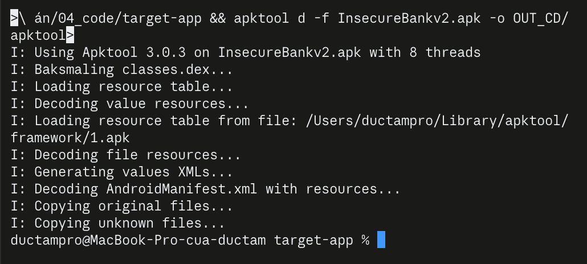

*Hình 2.2. Kết quả chạy apktool 3.0.3 trên InsecureBankv2 trong Terminal*

Các dòng nhật ký cho thấy đúng các bước đã mô tả (thứ tự hai dòng đầu có thể đổi giữa các lần chạy vì apktool xử lý song
song 8 luồng): nạp bảng tài nguyên, chuyển `classes.dex` thành smali (baksmali), giải mã
tài nguyên và Manifest. Thư mục kết quả gồm `AndroidManifest.xml`, `apktool.yml` (lưu phiên bản SDK và thông tin để đóng gói
lại), `original/`, `res/` và `smali/`. Với JADX, lệnh `jadx -d OUT_CD/jadx InsecureBankv2.apk` xử lý 2.291 lớp và sinh hai
thư mục `resources/` (tài nguyên) và `sources/` (mã Java):

```
$ jadx -d OUT_CD/jadx InsecureBankv2.apk
INFO  - loading ...
INFO  - processing ...
INFO  - progress: 0 of 2291 (0%) ... progress: 2283 of 2291 (99%)
INFO  - done
```

Trong thực hành, hai công cụ thường được dùng cùng nhau: apktool để đọc Manifest và tài nguyên, JADX để đọc mã. Kết quả
dịch ngược là đầu vào cho các kỹ thuật phát hiện lỗ hổng ở mục 2.3, dù người phân tích đọc thủ công hay công cụ quét tự
động.

## 2.3. Các kỹ thuật phát hiện lỗ hổng trong phân tích tĩnh

Các kỹ thuật phát hiện lỗ hổng có thể xếp theo độ phức tạp tăng dần như sau.

### 2.3.1. Phân tích cấu hình

Kỹ thuật đơn giản và đáng tin cậy nhất là đọc tệp cấu hình đã giải mã theo cấu trúc XML. Từ Manifest, có thể liệt kê các
cờ `debuggable`, `allowBackup`, `usesCleartextTraffic`, phiên bản SDK, và toàn bộ thành phần exported cùng permission bảo vệ
chúng. Từ tệp network security config, có thể biết ứng dụng có cho phép cleartext hay tin chứng chỉ do người dùng cài hay
không. Vì cấu hình có cấu trúc rõ ràng, kết quả ít bị nhầm. Khó khăn nằm ở việc diễn giải: cùng một cấu hình có thể là lỗ
hổng ở ứng dụng này nhưng là thiết kế bắt buộc ở ứng dụng khác (mục 1.3).

### 2.3.2. So khớp mẫu trên mã nguồn

Kỹ thuật phổ biến nhất trong các công cụ quét là so khớp mẫu: dùng biểu thức chính quy hoặc từ khoá để tìm các đoạn mã có
dấu hiệu nguy hiểm, ví dụ `Cipher.getInstance("AES/ECB…")`, chuỗi bắt đầu bằng `http://`, lời gọi `Log.d(` hay biến có tên
chứa `password`, `secret`, `key`. Ưu điểm là đơn giản, nhanh và dễ mở rộng: thêm một luật chỉ cần thêm một mẫu. Nhược
điểm là mẫu không hiểu ngữ cảnh. Chuỗi `"http://"` có thể là URL máy chủ thật, nhưng cũng có thể chỉ dùng để so sánh trong
hàm chuyển `http` thành `https`. Biến tên `PASSWORD_KEY` có thể chỉ là tên khoá trong SharedPreferences chứ không phải mật
khẩu. Do đó so khớp mẫu thường cho tỉ lệ báo nhầm cao; Chương 3 minh hoạ điều này bằng số liệu thật.

### 2.3.3. Phân tích cú pháp và luồng điều khiển

Thay vì xem mã như văn bản, công cụ có thể phân tích mã thành cây cú pháp trừu tượng (AST) hoặc đồ thị luồng điều khiển.
Khi đó luật có thể diễn đạt chính xác hơn: "lời gọi `Cipher.getInstance` với đối số là hằng chuỗi chứa `ECB`", thay vì
"dòng có chứa chữ ECB". Cách này loại được các trường hợp từ khoá nằm trong chú thích hay chuỗi không liên quan, nhưng chưa
biết được giá trị thực sự chảy vào lời gọi là gì.

### 2.3.4. Phân tích luồng dữ liệu và phân tích vết

Phân tích luồng dữ liệu theo dõi giá trị đi từ đâu tới đâu trong chương trình. Phân tích vết (taint analysis) là trường hợp
đặc biệt: đánh dấu dữ liệu từ một **nguồn** nhạy cảm (source), ví dụ mật khẩu người dùng nhập hay vị trí GPS, rồi kiểm tra
xem nó có chảy tới một **đích** nguy hiểm (sink) như lệnh ghi log, gửi SMS hay gửi qua mạng mà không qua bước làm sạch hay
không. FlowDroid [10] là công trình tiêu biểu cho Android: phân tích vết có xét tới vòng đời của các thành phần Android và
các lời gọi ngược (callback) do hệ thống kích hoạt. Phân tích luồng dữ liệu giảm báo nhầm đáng kể so với so khớp mẫu, nhưng
tốn nhiều tài nguyên tính toán, khó mở rộng cho ứng dụng lớn, và vẫn gặp khó với phản xạ (reflection) hay mã nạp động.

## 2.4. Các công cụ phân tích tĩnh phổ biến

Bảng 2.2 tóm tắt các công cụ được sử dụng trong chuyên đề.

*Bảng 2.2. Các công cụ phân tích tĩnh được sử dụng trong chuyên đề*

| Công cụ | Chức năng chính | Đầu ra | Mức tự động |
|---|---|---|---|
| apktool 2.9.3 [11] | Giải mã Manifest, tài nguyên; DEX ↔ smali; đóng gói lại | Thư mục Manifest, `res/`, `smali/` | Chỉ dịch ngược; người phân tích tự tìm lỗ hổng |
| JADX 1.5.0 [12] | Dịch ngược DEX về Java; giao diện có tìm kiếm, tham chiếu chéo | Thư mục mã Java hoặc giao diện duyệt mã | Chỉ dịch ngược; người phân tích tự tìm lỗ hổng |
| MobSF 4.5.4 [13] | Khung kiểm thử tự động: phân tích tĩnh (Manifest, mã, chứng chỉ, cấu hình mạng) và phân tích động | Báo cáo web/PDF/JSON có mức nghiêm trọng, ánh xạ OWASP/CWE | Tự động hoàn toàn với phần tĩnh |

### 2.4.1. apktool

apktool giải mã tài nguyên về dạng gần như nguyên bản và cho phép đóng gói ngược lại (`apktool b`), vì vậy thường được dùng
cho hai mục đích: đọc Manifest và tài nguyên, và sửa đổi rồi đóng gói lại ứng dụng để kiểm thử khả năng chống giả mạo (sau
khi ký lại bằng khoá của người kiểm thử). Phần mã được chuyển thành smali nhờ thư viện smali/baksmali. Tệp `apktool.yml`
trong kết quả lưu phiên bản SDK, giúp người phân tích biết nhanh `minSdkVersion` và `targetSdkVersion` của ứng dụng.

### 2.4.2. JADX

JADX có hai dạng: dòng lệnh (`jadx`) để dịch ngược hàng loạt ra thư mục mã Java, và giao diện đồ hoạ (`jadx-gui`) để duyệt
mã. Giao diện đồ hoạ hỗ trợ tìm kiếm theo chuỗi, tên lớp, tên phương thức; tra cứu nơi sử dụng (find usage) của một lớp,
phương thức hay trường; xem song song mã Java và smali; đổi tên ký hiệu khi đọc mã đã bị làm rối; và xuất toàn bộ mã thành dự
án Gradle. Tuỳ chọn `--deobf` của JADX tự đặt tên dễ phân biệt cho các lớp và phương thức bị làm rối, giúp việc đọc mã R8 bớt
khó khăn. Trong chuyên đề, JADX là công cụ chính để đọc mã và xác nhận điểm yếu ở Chương 3.

### 2.4.3. MobSF

MobSF (Mobile Security Framework) là khung kiểm thử mã nguồn mở phổ biến nhất cho ứng dụng di động, hỗ trợ cả phân tích tĩnh
và phân tích động cho Android và iOS. MobSF là một ứng dụng web viết bằng Python (Django), thường được chạy trong Docker.
Người dùng tải tệp APK lên qua giao diện web hoặc qua REST API, với ba lời gọi chính: `/api/v1/upload` để tải tệp,
`/api/v1/scan` để bắt đầu phân tích và `/api/v1/report_json` để lấy báo cáo dạng JSON. Giao diện REST giúp tích hợp MobSF
vào quy trình kiểm thử tự động.

Với phân tích tĩnh, MobSF tự giải nén và dịch ngược tệp APK, phân tích Manifest, chứng chỉ ký và cấu hình mạng, rồi chạy một
bộ luật so khớp mẫu trên mã Java để tìm khoá viết cứng, mật mã yếu, ghi log, truy vấn SQL thô, cách dùng WebView, bộ nhớ ngoài
và nhiều dấu hiệu khác. Mỗi luật gắn với mã CWE, nhóm OWASP Mobile và yêu cầu MASVS tương ứng. Cuối cùng MobSF tính một điểm
bảo mật tổng hợp trên thang 100 và xuất báo cáo dạng web, PDF hoặc JSON. Bảng 2.3 tóm tắt các mục chính của báo cáo.

*Bảng 2.3. Các mục chính trong báo cáo phân tích tĩnh của MobSF*

| Mục | Nội dung |
|---|---|
| App Scores, File/App Information | Điểm bảo mật, số trình theo dõi (tracker); tên gói, phiên bản SDK, mã băm tệp |
| Exported Activities/Services/Receivers/Providers | Số thành phần exported trên tổng số thành phần mỗi loại |
| Signer Certificate, Certificate Analysis | Các lược đồ ký được dùng, thông tin chứng chỉ, cảnh báo về chữ ký |
| Application Permissions | Danh sách quyền và mức độ nguy hiểm |
| Network Security | Kết quả phân tích tệp network security config |
| Manifest Analysis | Lỗi cấu hình trong Manifest: cờ gỡ lỗi, sao lưu, thành phần exported, phiên bản SDK |
| Code Analysis | Kết quả bộ luật trên mã Java, kèm tệp, mức nghiêm trọng, CWE, OWASP, MASVS |
| Trackers, Hardcoded Secrets, URLs | Thư viện theo dõi, chuỗi nghi là bí mật, URL trích từ mã |

Có hai điểm cần lưu ý khi đọc báo cáo MobSF. Thứ nhất, MobSF có một danh sách đường dẫn lớp bị bỏ qua khi quét mã, mặc định
gồm các tiền tố của thư viện phổ biến, nhằm giảm báo nhầm từ mã thư viện; Chương 3 cho thấy danh sách này có thể gây bỏ sót
trong một trường hợp cụ thể. Thứ hai, ở phiên bản 4.5.4 được dùng trong chuyên đề, nhãn OWASP trong mục Code Analysis vẫn theo
danh sách Mobile Top 10 năm 2016 (ví dụ "M5: Insufficient Cryptography", "M9: Reverse Engineering"), nên khi lập báo cáo theo
phiên bản 2024 người kiểm thử phải tự ánh xạ lại.

### 2.4.4. Các công cụ khác

Ngoài ba công cụ trên còn có nhiều công cụ khác như Androguard (thư viện Python phân tích APK), FlowDroid (phân tích vết),
hay các công cụ quét mã đa ngôn ngữ dùng luật dạng mẫu cú pháp. Nghiên cứu của Ranganath và Mitra [17] đánh giá 14 công cụ
phát hiện lỗ hổng Android miễn phí trên 42 lỗ hổng đã biết của bộ chuẩn Ghera: gộp tất cả công cụ lại cũng chỉ phát hiện
được 30/42 lỗ hổng. Kết quả này nhắc rằng không nên tin hoàn toàn vào một công cụ đơn lẻ.

## 2.5. Quy trình kiểm thử tĩnh theo MASVS và MASTG

Để việc phân tích tĩnh không bỏ sót nhóm yêu cầu nào, có thể tổ chức các bước kiểm tra theo các nhóm yêu cầu của MASVS [2]
và dùng các ca kiểm thử của MASTG [3] làm hướng dẫn chi tiết. Bảng 2.4 tóm tắt nội dung kiểm tra tĩnh tiêu biểu cho từng
nhóm.

*Bảng 2.4. Nội dung kiểm tra tĩnh tiêu biểu theo các nhóm yêu cầu MASVS*

| Nhóm MASVS | Mục tiêu | Kiểm tra tĩnh tiêu biểu |
|---|---|---|
| MASVS-STORAGE | Lưu trữ dữ liệu nhạy cảm an toàn | SharedPreferences, SQLite, bộ nhớ ngoài, log có chứa dữ liệu nhạy cảm không |
| MASVS-CRYPTO | Dùng mật mã đúng chuẩn | Thuật toán, chế độ mã hoá, IV, nguồn khoá, bộ sinh số ngẫu nhiên |
| MASVS-AUTH | Xác thực và phân quyền an toàn | Logic đăng nhập phía ứng dụng, cách lưu token, điểm cuối đăng nhập phụ |
| MASVS-NETWORK | Bảo vệ kênh truyền | Chuỗi `http://`, network security config, TrustManager/HostnameVerifier tự viết, ghim chứng chỉ |
| MASVS-PLATFORM | Tương tác an toàn với nền tảng | Thành phần exported, xử lý dữ liệu từ Intent, cấu hình WebView, quyền |
| MASVS-CODE | Chất lượng mã và cấu hình build | Cờ `debuggable`, thư viện lỗi thời, truy vấn SQL ghép chuỗi, `minSdkVersion` |
| MASVS-RESILIENCE | Chống dịch ngược, giả mạo | Làm rối mã, phát hiện root, gỡ lỗi, kiểm tra chữ ký |
| MASVS-PRIVACY | Bảo vệ quyền riêng tư | Quyền vượt nhu cầu, thu thập dữ liệu cá nhân, SDK theo dõi |

Các nhóm MASVS và các hạng mục OWASP Mobile Top 10 bổ sung cho nhau: Top 10 trả lời câu hỏi "rủi ro nào phổ biến nhất",
còn MASVS trả lời câu hỏi "cần kiểm tra những gì". Trong Chương 3, quy trình phân tích được tổ chức theo các nhóm MASVS và kết
quả được phân loại theo OWASP Mobile Top 10 – 2024.

## 2.6. Các thách thức của phân tích tĩnh

**Làm rối mã.** Khi tên lớp và phương thức bị R8 đổi thành `a`, `b`, `c`, người phân tích mất các gợi ý ngữ nghĩa, còn công
cụ dựa vào tên (ví dụ tìm lớp tên `CryptoUtils`) không còn hiệu quả. R8 còn có thể gộp mã thư viện vào package của ứng dụng,
làm nhoè ranh giới giữa mã ứng dụng và mã bên thứ ba.

**Mã thư viện bên thứ ba.** Một ứng dụng thực tế thường chứa mã của hàng chục tới hàng trăm thư viện, chiếm phần lớn số tệp
sau dịch ngược. Quét toàn bộ mã sẽ sinh nhiều cảnh báo thuộc về thư viện mà nhà phát triển ứng dụng không trực tiếp sửa được.
Bỏ qua mã thư viện thì lại có nguy cơ bỏ sót, nếu danh sách bỏ qua không chính xác.

**Mã nạp động, phản xạ và mã native.** Mã được tải về khi chạy, lời gọi qua reflection với tên lớp ghép từ chuỗi, hay logic
viết bằng C/C++ trong thư viện `.so` đều nằm ngoài tầm với của dịch ngược DEX.

**Báo nhầm và bỏ sót.** Hai đại lượng thường dùng để đánh giá một công cụ là **precision** (tỉ lệ cảnh báo đúng trong tổng
số cảnh báo, TP/(TP + FP)) và **recall** (tỉ lệ lỗ hổng thật được phát hiện, TP/(TP + FN)), trong đó TP là cảnh báo đúng, FP
là báo nhầm, FN là lỗ hổng bị bỏ sót. Công cụ dựa trên mẫu thường có recall khá nhưng precision thấp. Một báo cáo có quá
nhiều báo nhầm khiến người kiểm thử mất thời gian rà soát và dễ bỏ qua cả cảnh báo đúng.

**Lỗ hổng không có dấu hiệu tĩnh.** Một số lỗ hổng là sự **vắng mặt** của cơ chế bảo vệ (không ghim chứng chỉ, không kiểm
tra phân quyền phía máy chủ), hoặc chỉ biểu hiện khi chạy. Phân tích tĩnh trên tệp APK không phát hiện được các lỗ hổng phía
máy chủ.

## 2.7. Kết luận chương 2

Chương 2 đã trình bày khái niệm phân tích tĩnh trong tương quan với phân tích động, hai hướng dịch ngược tệp APK bằng
apktool và JADX, bốn nhóm kỹ thuật phát hiện lỗ hổng từ phân tích cấu hình tới phân tích vết, ba công cụ được sử dụng cùng
cấu trúc báo cáo của MobSF, quy trình kiểm tra theo các nhóm MASVS và các thách thức của phương pháp. Kết luận chính là phân tích tĩnh rất hiệu quả với lỗi cấu hình và các dấu hiệu có cấu trúc rõ,
nhưng các kỹ thuật dựa trên mẫu dễ báo nhầm vì không hiểu ngữ cảnh. Chương 3 kiểm chứng các nhận định này trên một ứng dụng
cụ thể.

# CHƯƠNG 3. THỰC NGHIỆM PHÂN TÍCH TĨNH ỨNG DỤNG INSECUREBANKV2

Chương này áp dụng các kỹ thuật đã trình bày để phân tích tĩnh ứng dụng InsecureBankv2: mô tả ứng dụng và môi trường,
quy trình thực hiện, các điểm yếu tìm được kèm bằng chứng mã nguồn, so sánh ba công cụ, một thử nghiệm về báo nhầm khi tìm
kiếm theo mẫu và đề xuất khắc phục.

## 3.1. Ứng dụng đích và môi trường thực nghiệm

InsecureBankv2 [14] là ứng dụng ngân hàng mô phỏng do Dinesh Shetty xây dựng, chứa có chủ đích nhiều lỗ hổng phổ biến để
phục vụ học tập và đánh giá công cụ. Ứng dụng có các chức năng đăng nhập, xem tài khoản, chuyển tiền, xem sao kê và đổi mật
khẩu, giao tiếp với một máy chủ Python đi kèm. Chuyên đề chỉ phân tích tệp APK, không chạy ứng dụng và máy chủ. Thông tin
tệp APK và môi trường được ghi ở Bảng 3.1.

*Bảng 3.1. Thông tin ứng dụng đích và môi trường thực nghiệm*

| Mục | Giá trị |
|---|---|
| Tệp APK | `InsecureBankv2.apk`, 3.462.429 byte, 555 mục trong tệp ZIP, một tệp `classes.dex` |
| SHA-256 | `b18af2a0e44d7634bbcdf93664d9c78a2695e050393fcfbb5e8b91f902d194a4` |
| Tên gói | `com.android.insecurebankv2` |
| minSdkVersion / targetSdkVersion | 15 / 22 |
| Kết quả dịch ngược | JADX: 2.992 tệp Java, trong đó 14 tệp thuộc package ứng dụng; apktool: 6.529 tệp smali |
| Máy tính | MacBook Apple Silicon, macOS |
| Công cụ | JADX 1.5.6 và apktool 3.0.3 (OpenJDK 21.0.9, cài qua Homebrew); MobSF 4.5.4 (Docker, ảnh ARM64, chỉ lắng nghe ở 127.0.0.1) |

Các công cụ được cài đặt như sau:

```
brew install jadx apktool
docker run -d --name mobsf -p 127.0.0.1:8000:8000 opensecurity/mobile-security-framework-mobsf:latest
```

Cổng của MobSF chỉ mở trên địa chỉ 127.0.0.1 để dịch vụ không truy cập được từ mạng ngoài. Số liệu thời gian và số tệp ở
chương này được đo ngày 4/10/2026 với đúng các phiên bản trên (tệp `do_thoi_gian.txt` đi kèm báo cáo).

Một con số đáng chú ý: chỉ 14 trên 2.992 tệp Java (dưới 0,5%) là mã của chính ứng dụng; phần còn lại là thư viện của
Android và Google (thư viện hỗ trợ, quảng cáo, thanh toán). Tỉ lệ này ảnh hưởng trực tiếp tới số báo nhầm khi quét toàn bộ
mã (mục 3.6).

## 3.2. Quy trình thực hiện

Quy trình phân tích gồm sáu bước (Hình 3.1), dựa trên hướng dẫn của MASTG [3]:

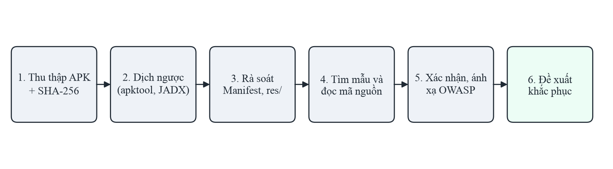

*Hình 3.1. Quy trình phân tích tĩnh được áp dụng*

1. Thu thập tệp APK và tính SHA-256 để bảo đảm mọi bước phân tích làm trên cùng một tệp.
2. Dịch ngược bằng hai công cụ:

```
apktool d InsecureBankv2.apk -o OUT_IB/apktool
jadx -d OUT_IB/jadx InsecureBankv2.apk
```

3. Rà soát `AndroidManifest.xml` và tài nguyên: cờ cấu hình, phiên bản SDK, thành phần exported.
4. Tìm kiếm theo mẫu trong mã Java (URL, lời gọi mật mã, log, SharedPreferences, bộ nhớ ngoài), rồi đọc mã quanh từng kết
   quả để hiểu ngữ cảnh.
5. Xác nhận điểm yếu bằng bằng chứng mã nguồn (tệp:dòng) và ánh xạ vào OWASP Mobile Top 10 – 2024.
6. Đề xuất biện pháp khắc phục.

Song song, tệp APK được đưa vào MobSF ở cấu hình mặc định để so sánh kết quả của một công cụ tự động với kết quả phân tích
thủ công.

## 3.3. Kết quả phân tích

### 3.3.1. Cấu hình trong Manifest

Manifest sau khi giải mã bằng apktool cho thấy ngay nhiều lỗi cấu hình ở thẻ `<application>`:

```
<application android:allowBackup="true" android:debuggable="true" ...>
```

- `android:debuggable="true"` trong bản phân phối: kẻ có quyền truy cập thiết bị có thể gắn trình gỡ lỗi và đọc dữ liệu
  riêng của ứng dụng (M8).
- `android:allowBackup="true"`, không có quy tắc giới hạn sao lưu: dữ liệu riêng, gồm SharedPreferences chứa thông tin đăng
  nhập (mục 3.3.4), trích xuất được bằng `adb backup` trên các phiên bản Android hỗ trợ (M8).
- Manifest khai báo nhiều quyền, trong đó có `INTERNET`, `WRITE_EXTERNAL_STORAGE`, `SEND_SMS`, `USE_CREDENTIALS`,
  `GET_ACCOUNTS`, `READ_PROFILE`, `READ_CONTACTS`, `ACCESS_NETWORK_STATE` và `ACCESS_COARSE_LOCATION`. Quyền `SEND_SMS` kết
  hợp với receiver exported ở mục 3.3.5 tạo thành một lỗ hổng nghiêm trọng; các quyền đọc danh bạ, hồ sơ và vị trí vượt quá
  các chức năng ngân hàng của ứng dụng, cần rà soát theo nguyên tắc đặc quyền tối thiểu (M6).
- `targetSdkVersion` là 22: ứng dụng không được hưởng các mặc định an toàn hơn của nền tảng, như chặn cleartext (API 28) và
  không tin chứng chỉ do người dùng cài (API 24) (M5).

Manifest khai báo sáu thành phần với `android:exported="true"` mà không có permission bảo vệ:

```
<activity android:exported="true" android:name="com.android.insecurebankv2.PostLogin"/>
<activity android:exported="true" android:name="com.android.insecurebankv2.DoTransfer"/>
<activity android:exported="true" android:name="com.android.insecurebankv2.ViewStatement"/>
<provider android:exported="true" android:name="com.android.insecurebankv2.TrackUserContentProvider" .../>
<receiver android:exported="true" android:name="com.android.insecurebankv2.MyBroadCastReceiver">
<activity android:exported="true" android:name="com.android.insecurebankv2.ChangePassword"/>
```

Bốn Activity `PostLogin`, `DoTransfer`, `ViewStatement` và `ChangePassword` là các màn hình chỉ được phép xuất hiện sau khi
đăng nhập, nhưng ứng dụng khác có thể mở thẳng chúng bằng Intent tường minh, bỏ qua màn hình đăng nhập (M8, M3).
`TrackUserContentProvider` không có permission; trong `DoLogin.java` (dòng 132–134), mỗi lần đăng nhập thành công ứng dụng
ghi tên người dùng vào provider này, nên ứng dụng khác có thể truy vấn danh sách tên người dùng qua URI
`content://com.android.insecurebankv2.TrackUserContentProvider/trackerusers`. Receiver `MyBroadCastReceiver` được phân tích
riêng ở mục 3.3.5. Ngược lại, `LoginActivity` có bộ lọc `MAIN/LAUNCHER` phải được mở từ trình khởi chạy, nên đó là thiết kế
bắt buộc chứ không phải lỗ hổng.

### 3.3.2. Khoá mã hoá viết cứng và IV cố định

Lớp `CryptoClass` chứa khoá AES và vector khởi tạo (IV) viết cứng (`CryptoClass.java`, dòng 22–23):

```
String key = "This is the super secret key 123";
byte[] ivBytes = {0, 0, 0, 0, 0, 0, 0, 0, 0, 0, 0, 0, 0, 0, 0, 0};
```

Hình 3.2 là lớp này khi mở trong giao diện JADX.

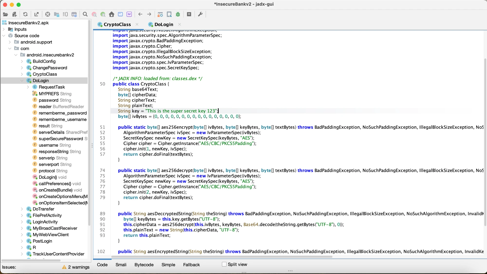

*Hình 3.2. Lớp CryptoClass trong giao diện JADX: khoá AES viết cứng, IV toàn số 0 và chế độ AES/CBC/PKCS5Padding*

Ảnh cho thấy toàn bộ điểm yếu mật mã của ứng dụng nằm gọn trong một màn hình: trường `key` chứa khoá dạng chuỗi, trường
`ivBytes` là 16 byte 0, và hai phương thức `aes256encrypt`, `aes256decrypt` gọi `Cipher.getInstance("AES/CBC/PKCS5Padding")`.
Hai dòng khai báo `key` và `ivBytes` không có số dòng ở cột bên trái, vì lệnh gán giá trị cho trường được trình biên dịch
chuyển vào hàm khởi tạo của lớp; số dòng gốc của chúng (25 và 28) chỉ thấy trong mã smali dưới đây.

Khoá dài 32 byte được dùng với `Cipher.getInstance("AES/CBC/PKCS5Padding")` để mã hoá mật khẩu người dùng. Thuật toán AES
không yếu, nhưng cách dùng thì sai ở hai điểm. Thứ nhất, khoá nằm trong mã nên bất kỳ ai dịch ngược APK đều có, tức là mọi
dữ liệu được "mã hoá" bằng khoá này đều giải mã được (M1, M10). Thứ hai, IV toàn số 0 cố định khiến cùng một bản rõ luôn cho
cùng một bản mã, làm lộ thông tin khi so sánh các bản mã (M10). Cùng hằng chuỗi này xuất hiện trong mã smali do apktool
sinh ra (`smali/com/android/insecurebankv2/CryptoClass.smali`):

```
.method public constructor <init>()V
    ...
    .line 25
    const-string v0, "This is the super secret key 123"
    iput-object v0, p0, Lcom/android/insecurebankv2/CryptoClass;->key:Ljava/lang/String;
    .line 28
    const/16 v0, 0x10
    new-array v0, v0, [B
    fill-array-data v0, :array_0
    iput-object v0, p0, Lcom/android/insecurebankv2/CryptoClass;->ivBytes:[B
```

Đoạn smali cho thấy hai điều. Thứ nhất, khoá vẫn nằm nguyên dạng chuỗi trong bytecode, nên làm rối tên lớp không giúp che
giấu bí mật dạng hằng chuỗi. Thứ hai, chỉ thị `.line` giữ số dòng trong mã nguồn gốc (dòng 25 và 28) do ứng dụng được build
kèm thông tin gỡ lỗi, khác với số dòng 22–23 trong tệp Java do JADX sinh ra; khi trích dẫn bằng chứng cần ghi rõ số dòng
theo công cụ nào.

### 3.3.3. Giao tiếp không mã hoá và điểm cuối đăng nhập ẩn

Ba lớp gọi mạng đều dựng URL từ một trường giao thức là `"http://"`: `DoLogin.java` dòng 51, `DoTransfer.java` dòng 65,
`ChangePassword.java` dòng 57. Kết hợp với `targetSdkVersion` 22 và không có network security config, tên đăng nhập, mật khẩu
và lệnh chuyển tiền được gửi qua HTTP không mã hoá, có thể bị nghe lén hoặc sửa đổi trên đường truyền (M5).

Trong `DoLogin.java` (dòng 98–105), ứng dụng dựng hai yêu cầu tới `/login` và `/devlogin`, và chọn `/devlogin` khi tên đăng
nhập là `devadmin`:

```
HttpPost httppost2 = new HttpPost(... + "/devlogin");
if (DoLogin.this.username.equals("devadmin")) {
    httppost2.setEntity(new UrlEncodedFormEntity(nameValuePairs));
    responseBody = httpclient.execute(httppost2);
```

Hình 3.3 là ảnh chụp giao diện JADX (`jadx-gui`) khi mở lớp `DoLogin` ở chế độ xem mã Java.

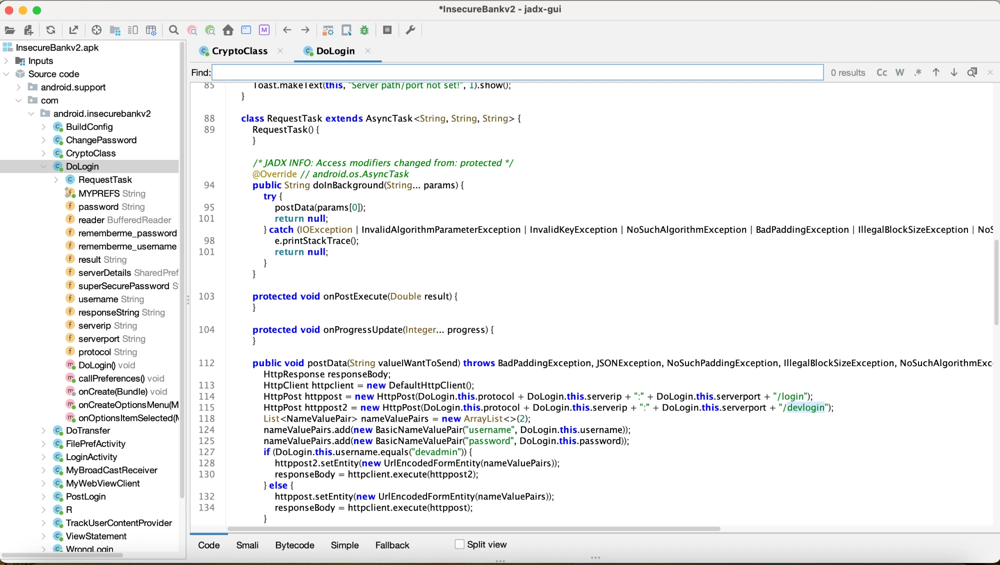

*Hình 3.3. Lớp DoLogin trong giao diện JADX: nhánh `devadmin` gửi yêu cầu tới `/devlogin`*

Cột số dòng bên trái của giao diện hiển thị số dòng của mã nguồn gốc, lấy từ thông tin gỡ lỗi trong bytecode (`/login` ở
dòng 114, `/devlogin` ở dòng 115, điều kiện `devadmin` ở dòng 127), nên khác với số dòng 98–105 trong tệp Java mà JADX dòng
lệnh sinh ra. Đây cũng là hiện tượng đã thấy với chỉ thị `.line` trong smali ở mục 3.3.2. Cây bên trái của giao diện liệt
kê các trường của lớp, trong đó có `password`, `rememberme_password` và `superSecurePassword`, gợi ý ngay những nơi cần
kiểm tra cách lưu mật khẩu.

Đây là dấu hiệu của một điểm cuối dành cho nhà phát triển còn sót lại trong bản phân phối, một cửa hậu tiềm năng (M3).
Phân tích tĩnh chỉ cho thấy ứng dụng gọi tới điểm cuối này; muốn biết máy chủ xử lý nó ra sao cần kiểm thử động hoặc xem
mã máy chủ, nằm ngoài phạm vi chuyên đề.

### 3.3.4. Lưu trữ và ghi log dữ liệu nhạy cảm

Khi người dùng đăng nhập, hàm `saveCreds` trong `DoLogin.java` (dòng 140–149) lưu thông tin đăng nhập vào SharedPreferences:
tên đăng nhập chỉ được mã hoá Base64 (không phải mã hoá), còn mật khẩu được mã hoá AES bằng chính khoá viết cứng ở mục 3.3.2.
Ai lấy được tệp SharedPreferences, ví dụ qua `adb backup` nhờ `allowBackup="true"`, đều khôi phục được cả tên đăng nhập lẫn
mật khẩu (M9).

Dòng 115 của `DoLogin.java` ghi thẳng tên đăng nhập và mật khẩu vào nhật ký hệ thống:

```
Log.d("Successful Login:", ", account=" + DoLogin.this.username + ":" + DoLogin.this.password);
```

Trên các phiên bản Android cũ, ứng dụng có quyền `READ_LOGS` đọc được log của ứng dụng khác; người có quyền truy cập thiết bị
qua `adb logcat` cũng đọc được (M9).

Chức năng sao kê ghi tệp HTML ra bộ nhớ ngoài dùng chung (`DoTransfer.java` dòng 162 và 180, đường dẫn
`Environment.getExternalStorageDirectory() + "/Statements_" + …`). Màn hình `ViewStatement` (dòng 25–30) nạp lại chính tệp
này vào WebView qua URL `file://` và bật JavaScript. Ứng dụng khác có quyền ghi bộ nhớ ngoài có thể đọc sao kê, hoặc sửa tệp
để chèn mã JavaScript chạy trong WebView của ứng dụng (M9, M4).

### 3.3.5. BroadcastReceiver đổi mật khẩu

`MyBroadCastReceiver` là receiver exported, lắng nghe action `theBroadcast`. Khi nhận Intent có extra `phonenumber` và
`newpass`, receiver đọc SharedPreferences ở chế độ `1` (`MODE_WORLD_READABLE`, dòng 21), giải mã mật khẩu hiện tại bằng
khoá viết cứng, rồi gửi SMS chứa cả mật khẩu cũ và mới tới số điện thoại lấy từ Intent (dòng 32). Mật khẩu cũng được in ra
bằng `System.out.println` (dòng 31):

```
SharedPreferences settings = context.getSharedPreferences("mySharedPreferences", 1);
...
smsManager.sendTextMessage(textPhoneno, null, textMessage, null, null);
```

Vì receiver không có permission và không kiểm tra người gửi, bất kỳ ứng dụng nào cũng có thể gửi broadcast này để ứng dụng
gửi mật khẩu của người dùng tới một số điện thoại tuỳ ý. Đây là ví dụ điển hình cho việc nhiều điểm yếu nhỏ (thành phần
exported, khoá viết cứng, dữ liệu đọc chung) cộng lại thành một lỗ hổng nghiêm trọng (M8, M9, M1).

### 3.3.6. Tổng hợp

Ngoài các điểm trên, mã dịch ngược giữ nguyên tên lớp, tên phương thức có nghĩa (`CryptoClass`, `aesEncryptedString`,
`saveCreds`), cho thấy ứng dụng không được làm rối mã (M7). Ứng dụng có một hàm phát hiện root đơn giản trong `PostLogin`
(kiểm tra sự tồn tại của `Superuser.apk` và lệnh `su`), nhưng hàm này chỉ hiển thị thông báo chứ không ngăn ứng dụng chạy.
Bảng 3.2 tổng hợp các điểm yếu tìm được.

*Bảng 3.2. Tổng hợp các điểm yếu tìm được bằng phân tích tĩnh*

| STT | Điểm yếu | Bằng chứng | OWASP 2024 |
|---|---|---|---|
| 1 | Khoá AES viết cứng, IV toàn số 0 | `CryptoClass.java:22–23` | M1, M10 |
| 2 | Giao tiếp HTTP không mã hoá, targetSdk 22 | `DoLogin.java:51`, `DoTransfer.java:65`, `ChangePassword.java:57` | M5 |
| 3 | Điểm cuối `/devlogin` cho tài khoản `devadmin` | `DoLogin.java:98–105` | M3 |
| 4 | Thông tin đăng nhập trong SharedPreferences giải mã được | `DoLogin.java:140–149` | M9 |
| 5 | Ghi log tên đăng nhập và mật khẩu | `DoLogin.java:115`; `MyBroadCastReceiver.java:31` | M9 |
| 6 | Bốn Activity sau đăng nhập exported, không permission | `AndroidManifest.xml` | M8, M3 |
| 7 | ContentProvider exported lộ danh sách tên người dùng | `AndroidManifest.xml`; `DoLogin.java:132–134` | M8 |
| 8 | Receiver exported gửi mật khẩu qua SMS tới số tuỳ ý; đọc dữ liệu ở chế độ world-readable | `MyBroadCastReceiver.java:21–32` | M8, M9 |
| 9 | Sao kê ghi ra bộ nhớ ngoài, nạp lại vào WebView có JavaScript | `DoTransfer.java:162, 180`; `ViewStatement.java:25–30` | M9, M4 |
| 10 | `debuggable="true"`, `allowBackup="true"` | `AndroidManifest.xml` | M8 |
| 11 | Không làm rối mã | Tên lớp/hàm gốc trong mã dịch ngược | M7 |

### 3.3.7. Bản đồ điểm cuối API và các dấu hiệu cần kiểm thử động

Đọc các lời gọi `HttpPost` trong mã JADX cho phép lập bản đồ toàn bộ điểm cuối API mà ứng dụng gọi tới (Bảng 3.3). Địa chỉ
và cổng máy chủ không viết cứng trong mã mà do người dùng nhập ở màn hình cấu hình `FilePrefActivity` và lưu vào
SharedPreferences; đường dẫn của từng điểm cuối được nối vào sau địa chỉ này.

*Bảng 3.3. Các điểm cuối API của InsecureBankv2 xác định bằng phân tích tĩnh*

| Điểm cuối | Vị trí trong mã | Tham số gửi lên | Dấu hiệu đáng chú ý |
|---|---|---|---|
| `POST /login` | `DoLogin.java:98` | `username`, `password` | Gửi qua HTTP không mã hoá |
| `POST /devlogin` | `DoLogin.java:99` | `username`, `password` | Chỉ dùng khi tên đăng nhập là `devadmin`; điểm cuối gỡ lỗi (API5, API9) |
| `POST /getaccounts` | `DoTransfer.java:216` | `username`, `password` | Gửi lại mật khẩu ở mỗi yêu cầu, không có token phiên (API2) |
| `POST /dotransfer` | `DoTransfer.java:103` | `username`, `password`, `from_acc`, `to_acc`, `amount` | Tài khoản nguồn `from_acc` do ứng dụng gửi lên (API1, API6) |
| `POST /changepassword` | `ChangePassword.java:105` | `username`, `newpassword` | Không kèm mật khẩu cũ hay token; tên người dùng lấy từ Intent (API2, API5) |

Từ bảng này rút ra ba dấu hiệu liên quan tới API mà phân tích tĩnh **chỉ có thể nêu nghi vấn**, cần kiểm thử động trên máy
chủ (với sự cho phép của chủ hệ thống) để khẳng định:

- **Không có cơ chế phiên.** Mọi yêu cầu sau đăng nhập đều gửi lại tên đăng nhập và mật khẩu, thay vì một token phiên có
  thời hạn. Mật khẩu vì vậy xuất hiện trên đường truyền ở mọi thao tác, và lại được gửi qua HTTP.
- **Tài khoản nguồn do ứng dụng quyết định.** Yêu cầu chuyển tiền gửi kèm `from_acc`. Nếu máy chủ không kiểm tra tài khoản
  nguồn có thuộc người đăng nhập hay không, kẻ tấn công có thể chuyển tiền từ tài khoản của người khác, một lỗi BOLA (API1)
  điển hình.
- **Đổi mật khẩu chỉ dựa vào tên người dùng.** `ChangePassword` là Activity exported, lấy tên người dùng từ extra `uname` của
  Intent (dòng 68), rồi gửi yêu cầu chỉ gồm `username` và `newpassword` (dòng 105–108). Nếu máy chủ không xác thực thêm, bất
  kỳ ai biết tên người dùng đều có thể đổi mật khẩu của người đó.

Ba dấu hiệu này không được tính vào 11 điểm yếu ở Bảng 3.2 vì chưa thể khẳng định chỉ bằng tệp APK, nhưng chúng là đầu vào
trực tiếp cho bước kiểm thử API tiếp theo, đúng với vai trò của phân tích tĩnh đã nêu ở mục 1.6.

## 3.4. Phân tích tự động bằng MobSF

Song song với phân tích thủ công, tệp APK được tải lên MobSF chạy cục bộ. Như sẽ giải thích ở mục 3.5, ở cấu hình mặc định
MobSF bỏ qua toàn bộ mã trong package `com.android.insecurebankv2`; các ảnh chụp dưới đây là báo cáo của lần quét sau khi bỏ
tiền tố `com/android/` khỏi danh sách đường dẫn bị bỏ qua, để thấy đầy đủ khả năng của công cụ.

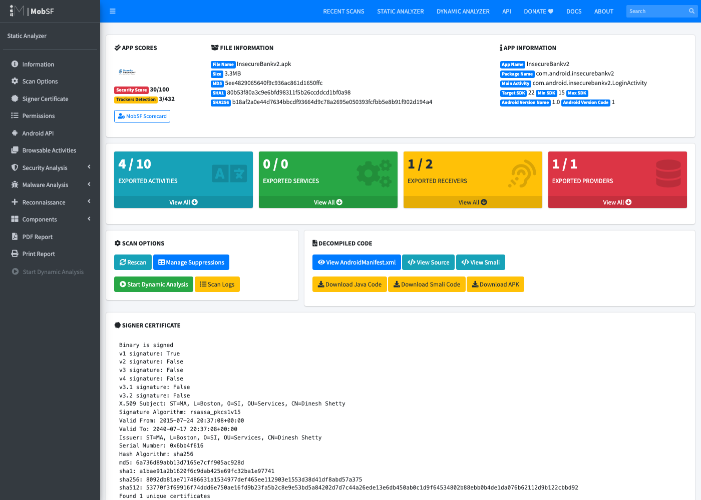

*Hình 3.4. Trang tổng quan báo cáo phân tích tĩnh của MobSF cho InsecureBankv2 (ảnh chụp giao diện web)*

Trang tổng quan (Hình 3.4) cho điểm bảo mật 30/100 và phát hiện 3 trên 432 trình theo dõi đã biết (thư viện Google AdMob,
Google Analytics và Google Tag Manager). Bốn ô màu thống kê thành phần exported: 4/10 Activity, 0/0 Service, 1/2 Receiver và
1/1 Provider, khớp với kết quả đọc Manifest ở mục 3.3.1. Mục chữ ký cho thấy tệp APK **chỉ được ký theo lược đồ v1** (v2, v3
đều là False), một chi tiết mà phân tích thủ công ở mục 3.3 chưa kiểm tra.

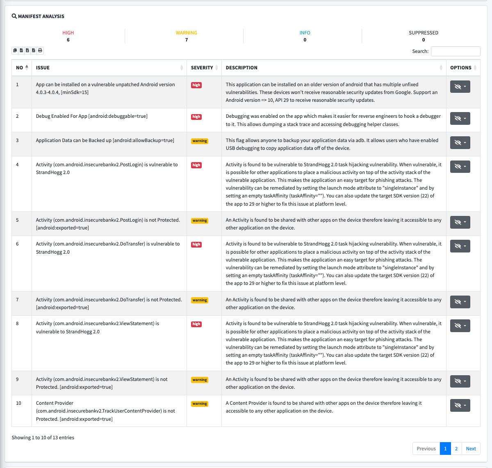

*Hình 3.5. Mục Manifest Analysis trong báo cáo MobSF*

Mục Manifest Analysis (Hình 3.5) có 6 cảnh báo mức cao và 7 cảnh báo mức trung bình. Ngoài các lỗi đã tìm được thủ công
(`debuggable`, `allowBackup`, thành phần exported), MobSF còn báo hai nhóm mới: ứng dụng cài được trên Android 4.0.3–4.0.4
(`minSdkVersion` 15), các phiên bản không còn được vá bảo mật; và bốn Activity exported có nguy cơ bị chiếm tác vụ theo kiểu
StrandHogg 2.0 (CVE-2020-0096) [19], một lỗ hổng ảnh hưởng Android 8.0–9 cho phép ứng dụng độc hại hiển thị giao diện giả
chồng lên ứng dụng thật.

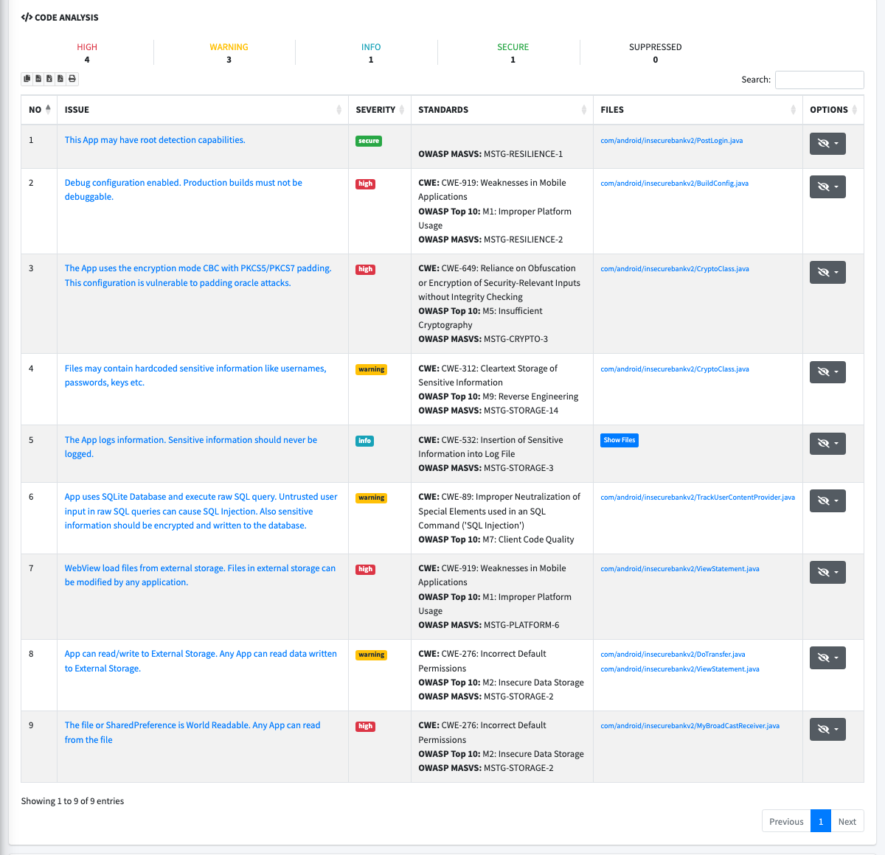

*Hình 3.6. Mục Code Analysis trong báo cáo MobSF*

Mục Code Analysis (Hình 3.6) liệt kê 9 kết quả: 4 mức cao, 3 mức trung bình, 1 mức thông tin và 1 mục "secure" (ứng dụng có
cơ chế phát hiện root). Các kết quả mức cao gồm cấu hình gỡ lỗi trong `BuildConfig`, chế độ CBC có nguy cơ padding oracle
trong `CryptoClass`, WebView nạp tệp từ bộ nhớ ngoài trong `ViewStatement`, và SharedPreferences ở chế độ world-readable trong
`MyBroadCastReceiver`. Nhãn OWASP ở cột Standards là của danh sách năm 2016 (mục 2.4.3).

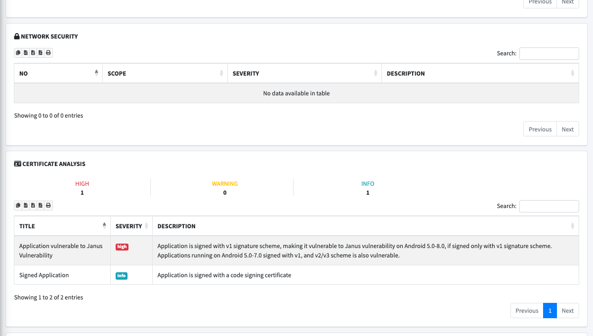

*Hình 3.7. Mục Network Security và Certificate Analysis trong báo cáo MobSF*

Mục Network Security (Hình 3.7) trống vì ứng dụng không có tệp network security config. Mục Certificate Analysis báo lỗ hổng
Janus (CVE-2017-13156) [20] ở mức cao: tệp APK chỉ ký theo lược đồ v1 nên trên Android 5.0–8.0 có thể bị chèn mã vào tệp mà
chữ ký vẫn hợp lệ.

Bảng 3.4 đối chiếu 11 điểm yếu tìm được bằng phân tích thủ công (Bảng 3.2) với báo cáo của MobSF.

*Bảng 3.4. Đối chiếu kết quả phân tích thủ công với báo cáo MobSF*

| STT | Điểm yếu (phân tích thủ công) | MobSF | Ghi chú |
|---|---|---|---|
| 1 | Khoá AES viết cứng, IV toàn số 0 | Có | Báo khoá viết cứng và chế độ CBC; không báo riêng IV cố định |
| 2 | Giao tiếp HTTP không mã hoá | Không | Địa chỉ máy chủ do người dùng nhập, URL được ghép chuỗi khi chạy nên danh sách URL của MobSF trống |
| 3 | Điểm cuối `/devlogin` | Không | Không có luật cho điểm cuối ẩn |
| 4 | Thông tin đăng nhập trong SharedPreferences | Không | Chỉ báo gián tiếp qua khoá viết cứng |
| 5 | Ghi log tên đăng nhập, mật khẩu | Một phần | Báo ở mức thông tin, gộp chung mọi lời gọi log |
| 6 | Bốn Activity sau đăng nhập exported | Có | Kèm cảnh báo StrandHogg 2.0 |
| 7 | ContentProvider exported | Có | Kèm cảnh báo truy vấn SQL thô |
| 8 | Receiver exported gửi SMS, dữ liệu world-readable | Có | Báo exported và world-readable; hành vi gửi SMS ở mục Behaviour |
| 9 | Sao kê ở bộ nhớ ngoài, nạp vào WebView | Có | Hai luật: đọc/ghi bộ nhớ ngoài và WebView nạp tệp ngoài |
| 10 | `debuggable`, `allowBackup` | Có | Ở cả Manifest Analysis và Code Analysis |
| 11 | Không làm rối mã | Không | Không có cảnh báo trực tiếp |

MobSF phát hiện được 6/11 điểm yếu, 1 điểm một phần, bỏ sót 4 điểm, đồng thời bổ sung ba điểm mà phân tích thủ công chưa
xét: `minSdkVersion` quá thấp, nguy cơ StrandHogg 2.0 và lỗ hổng Janus do chỉ ký v1. Kết quả này minh hoạ đúng tương quan
giữa hai cách làm: công cụ tự động nhanh và kiểm tra rộng các dấu hiệu có cấu trúc, còn người phân tích cần thiết cho các
điểm yếu đòi hỏi hiểu ngữ cảnh của mã, như URL được ghép chuỗi hay một nhánh xử lý dành riêng cho tài khoản `devadmin`.

## 3.5. So sánh khả năng của ba công cụ

Để so sánh, chuyên đề dùng sáu điểm yếu có dấu hiệu tĩnh rõ ràng làm thước đo chung: khoá viết cứng (1), giao tiếp không mã
hoá (2), điểm cuối `/devlogin` (3), thành phần exported (6–8), mật mã CBC với IV cố định (thuộc 1) và cờ `allowBackup` (10).
Kết quả ở Bảng 3.5. Thời gian của JADX và apktool là trung bình ba lần chạy; thời gian của MobSF tính từ lúc tải tệp lên tới
khi có báo cáo JSON.

*Bảng 3.5. Kết quả của ba công cụ trên sáu điểm yếu tĩnh của InsecureBankv2*

| Điểm yếu | JADX 1.5.6 (đọc mã) | apktool 3.0.3 (đọc Manifest/smali) | MobSF mặc định | MobSF sau khi chỉnh cấu hình |
|---|---|---|---|---|
| Khoá AES viết cứng | Có | Không (chỉ thấy hằng chuỗi, khó đọc) | Không | Có |
| Giao tiếp HTTP không mã hoá | Gợi ý (thấy `"http://"`, cần đọc thêm) | Không | Không | Không |
| CBC với IV cố định | Có | Không | Không | Một phần (chỉ cảnh báo CBC) |
| Thành phần exported | Có (qua Manifest JADX giải mã) | Có | Có | Có |
| Điểm cuối `/devlogin` | Có | Không | Không | Không |
| `allowBackup="true"` | Có | Có | Có | Có |
| **Tổng** | **5/6 + 1 gợi ý** | **2/6** | **2/6** | **3/6 + 1 một phần** |
| Thời gian | 28,8 giây | 11,5 giây | 24,4 giây | 16,9 giây (quét lại) |

Ba nhận xét rút ra từ bảng:

- **JADX và apktool chỉ làm lộ bằng chứng; người phân tích phải tự tìm lỗ hổng.** Con số 5/6 của JADX là kết quả của việc
  đọc mã thủ công theo quy trình ở mục 3.2, không phải kết quả tự động. apktool mạnh ở Manifest nhưng mã smali khó đọc.
- **MobSF ở cấu hình mặc định không báo được lỗ hổng nào trong mã của InsecureBankv2.** Nguyên nhân là danh sách đường dẫn
  bỏ qua khi quét mã của MobSF chứa tiền tố `com/android/` (vốn nhằm bỏ qua mã thư viện của Android), trùng với package
  `com.android.insecurebankv2` của ứng dụng. Khi bỏ tiền tố này khỏi cấu hình và quét lại, MobSF báo thêm khoá viết cứng,
  cảnh báo chế độ CBC, dữ liệu world-readable và việc ghi log. Đây là ví dụ cụ thể cho thách thức "bỏ qua mã thư viện" ở
  mục 2.6: một quy tắc hợp lý cho đa số ứng dụng lại gây bỏ sót toàn bộ ở một ứng dụng.
- **Không công cụ nào phát hiện được giao tiếp HTTP và điểm cuối `/devlogin` một cách tự động.** Cả hai đều cần hiểu ngữ cảnh
  của chuỗi trong mã: `"http://"` được nối với địa chỉ máy chủ ở đâu, và nhánh `devadmin` dẫn tới yêu cầu nào.

## 3.6. Thử nghiệm: tìm kiếm theo mẫu và vấn đề báo nhầm

Để định lượng nhận định "so khớp mẫu dễ báo nhầm" ở mục 2.3.2, chuyên đề đếm số dòng khớp sáu mẫu tìm kiếm điển hình trong
mã JADX, ở hai phạm vi: chỉ package của ứng dụng (14 tệp) và toàn bộ APK (2.992 tệp). Tập lệnh `thuc_nghiem_tim_mau.py` đi
kèm báo cáo tái lập được kết quả ở Bảng 3.6 và Hình 3.8.

*Bảng 3.6. Số dòng (số tệp) khớp mẫu trong mã dịch ngược của InsecureBankv2*

| Mẫu tìm kiếm | Package ứng dụng | Toàn APK | Điểm yếu thật liên quan |
|---|---|---|---|
| `http://` | 3 (3 tệp) | 38 (14 tệp) | 3 dòng, đều trong package ứng dụng |
| `Cipher.getInstance` | 2 (1 tệp) | 3 (2 tệp) | 2 dòng trong `CryptoClass` |
| `Log.[dievw](` | 1 (1 tệp) | 644 (146 tệp) | 1 dòng ghi mật khẩu trong `DoLogin` |
| `password` (không phân biệt hoa thường) | 70 (7 tệp) | 118 (17 tệp) | Vài dòng; phần lớn là tên biến, ID giao diện |
| `getExternalStorage` | 4 (2 tệp) | 12 (7 tệp) | 4 dòng của chức năng sao kê |
| `getSharedPreferences(…, 1)` | 1 (1 tệp) | 2 (2 tệp) | 1 dòng trong `MyBroadCastReceiver` |

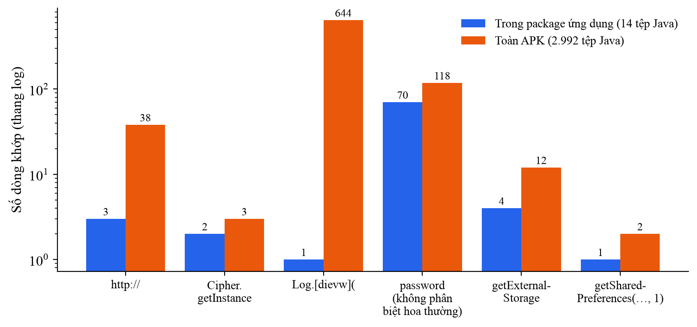

*Hình 3.8. Số dòng khớp mẫu trong package ứng dụng và trên toàn APK (thang logarit)*

Kết quả cho thấy hai nguồn báo nhầm khác nhau:

- **Mã thư viện.** Với mẫu `Log.*(`, cả APK có 644 dòng khớp trong 146 tệp, nhưng chỉ 1 dòng thuộc ứng dụng, và đó chính là
  dòng ghi mật khẩu. Nếu quét toàn bộ APK, người phân tích phải lọc 643 dòng không liên quan để tìm 1 dòng đáng chú ý. Mẫu
  `http://` cũng tương tự: 35 trong 38 dòng nằm ở thư viện.
- **Từ khoá không đủ ngữ cảnh.** Ngay trong 14 tệp của ứng dụng, mẫu `password` khớp 70 dòng, phần lớn là tên biến, nhãn giao
  diện và hằng ID trong `R.java`, chỉ vài dòng là nơi mật khẩu thực sự bị lưu hoặc ghi log.

Thử nghiệm này được thực hiện trên một ứng dụng nhỏ có lỗ hổng có chủ đích. Với ứng dụng thực tế có hàng nghìn tệp mã của
chính ứng dụng, số báo nhầm sẽ lớn hơn nhiều. Việc giới hạn phạm vi quét vào mã của ứng dụng và xét ngữ cảnh của từng kết
quả (giá trị được ghi log là gì, chuỗi `http://` được dùng để kết nối hay để so sánh) là hướng cải tiến tự nhiên cho các
công cụ quét tĩnh.

## 3.7. Đề xuất khắc phục

Bảng 3.7 đề xuất biện pháp khắc phục cho từng điểm yếu, theo khuyến nghị của MASVS [2] và tài liệu của Android [5], [6].

*Bảng 3.7. Đề xuất khắc phục các điểm yếu tìm được*

| Điểm yếu | Biện pháp khắc phục |
|---|---|
| Khoá viết cứng, IV cố định | Sinh khoá trong Android Keystore, không đưa khoá vào mã; dùng AES/GCM với IV ngẫu nhiên cho mỗi lần mã hoá |
| HTTP không mã hoá | Dùng HTTPS cho mọi điểm cuối; nâng `targetSdkVersion`; khai báo network security config với `cleartextTrafficPermitted="false"`; cân nhắc ghim chứng chỉ |
| Điểm cuối `/devlogin` | Gỡ mã và điểm cuối dành cho nhà phát triển khỏi bản phát hành; tách cấu hình theo biến thể build |
| Lưu thông tin đăng nhập | Không lưu mật khẩu; nếu cần duy trì phiên, lưu token có thời hạn bằng cơ chế mã hoá dựa trên Keystore |
| Ghi log dữ liệu nhạy cảm | Bỏ log chứa thông tin xác thực; loại bỏ lời gọi log ở bản phát hành bằng cấu hình R8 |
| Thành phần exported | Đặt `android:exported="false"` cho thành phần nội bộ; với thành phần cần chia sẻ, bảo vệ bằng permission mức `signature` và kiểm tra người gọi |
| Receiver gửi SMS | Không exported; không bao giờ gửi mật khẩu qua SMS; không dùng chế độ world-readable |
| Sao kê ở bộ nhớ ngoài | Lưu trong thư mục riêng của ứng dụng; tắt JavaScript và truy cập `file://` trong WebView khi không cần |
| `debuggable`, `allowBackup` | Tắt `debuggable` ở bản phát hành; đặt `allowBackup="false"` hoặc khai báo quy tắc loại trừ dữ liệu nhạy cảm |
| Thiết kế API (mục 3.3.7) | Dùng token phiên có thời hạn thay cho việc gửi mật khẩu ở mọi yêu cầu; máy chủ kiểm tra tài khoản nguồn thuộc người đăng nhập và yêu cầu mật khẩu cũ khi đổi mật khẩu |
| Chỉ ký theo lược đồ v1 | Ký lại bằng lược đồ v2/v3 (công cụ `apksigner`) để chữ ký bảo vệ toàn bộ tệp APK |
| Không làm rối mã | Bật R8 cho bản phát hành (giảm thông tin cho người dịch ngược, nhưng không thay thế được việc không lưu bí mật trong mã) |

## 3.8. Kết luận chương 3

Chương 3 đã áp dụng quy trình phân tích tĩnh lên InsecureBankv2 và tìm được 11 nhóm điểm yếu thuộc 8 trong 10 hạng mục OWASP
Mobile Top 10 – 2024, mỗi điểm yếu đều có bằng chứng tệp:dòng. Báo cáo tự động của MobSF phát hiện 6/11 điểm yếu này, một
điểm một phần, và bổ sung ba điểm mới liên quan tới phiên bản SDK và lược đồ ký. Kết quả so sánh cho thấy công cụ dịch ngược kết hợp với đọc
mã thủ công phát hiện được nhiều nhất (5/6 điểm yếu tĩnh và 1 gợi ý) nhưng tốn công. MobSF tự động hoàn toàn nhưng ở cấu
hình mặc định bỏ sót toàn bộ lỗ hổng trong mã vì một quy tắc bỏ qua thư viện. Thử nghiệm tìm kiếm theo mẫu cho thấy báo
nhầm đến từ hai nguồn: mã thư viện (643/644 dòng log nằm ngoài ứng dụng) và từ khoá thiếu ngữ cảnh.

# KẾT LUẬN

**Kết quả đạt được.** Chuyên đề đã hoàn thành ba mục tiêu đề ra:

1. Hệ thống hoá kiến thức nền tảng về kiến trúc Android, cấu trúc tệp APK, bốn loại thành phần ứng dụng và cơ chế giao tiếp
   qua Intent, các cơ chế bảo mật của nền tảng, cùng danh sách OWASP Mobile Top 10 – 2024 và mức độ phát hiện được của từng
   nhóm bằng phân tích tĩnh.
2. Trình bày kỹ thuật phân tích tĩnh ứng dụng Android: hai hướng dịch ngược bằng apktool và JADX, bốn nhóm kỹ thuật phát hiện
   lỗ hổng, các công cụ phổ biến và các thách thức của phương pháp.
3. Thực hành phân tích tĩnh InsecureBankv2: tìm được 11 nhóm điểm yếu thuộc 8 hạng mục OWASP, có bằng chứng mã nguồn và đề
   xuất khắc phục cụ thể; xác định 5 điểm cuối API mà ứng dụng gọi tới; đối chiếu với báo cáo tự động của MobSF; so sánh ba
   công cụ trên cùng thước đo; và định lượng vấn đề báo nhầm của tìm kiếm theo mẫu.

**Hạn chế.**
- Chuyên đề chỉ thực hành trên một ứng dụng có lỗ hổng có chủ đích. Ứng dụng này nhỏ, không làm rối mã, có lỗ hổng rõ ràng
  hơn nhiều so với ứng dụng thực tế.
- Chuyên đề chỉ dùng phân tích tĩnh, nên chưa kiểm chứng được các lỗ hổng phía máy chủ hay hành vi khi chạy, chẳng hạn máy
  chủ xử lý điểm cuối `/devlogin` thế nào.
- Việc tìm lỗ hổng bằng JADX phụ thuộc vào kỹ năng của người đọc mã, chưa phải quy trình tự động.

**Hướng phát triển.** Kết quả của chuyên đề là nền tảng để tiếp tục hướng nghiên cứu này ở đồ án tốt nghiệp, theo hai hướng:
- Tự động hoá quy trình phân tích tĩnh ở Chương 3 thành một công cụ.
- Giải quyết vấn đề báo nhầm đã định lượng ở mục 3.6 bằng cách giới hạn phạm vi mã và xét ngữ cảnh của từng cảnh báo, rồi
  đánh giá công cụ trên các ứng dụng mã nguồn mở thực tế thay vì chỉ trên ứng dụng có lỗ hổng có chủ đích.

# TÀI LIỆU THAM KHẢO

[1]. OWASP Foundation. OWASP Mobile Top 10 – 2024. Online: https://owasp.org/www-project-mobile-top-10/ [Truy cập: 4/10/2026].

[2]. OWASP Foundation. OWASP Mobile Application Security Verification Standard (MASVS). Online: https://mas.owasp.org/MASVS/ [Truy cập: 4/10/2026].

[3]. OWASP Foundation. OWASP Mobile Application Security Testing Guide (MASTG). Online: https://mas.owasp.org/MASTG/ [Truy cập: 4/10/2026].

[4]. Google. Application fundamentals — Android Developers. Online: https://developer.android.com/guide/components/fundamentals [Truy cập: 4/10/2026].

[5]. Google. Network security configuration — Android Developers. Online: https://developer.android.com/privacy-and-security/security-config [Truy cập: 4/10/2026].

[6]. Google. Back up user data with Auto Backup — Android Developers. Online: https://developer.android.com/identity/data/autobackup [Truy cập: 4/10/2026].

[7]. Android Open Source Project. Application signing. Online: https://source.android.com/docs/security/features/apksigning [Truy cập: 4/10/2026].

[8]. Google. Shrink, obfuscate, and optimize your app — Android Developers. Online: https://developer.android.com/build/shrink-code [Truy cập: 4/10/2026].

[9]. Elenkov, N. Android Security Internals: An In-Depth Guide to Android's Security Architecture. No Starch Press, 2014.

[10]. Arzt, S., Rasthofer, S., Fritz, C., Bodden, E., Bartel, A., Klein, J., Le Traon, Y., Octeau, D., McDaniel, P. FlowDroid: Precise Context, Flow, Field, Object-sensitive and Lifecycle-aware Taint Analysis for Android Apps. Proceedings of the 35th ACM SIGPLAN Conference on Programming Language Design and Implementation (PLDI), 2014, pp. 259–269.

[11]. iBotPeaches. Apktool — A Tool for Reverse Engineering Android APK Files. Online: https://apktool.org/ [Truy cập: 4/10/2026].

[12]. Skylot. JADX — Dex to Java Decompiler. GitHub. Online: https://github.com/skylot/jadx [Truy cập: 4/10/2026].

[13]. MobSF Development Team. Mobile Security Framework (MobSF). GitHub. Online: https://github.com/MobSF/Mobile-Security-Framework-MobSF [Truy cập: 4/10/2026].

[14]. Shetty, D. Android-InsecureBankv2. GitHub. Online: https://github.com/dineshshetty/Android-InsecureBankv2 [Truy cập: 4/10/2026].

[15]. Google. Behavior changes: Apps targeting Android 12 — Android Developers. Online: https://developer.android.com/about/versions/12/behavior-changes-12 [Truy cập: 4/10/2026].

[16]. Android Open Source Project. Dalvik executable format. Online: https://source.android.com/docs/core/runtime/dex-format [Truy cập: 4/10/2026].

[17]. Ranganath, V.-P., Mitra, J. Are Free Android App Security Analysis Tools Effective in Detecting Known Vulnerabilities?. Empirical Software Engineering, Vol. 25, 2020, pp. 178–219.

[18]. OWASP Foundation. OWASP API Security Top 10 – 2023. Online: https://owasp.org/API-Security/editions/2023/en/0x11-t10/ [Truy cập: 4/10/2026].

[19]. NIST National Vulnerability Database. CVE-2020-0096 (StrandHogg 2.0). Online: https://nvd.nist.gov/vuln/detail/CVE-2020-0096 [Truy cập: 4/10/2026].

[20]. NIST National Vulnerability Database. CVE-2017-13156 (Janus). Online: https://nvd.nist.gov/vuln/detail/CVE-2017-13156 [Truy cập: 4/10/2026].
